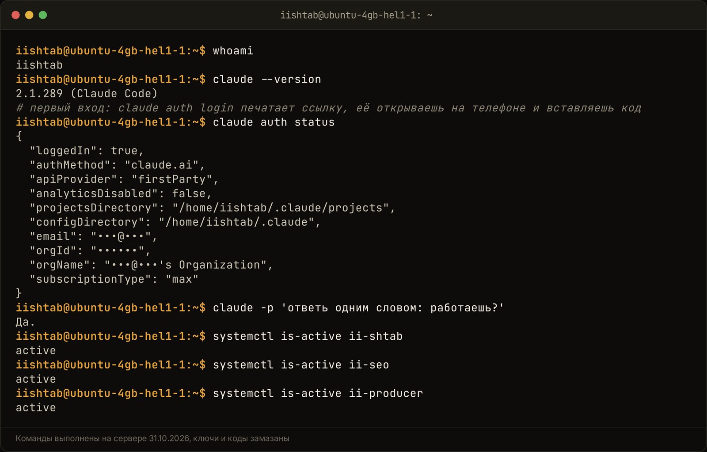
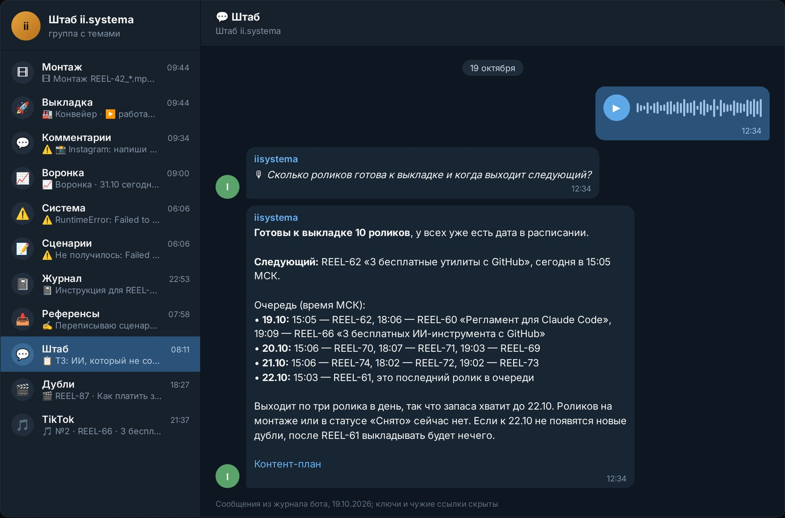
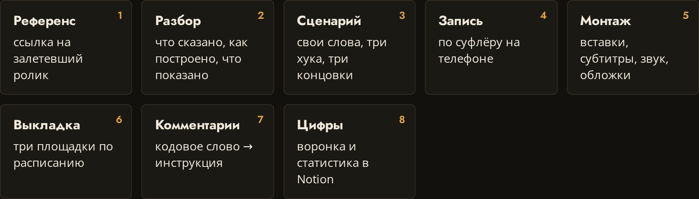

Запустить Claude Code в Telegram на своём сервере без API можно так: на Linux-сервере работает небольшой бот, он передаёт твои сообщения в `claude -p`, а сам Claude Code вошёл в аккаунт по обычной подписке Claude Pro или Max. За каждый токен ты не платишь, только за подписку и сервер. Агент выполняет задачи прямо на сервере, а ты пишешь ему текстом или голосом из мессенджера, хоть с телефона.

Я работаю так с 30 сентября 2026 года. За месяц на одном сервере и одной подписке у меня выросли четыре бота: штаб роликов, SEO-штаб, продюсер канала и бот «Мозг», который с 25 октября берёт задачи по коду. Здесь всё по порядку: сервер, вход без экрана, код бота, служба, права, навыки, управление с телефона, лимиты и мои поломки.

## Как устроена связка Telegram-бота и Claude Code без платного API?

Связка из трёх частей: Telegram, бот-курьер на сервере и Claude Code в рабочей папке. Бот сам не думает. Он получает сообщение, решает, какие правила и права подложить, запускает `claude -p` и возвращает ответ в тот же чат.

`claude -p` это неинтерактивный режим Claude Code: задача передаётся одной строкой, агент делает работу и печатает результат. Агент здесь программа, которая сама выбирает шаги: прочитать файл, поправить код, записать строку в Notion. API это платный доступ к модели, где каждый запрос оплачивается по объёму текста. Подписка устроена иначе: цена фиксированная, а расход ограничен лимитом.

Почему вопрос сейчас всплывает у многих. 21 октября 2026 года в топе GitHub за день стояли сразу три проекта про Claude Code как рабочего агента на своей подписке: [stablyai/orca](https://github.com/stablyai/orca) (+1146 звёзд), официальный каталог плагинов [anthropics/claude-plugins-official](https://github.com/anthropics/claude-plugins-official) (+1187) и фреймворк поиска работы на Claude Code (+2213). Это из моей заметки в базе «Семантика» за тот день. Людям нужен агент, который сам делает задачи, и подешевле.

<!-- img: type=scheme what="узлы и стрелки: сообщение или голосовое в Telegram → бот на сервере (проверка, что пишет владелец; очередь; таймаут) → claude -p по подписке в рабочей папке (CLAUDE.md, навыки, Notion) → ответ в тот же чат; от бота вниз пунктиром: state.json на диске и --resume сессии; сбоку ветка «лимит» → резерв по API с потолком $3 в сутки → ответ второго мозга" caption="Путь задачи от сообщения в Telegram до ответа: очередь, сессия, состояние на диске и резерв на случай лимита." alt="телеграм бот на claude code без api: схема агента на своём сервере" -->

<figure class="scheme">
<svg xmlns="http://www.w3.org/2000/svg" viewBox="0 0 1200 560" width="100%" role="img" aria-label="Путь задачи от сообщения в Telegram до ответа: бот на сервере, claude -p по подписке, состояние на диске и резерв по API на случай лимита">
<title>Как Telegram-бот запускает Claude Code по подписке и что делает при лимите</title>
<defs>
<marker id="ah" viewBox="0 0 10 10" refX="8" refY="5" markerWidth="9" markerHeight="9" orient="auto-start-reverse"><path d="M1 1 L9 5 L1 9 Z" fill="var(--accent)"/></marker>
<marker id="al" viewBox="0 0 10 10" refX="8" refY="5" markerWidth="9" markerHeight="9" orient="auto-start-reverse"><path d="M1 1 L9 5 L1 9 Z" fill="var(--line)"/></marker>
</defs>

<rect x="40" y="70" width="235" height="190" rx="10" fill="var(--surface)" stroke="var(--line)" stroke-width="2"/>
<circle cx="70" cy="70" r="18" fill="var(--surface)" stroke="var(--accent)" stroke-width="2"/>
<text x="70" y="77" text-anchor="middle" font-family="var(--font-display)" font-weight="600" font-size="20" fill="var(--accent)">1</text>
<text x="60" y="120" font-family="var(--font-display)" font-weight="600" font-size="24" fill="var(--fg)">Сообщение</text>
<text x="60" y="150" font-family="var(--font-display)" font-weight="600" font-size="24" fill="var(--fg)">в Telegram</text>
<text x="60" y="188" font-family="var(--font-body)" font-size="18" fill="var(--muted)">текст или голосовое</text>

<rect x="335" y="70" width="235" height="190" rx="10" fill="var(--surface)" stroke="var(--line)" stroke-width="2"/>
<circle cx="365" cy="70" r="18" fill="var(--surface)" stroke="var(--accent)" stroke-width="2"/>
<text x="365" y="77" text-anchor="middle" font-family="var(--font-display)" font-weight="600" font-size="20" fill="var(--accent)">2</text>
<text x="355" y="120" font-family="var(--font-display)" font-weight="600" font-size="24" fill="var(--fg)">Бот</text>
<text x="355" y="150" font-family="var(--font-display)" font-weight="600" font-size="24" fill="var(--fg)">на сервере</text>
<text x="355" y="188" font-family="var(--font-body)" font-size="18" fill="var(--muted)">проверка владельца,</text>
<text x="355" y="212" font-family="var(--font-body)" font-size="18" fill="var(--muted)">очередь, таймаут</text>

<rect x="630" y="70" width="235" height="190" rx="10" fill="var(--surface)" stroke="var(--accent)" stroke-width="2"/>
<circle cx="660" cy="70" r="18" fill="var(--surface)" stroke="var(--accent)" stroke-width="2"/>
<text x="660" y="77" text-anchor="middle" font-family="var(--font-display)" font-weight="600" font-size="20" fill="var(--accent)">3</text>
<text x="650" y="120" font-family="var(--font-display)" font-weight="600" font-size="24" fill="var(--fg)">claude -p</text>
<text x="650" y="150" font-family="var(--font-display)" font-weight="600" font-size="24" fill="var(--fg)">по подписке</text>
<text x="650" y="188" font-family="var(--font-body)" font-size="18" fill="var(--muted)">в рабочей папке:</text>
<text x="650" y="212" font-family="var(--font-body)" font-size="18" fill="var(--muted)">CLAUDE.md, навыки,</text>
<text x="650" y="236" font-family="var(--font-body)" font-size="18" fill="var(--muted)">Notion</text>

<rect x="925" y="70" width="235" height="190" rx="10" fill="var(--surface)" stroke="var(--line)" stroke-width="2"/>
<circle cx="955" cy="70" r="18" fill="var(--surface)" stroke="var(--accent)" stroke-width="2"/>
<text x="955" y="77" text-anchor="middle" font-family="var(--font-display)" font-weight="600" font-size="20" fill="var(--accent)">4</text>
<text x="945" y="120" font-family="var(--font-display)" font-weight="600" font-size="24" fill="var(--fg)">Ответ</text>
<text x="945" y="150" font-family="var(--font-display)" font-weight="600" font-size="24" fill="var(--fg)">в тот же чат</text>
<text x="945" y="188" font-family="var(--font-body)" font-size="18" fill="var(--muted)">итог работы агента</text>

<path d="M277 165 H333" stroke="var(--accent)" stroke-width="3" fill="none" marker-end="url(#ah)"/>
<path d="M572 165 H628" stroke="var(--accent)" stroke-width="3" fill="none" marker-end="url(#ah)"/>
<path d="M867 165 H923" stroke="var(--accent)" stroke-width="3" fill="none" marker-end="url(#ah)"/>

<rect x="335" y="350" width="235" height="130" rx="10" fill="var(--surface)" stroke="var(--line)" stroke-width="2" stroke-dasharray="8 6"/>
<text x="355" y="398" font-family="var(--font-display)" font-weight="600" font-size="24" fill="var(--fg)">state.json</text>
<text x="355" y="432" font-family="var(--font-body)" font-size="18" fill="var(--muted)">--resume сессии</text>
<text x="355" y="456" font-family="var(--font-body)" font-size="18" fill="var(--muted)">и состояние на диске</text>
<path d="M452 262 V348" stroke="var(--line)" stroke-width="3" stroke-dasharray="8 6" fill="none" marker-end="url(#al)"/>

<path d="M747 262 V348" stroke="var(--line)" stroke-width="3" fill="none" marker-end="url(#al)"/>
<text x="764" y="312" font-family="var(--font-body)" font-size="19" fill="var(--muted)">лимит</text>

<rect x="630" y="350" width="235" height="130" rx="10" fill="var(--surface)" stroke="var(--line)" stroke-width="2"/>
<text x="650" y="398" font-family="var(--font-display)" font-weight="600" font-size="24" fill="var(--fg)">Резерв по API</text>
<text x="650" y="432" font-family="var(--font-body)" font-size="18" fill="var(--muted)">потолок $3 в сутки</text>
<text x="650" y="456" font-family="var(--font-body)" font-size="18" fill="var(--muted)">на случай лимита</text>

<path d="M867 415 H923" stroke="var(--line)" stroke-width="3" fill="none" marker-end="url(#al)"/>

<rect x="925" y="350" width="235" height="130" rx="10" fill="var(--surface)" stroke="var(--line)" stroke-width="2"/>
<text x="945" y="398" font-family="var(--font-display)" font-weight="600" font-size="24" fill="var(--fg)">Ответ</text>
<text x="945" y="428" font-family="var(--font-display)" font-weight="600" font-size="24" fill="var(--fg)">второго мозга</text>
<text x="945" y="462" font-family="var(--font-body)" font-size="18" fill="var(--muted)">когда потолок выбран</text>

<path d="M1042 348 V262" stroke="var(--line)" stroke-width="3" fill="none" marker-end="url(#al)"/>

<path d="M40 524 H90" stroke="var(--line)" stroke-width="3" stroke-dasharray="8 6"/>
<text x="104" y="530" font-family="var(--font-body)" font-size="18" fill="var(--muted)">пунктир — то, что бот хранит на диске между сообщениями</text>
</svg>
<figcaption>Путь задачи от сообщения в Telegram до ответа: очередь, сессия, состояние на диске и резерв на случай лимита.</figcaption>
</figure>


Путь одной задачи у меня такой:

1. Я пишу или наговариваю задачу в тему группы. Голосовое бот переводит в текст через whisper, программу распознавания речи.
2. Бот проверяет, что пишу я, а не случайный участник группы.
3. Бот собирает команду: текст, правила темы, разрешённые инструменты, номер прошлой сессии.
4. Claude Code работает в своей папке и отдаёт ответ в формате JSON.
5. Бот пишет итог в ту же тему, а у длинной задачи держит живой статус.

## Какой сервер выбрать для агента и сколько он стоит в месяц?

Хватит небольшого облачного сервера на Ubuntu с 2 ядрами и 4 ГБ памяти. Мой штаб живёт на Hetzner: 2 ядра и 3,7 ГБ памяти, по данным на 30.09.2026 свободно около 2,9 ГБ, диск занят на 25%. Сервер для ботов у меня стоит от 500 рублей в месяц, эту цифру я разбирал в [статье про медиа-конвейер](/blog/media-konveyer-na-ii/).

К серверу добавь подписку. В моём [руководстве по настройке Claude](https://app.notion.com/p/Claude-60-3efdfdb1482281f29f6ede5d1c6f2e0a) на 04.10.2026 записано: Pro стоит $20 в месяц или $17 при оплате за год, Claude Code входит в платные тарифы.

Видеокарта не нужна. Claude думает на стороне Anthropic, сервер держит бота, файлы и сам процесс Claude Code. Тяжёлое, вроде монтажа роликов, у меня идёт на домашнем компьютере: сервер передаёт туда задачи через синхронизацию папок. Узкое место на сервере это память: каждая сессия Claude Code это отдельный процесс. Поэтому в штабе роликов с первого дня работает один Claude за раз, остальные задачи ждут очереди.

Когда ботов стало четыре, правило пришлось уточнить. Бот «Мозг» выполняет задачи по коду в два потока: по его README на 30.10.2026 одновременно идут 2 задачи, у каждой потолок 90 минут. Больше двух на таком сервере я не пускаю.

Что поставить:

- Node.js и npm для Claude Code, Python для бота;
- отдельного пользователя под ботов, у меня это `iishtab`;
- git, если агент будет работать с кодом;
- локальный сервер Telegram Bot API, если нужны файлы больше 20 МБ. У меня он стоит с 01.10.2026 и принимает до 2 ГБ, так в штаб приезжают сырые видеодубли.

Наружу на сервере открыт только SSH. Графический интерфейс и браузер не нужны.

## Как войти в Claude Code на удалённом сервере без графического экрана?

Вход делается в терминале по SSH. Запускаешь `claude` от пользователя бота, он печатает ссылку, ты открываешь её на телефоне или ноутбуке, входишь аккаунтом с подпиской и вставляешь код обратно. Браузер на сервере не нужен.

Порядок:

1. `sudo -iu iishtab`. Вход сохраняется в домашней папке пользователя, поэтому входить надо под тем, от кого работает бот.
2. Claude Code ставишь от root: `npm install -g @anthropic-ai/claude-code`.
3. От пользователя бота запускаешь `claude auth login`, открываешь ссылку, вставляешь код.
4. Проверяешь: `claude auth status` показывает вход через claude.ai, а `claude -p "привет"` возвращает ответ.

<!-- img: type=terminal cmds="whoami ;; claude --version ;; # первый вход: claude auth login печатает ссылку, её открываешь на телефоне и вставляешь код ;; claude auth status ;; claude -p 'ответь одним словом: работаешь?' ;; systemctl is-active ii-shtab ;; systemctl is-active ii-seo ;; systemctl is-active ii-producer" caption="Сервер штаба: Claude Code вошёл по подписке, отвечает на проверочный вопрос, боты работают службами." alt="claude code на сервере по подписке: вход без api ключа и службы ботов" -->




Главная ловушка с подпиской одна. [Справка Anthropic](https://support.claude.com/en/articles/11145838-using-claude-code-with-your-pro-or-max-plan) (проверено 19.10.2026) предупреждает: если на машине задана переменная `ANTHROPIC_API_KEY`, Claude Code возьмёт ключ вместо подписки, и запросы пойдут в оплату по API. На сервере, где раньше жили другие проекты, ключ легко пропустить. Посмотри `env` пользователя бота, его `.bashrc` и файл службы. Ниже покажу, как я держу ключ для резерва и в эту ловушку не попадаю.

Мелочь, на которой легко потерять час: встроенная панель терминала в приложении у меня не передавала ввод в SSH, и код входа не вставлялся. Помогло обычное отдельное окно командной строки.

Один вход обслуживает все боты сервера. Штаб, SEO-штаб, продюсер и «Мозг» работают от одного пользователя `iishtab` и одного Claude Code. Это просто в обслуживании. Минус один: все делят один лимит, к нему вернусь в разделе про лимиты.

## Как настроить Telegram-бота для передачи задач в режим claude -p?

Бот запускает `claude -p` как обычную программу, ждёт результат и отправляет его в чат. Работать без присмотра агенту помогают четыре вещи вокруг этого вызова: очередь, сессия, таймаут и состояние на диске.

Ядро бота выглядит примерно так. Это схема, имена и пути подставь свои:

```python
import asyncio, json

lock = asyncio.Lock()          # очередь на одного Claude
sessions = {}                  # тема -> id сессии

async def run_claude(topic, text):
    cmd = ["claude", "-p", text, "--output-format", "json",
           "--allowedTools", "Read,Edit"]
    if topic in sessions:
        cmd += ["--resume", sessions[topic]]
    async with lock:
        proc = await asyncio.create_subprocess_exec(
            *cmd, cwd="/opt/my-agent/workspace",
            stdout=asyncio.subprocess.PIPE)
        try:
            out, _ = await asyncio.wait_for(proc.communicate(), timeout=1800)
        except asyncio.TimeoutError:
            proc.kill()
            return "Не уложился во время, задачу остановил."
    data = json.loads(out)
    sessions[topic] = data["session_id"]
    return data["result"]
```

**Очередь.** Замок `lock` пускает одного Claude за раз: на сервере с 4 ГБ памяти две сессии сразу уже риск.

**Сессия.** С флагом `--output-format json` Claude Code возвращает поля `result` и `session_id`. Бот запоминает номер сессии для темы и в следующий раз передаёт `--resume`, так агент помнит разговор. Флаги описаны в [документации Anthropic](https://code.claude.com/docs/en/headless) (проверено 21.10.2026). Сессии со временем протухают. Тогда бот начинает новую, а всё важное лежит в `CLAUDE.md` и Notion.

**Таймаут.** Зависший процесс бот убивает и пишет в чат, что случилось. Без этого одна задача держала бы очередь вечно.

**Состояние на диске.** В примере сессии живут в словаре и пропадут при перезапуске. В рабочем боте всё, что он держит в голове, пишется в файл `state.json`: задачи в работе, сессии тем, что ждёт ответа. Перезапуск службы или сервера ничего не теряет, бот поднимается и продолжает.

Последнее я понял на монтаже роликов. 10 октября сон компьютера оборвал монтаж восьми роликов подряд, это есть в таблице поломок [статьи про медиа-конвейер](/blog/media-konveyer-na-ii/). После этого монтаж сам повторяется до трёх раз той же сессией Claude. А 18 октября вылезла обратная сторона. Раннер, перезапущенный во время паузы на лимите, падал на чтении своего состояния, и ролик REEL-61 сжёг все три повтора впустую, так записано в [журнале изменений](https://app.notion.com/p/KeyError-resume-3fddfdb148228133977ac4117a796892). Починка заняла одну строку, урок шире: проверяй перезапуск в каждом состоянии задачи, особенно в состоянии «жду».

**Кому бот отвечает.** Мой «Мозг» сидит в нескольких группах, слышит голосовые и видит скрины, но отвечает только мне и только когда я обращаюсь: `@бот`, «Мозг, …» или ответ на его сообщение. Если его добавил в группу кто-то другой, он выходит сам и пишет мне. Это решение от 25.10.2026, оно есть в [журнале изменений](https://app.notion.com/p/404dfdb1482281bc902ac7b1132471ed). Для своего агента сделай хотя бы проверку id отправителя. Иначе любой участник группы тратит твой лимит.

В той же документации я нашёл две ловушки, которые бьют именно по боту на подписке.

**Флаг `--bare`.** Он ускоряет запуск и пропускает навыки, `CLAUDE.md`, MCP-серверы и память. Документация на 21.10.2026 прямо пишет: в этом режиме Claude Code не читает вход по подписке, ему нужен `ANTHROPIC_API_KEY`. И добавляет, что `--bare` в будущих версиях станет режимом по умолчанию для `-p`. Поэтому после каждого обновления проверяй, что ответ пришёл по подписке.

**Режим Manual.** С версии 2.1.302 запуск `claude -p` без явного режима разрешений стартует в Manual. Действие, которому нужно подтверждение, будет отклонено: спросить некого. Всё, что агенту можно делать, перечисли заранее в `--allowedTools` или задай режим через `--permission-mode`.

## Как завернуть бота в службу, чтобы он работал круглосуточно?

Бота стоит запустить службой systemd. Она сама поднимает его после перезагрузки сервера и после падения. У меня бот @ii_systemaBot работает службой `ii-shtab` от пользователя `iishtab`, рядом так же живут SEO-штаб, продюсер и «Мозг».

Файл службы выглядит примерно так, пути подставь свои:

```
[Unit]
Description=Telegram-бот поверх Claude Code
After=network-online.target

[Service]
User=iishtab
WorkingDirectory=/opt/ii-shtab
ExecStart=/opt/ii-shtab/venv/bin/python bot.py
Restart=always

[Install]
WantedBy=multi-user.target
```

Дальше `systemctl enable --now ii-shtab`, и бот живёт сам. Логи смотрю через `journalctl -u ii-shtab`.

Служба без состояния на диске помогает наполовину: бот поднимется, но забудет, что делал. Поэтому после настройки перезапусти бота посреди задачи и убедись, что он продолжил с того же места.

## Как ограничить права агента, чтобы он не сломал операционную систему?

Права задаются заранее, потому что в режиме `claude -p` спросить подтверждение не у кого. У меня три слоя защиты: отдельный пользователь Linux, узкий список инструментов Claude и ограничения снаружи агента, которые он сам снять не может.

**Отдельный пользователь.** Claude Code стоит от root, а работает от `iishtab`. Системные файлы, службы и пакеты закрыты на уровне Linux, что бы агент ни решил сделать.

**Узкий список инструментов.** Флаг `--allowedTools` перечисляет, что агенту можно. Примеры из моих ботов:

- SEO-штаб пишет статьи с разрешением ровно на одну команду в терминале: проверку текста на штампы;
- продюсер с 19.10.2026 Notion только читает, а процессы других ботов запускает из белого списка и только по моей кнопке;
- исполнитель задач в «Мозге» по моему разрешению от 25.10.2026 правит файлы только в папке задачи, из команд ему доступен только git, плюс Notion. Режим `--permission-mode dontAsk`: всё, чего нет в списке, отклоняется без вопроса.

**Ограничения снаружи.** Каждая задача по коду получает свою папку: отдельную копию репозитория в ветке `claude/task-<номер>`. Пушить агенту можно только в такие ветки. В основную ветку main пропускает хук `pre-push`, это маленький скрипт git, который срабатывает перед отправкой кода. Он пускает в main, только если слово «мержи» есть в моём сообщении или я нажал кнопку. Текст модели здесь не считается: напиши агент сам «мержу», хук его не пустит.

| Слой | Что закрывает | Как сделано у меня |
|---|---|---|
| Пользователь Linux | системные файлы, службы, пакеты | Claude Code от root, работа от `iishtab` |
| Список инструментов | лишние команды и действия | `--allowedTools`, режим `dontAsk` |
| Папка задачи | правки вне задачи | своя копия репозитория на каждую задачу |
| Хук git | выкат в main без меня | `pre-push`, «мержи» только из моих слов |
| Ключи к другим серверам | доступ дальше нужного | ключ к серверу разбора разрешает одну команду |

У правила «ставлю от root, работаю от пользователя» есть обратная сторона. Штатное `claude update` от пользователя бота падает: npm-пакеты принадлежат root, писать некуда. У меня автообновление молча не работало с первого дня, и я узнал об этом, только когда понадобилась новая модель. Правило с тех пор такое:

1. Обновлять от root: `npm install -g @anthropic-ai/claude-code@latest`.
2. Проверить `claude --version` и вызов нужной модели от пользователя бота.
3. Записать обновление строкой в журнал изменений.

Деплой и включение новых служб я агенту не отдаю совсем. Агент готовит, человек нажимает.

## Как научить Claude Code работать с файлами и базами знаний через навыки?

Знания агента живут в рабочей папке: `CLAUDE.md` с описанием проекта, навыки в `.claude/skills` и коннекторы. Каждая новая сессия читает `CLAUDE.md` первым, поэтому короткое «перепиши REEL-6» агент понимает без объяснений.

Пиши `CLAUDE.md` как памятку новому сотруднику: что за проект, кто автор, где база, чего делать нельзя. И держи его коротким, потому что этот файл попадает в каждый запуск и расходует лимит. Правило у меня простое: если я объяснил агенту что-то второй раз, это пора записать в файл.

Навык, или скилл, это инструкция на одну задачу: разобрать ролик, написать статью по брифу. Claude подключает его сам, когда задача подходит. Эту статью SEO-штаб пишет навыком блога, в нём правила тона, структура и проверки.

Коннектор это готовый мост от Claude к внешнему сервису. Через коннектор claude.ai агенту доступен Notion, ключ к нему на сервере хранить не нужно. Свою базу знаний я подключил отдельным сервером MCP, это стандарт подключения внешних инструментов к Claude. «Мозг» ищет в ней факты из Notion, статей и заметок.

Если агенту нужны файлы из другой папки, их открывают флагом `--add-dir`. Мой SEO-штаб так пишет статьи: Claude работает из папки штаба с правилами и навыками и получает доступ к клону сайта, куда сохраняет статью.

С файлами из чата всё просто. Бот скачивает файл в рабочую папку и передаёт Claude путь к нему. Скрины «Мозг» сначала описывает через Gemini и кладёт в журнал словами, а Opus при ответе открывает сами картинки. Результат возвращается тем же путём: монтаж кладёт готовый ролик в общую папку, бот присылает его в тему.

Одна вещь, которой мне не хватало: боты не видят друг друга. Telegram не показывает боту сообщения других ботов. Поэтому у меня есть мост: каждый бот пишет свою переписку в общий журнал на сервере. По этому журналу «Мозг» отвечает на вопрос «что вчера было в SEO-штабе?».

## Как управлять Claude Code с телефона через Telegram?

С телефона я делаю почти всё, кроме съёмки: ставлю задачи по коду, правлю базы в Notion, запускаю монтаж и выкладку, готовлю статьи. Каждая задача это сообщение, голосовое или кнопка в своей теме Telegram-группы. Ноутбук для этого не нужен: агент ждёт задачу на сервере круглосуточно.

Что идёт через штаб с телефона каждый день:

- **Разбор референсов.** Кидаю ссылку на чужой ролик, сервер скачивает его, расшифровывает и кладёт разбор строкой в «Контент-план».
- **Сценарии.** С 04.10.2026 хуки, текст и концовки пишет Claude Opus 5.5 по подписке. Если Opus недоступен, бот берёт Gemini.
- **Правки голосом.** Наговариваю «в сценарии REEL-6 убери второй хук», бот переводит голосовое в текст, Claude правит страницу в Notion и пишет, что сделал.
- **Монтаж.** С 01.10.2026 под дублем есть кнопка «Смонтировать». Бот кладёт задачу в общую папку, на компьютере её подхватывает Claude Code со скиллом монтажа, а готовый ролик возвращается в тему.
- **Статьи.** SEO-штаб пишет статью через `claude -p` за 10–25 минут, потом я смотрю превью и сам жму «Выложить».

Все участки разложены по темам одной группы: «Штаб» для разговора и голосовых, «Референсы» для ссылок, «Сценарии», «Дубли», «Монтаж», «Выкладка». Принцип один: одна тема, один участок работы. По теме бот понимает, какие правила подложить Claude и какие инструменты ему открыть. В теме разговора агенту можно читать и править Notion, в теме выкладки у него свой узкий набор действий.

<!-- img: type=telegram chat=shtab topic="💬 Штаб" find="задача Петра голосом или текстом и ответ бота с отчётом, что сделано в Notion" caption="Тема «Штаб» в Telegram: задача голосом, агент делает работу на сервере и отчитывается в той же теме." alt="ии ассистент в телеграм без api: задача и отчёт агента Claude Code" -->




Готовые инструменты для этого тоже появляются. Например, [Orca](https://github.com/stablyai/orca) обещает следить за агентами вроде Claude Code с телефона и отправлять им задачи откуда угодно (так написано на странице проекта 19.10.2026). Свой бот мне удобнее: он знает мои темы, мои базы и мои правила.

## Проверил на себе: как агент работает в ii.systema и где он спотыкался?

Штаб работает с 30.09.2026 на одной подписке Claude Pro: сценарии роликов, правки в Notion, запуск монтажа и выкладки. С 18.10.2026 рядом SEO-штаб, статья у него занимает 10–25 минут. С 19.10.2026 работает продюсер канала на Claude Opus, с 25.10.2026 бот «Мозг» с задачами по коду. Как всё это встроено в конвейер роликов, видно в [кейсе ii.systema](/iisystema/).

<!-- img: type=screenshot url=https://petrsolovarov.ru/iisystema/ selector=".flow" caption="Схема медиа-конвейера ii.systema: Claude Code на сервере ведёт ролик от референса до цифр." alt="claude code как сотрудник в telegram: медиа-конвейер ii.systema" -->




Где агент спотыкался:

- **Лимит посреди задачи.** 01.10.2026 первый монтаж из чата упёрся в лимит подписки на шаге 4 из 7. В тот же день появились кнопка «Продолжить» и автоожидание сброса. По [журналу изменений](https://app.notion.com/p/Claude-3ecdfdb14822811da1a8ecc18d22b69a) три дубля продолжились сами после сброса в 16:39.
- **Старая версия и новая модель.** 04.10.2026 я переводил сценарии с Gemini Flash на Claude Opus 5.5, и Claude Code 2.1.251 такую модель не принял. `claude update` от пользователя бота падал без прав npm. Я обновил его от root до 2.1.289, и сценарий REEL-19 переписался примерно за 33 секунды. С тех пор обновляю только так.
- **Сон компьютера.** 10.10.2026 оборвался монтаж восьми роликов. Теперь три автоповтора и автопродолжение.
- **Перезапуск во время паузы.** 18.10.2026 раннер падал, REEL-61 сжёг все повторы.
- **Ограничение Telegram на частоту сообщений.** Пачка готовых роликов после простоя упёрлась в него, и часть карточек не дошла. Теперь бот сам находит ролики без карточки и отправляет их заново.
- **Вопрос, который никто не видит.** Облачная сессия Claude может встать на вопросе «разрешить?», а бот этого не замечает. Поэтому через 2 часа без отчёта он напоминает мне заглянуть в сессию.

С кодом я пробую и второй путь, без нагрузки на свой сервер. С 25.10.2026 «Мозг» умеет отдавать задачу в облачную сессию Claude Code. Бот дёргает API-триггер запланированной задачи на claude.ai/code/routines, сессия работает с репозиторием и в конце пишет статус в строку Notion, а бот присылает итог ответом на карточку. По README бота на 30.10.2026 у триггера лимит 30 запусков в час, расход идёт из той же подписки. До серверов из облака не достать, поэтому код оттуда приходит только запросом на слияние в main, и без моего «мержи» он там и остаётся.

Что я вынес из месяца: каждая длинная задача должна уметь три вещи. Продолжиться с места, сказать, где она стоит, и не повторить сделанное.

## Что делать, когда заканчиваются лимиты сообщений в Claude Pro?

Когда лимит кончился, ходов три: подождать сброса и продолжить ту же сессию, переключиться на резерв по API с потолком расходов или ответить без Claude. У меня работают все три, по очереди.

1. **Подождать и продолжить.** Монтаж встаёт на паузу до сброса лимита, в статусе пишется время продолжения. Потом Claude поднимает ту же сессию через `--resume`, готовые шаги не повторяются.
2. **Резерв через API.** С 28.10.2026 «Мозг» при ошибке лимита повторяет тот же разговор тем же Claude Code, но по ключу из Console и на модели Sonnet 5.5. Потолок 3 доллара в сутки по Москве, так записано в [журнале изменений](https://app.notion.com/p/API-Sonnet-5-5-3-407dfdb1482281308e0bf82edf98efa7). Расход бот считает по полю `total_cost_usd` в ответе и пишет под каждым ответом, сколько потрачено сегодня. Документация уточняет, что это оценка на стороне клиента. Для дневного счётчика её хватает. Облачные задачи остаются на подписке.
3. **Ответ без Claude.** Потолок исчерпан, и до полуночи отвечает второй мозг: Gemini по выдержкам из базы знаний.

Как резерв не ломает подписку. Ключ лежит в настройках бота под своим именем `API_FALLBACK_KEY`. Бот подставляет его как `ANTHROPIC_API_KEY` только в окружение одного повторного запуска. Положишь ключ сразу под именем `ANTHROPIC_API_KEY`, и весь Claude Code уйдёт с подписки на оплату по API. Это та самая ловушка из раздела про вход.

Лимит Pro по моему гайду по Claude на 04.10.2026 считается окнами по 5 часов, а чат и Claude Code тратят один общий пул. Четыре бота на одной подписке это чувствуют. Поэтому тяжёлое, вроде ночного отбора тем и монтажа, идёт по расписанию и не пересекается с дневной работой.

Что съедает лимит быстрее всего и что я с этим делаю:

| Что расходует лимит | Что делаю |
|---|---|
| Длинные задачи: монтаж, статья | Запускаю по одной, после лимита продолжаю через `--resume` |
| Длинный разговор в одной сессии | Отдельная сессия на каждую тему, история не тянется в каждый запрос |
| Толстый `CLAUDE.md` | Держу коротким, подробности выношу в навыки |
| Параллельная работа в чате claude.ai | Помню, что пул общий, тяжёлое ставлю на ночь |
| Зависший запуск | Таймаут убивает процесс, бот пишет в тему |

Подробно про экономию лимита я разобрал в [отдельной статье](/blog/pochemu-limit-claude-bystro-konchaetsya/).

## С чего начать, если хочешь такого агента себе?

Начни с одного бота, одной задачи и узких прав. Такой бот собирается за вечер. Агент, который неделю без сбоев правит одну базу в Notion, полезнее штаба из двадцати функций, который падает к вечеру.

Порядок, который я бы повторил:

1. Сервер на Ubuntu, отдельный пользователь, Node.js, Python, git.
2. Claude Code от root, вход по подписке от пользователя бота, проверка `claude -p "привет"` и отсутствия `ANTHROPIC_API_KEY`.
3. `CLAUDE.md` на одну страницу: что за проект, где база, что нельзя.
4. Бот, который отвечает только твоему id, с очередью, таймаутом и сессией на тему.
5. Состояние в файле и служба systemd. Перезапусти бота посреди задачи и убедись, что он продолжил.
6. Узкий `--allowedTools`. Для кода добавь отдельную папку на задачу и запрет пуша в main.
7. Автоожидание сброса лимита. Резерв по API ставь только с дневным потолком.

Первой задачей подойдёт что-то простое, например «добавь строку в базу Notion». Дальше добавляй по одной вещи: вторую тему, навык под повторяющуюся задачу, локальный Bot API для больших файлов. И веди журнал изменений с первого дня: через месяц он скажет, что и когда сломалось.

Если собирать это самому некогда, напиши слово «система» мне в личку https://t.me/solovarov. Посмотрим, какие рутинные задачи в твоём бизнесе можно безопасно переложить на автономного ИИ-агента.
