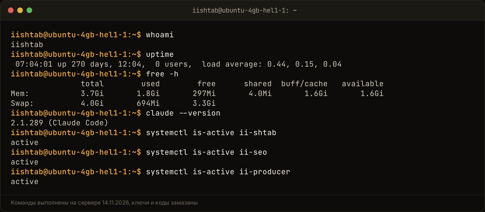

Claude Code параллельные задачи теперь ведёт сам: в новых Projects один координатор раздаёт работу нескольким исполнителям, и они идут одновременно, без тебя за клавиатурой. Для бизнеса это значит, что пачку однотипных задач можно отдать разом и утром проверить готовые правки. Платишь за это лимитом подписки, и он тает быстрее.

Ниже разбираю, как устроена новинка, во что она упирается и как я веду две задачи по коду сразу из Telegram на своём сервере.

## Что изменилось в обновлении Projects для Claude Code?

Projects превратились из папки с файлами в координатора, который сам дробит задачу и раздаёт её потокам. По данным [VentureBeat](https://venturebeat.com/2026/09/17/anthropic-launches-claude-code-projects-an-always-on-conversation-that-remembers-and-delegates-your-long-running-dev-work/) от 17.09.2026, каждый поток это отдельная облачная сессия Claude Code в своей ветке и своей копии репозитория. Репозиторий тут значит папку с кодом проекта и всей историей правок.

Что ещё есть в обновлении по тому же источнику:

- **Общая память проекта.** Потоки пишут в неё и читают из неё: сдвинулся срок, убрали функцию, кого спросить перед правкой.
- **Библиотека.** Туда попадают твои файлы и то, что собрал Claude.
- **Итог запросом на слияние.** Поток предлагает свои правки, а координатор подсказывает, что вливать первым.
- **Работа в облаке.** Ноутбук можно закрыть. Доступа к файлам на твоём компьютере и к внутренней сети у потоков пока нет.

Бета открылась для части подписчиков Pro и Max. 07.11.2026 я писал в [канале](https://app.notion.com/p/Claude-Code-411dfdb14822812db1b4eb58daeba030), что на странице Projects появился блок «Недавняя активность», он коротко пересказывает последние события проекта.

## Как запустить несколько задач Claude Code одновременно?

Есть два пути: дать задачу координатору в Projects или поднять параллельные сессии самому. Первый проще, второй даёт больше контроля над правами и очередью.

1. **Через Projects.** Описываешь цель словами, подключаешь репозитории, координатор сам решает, сколько потоков открыть. Зайти в любой поток и поправить курс можно и с телефона.
2. **Своими руками.** Бот или скрипт запускает `claude -p`, это режим без окна: задача одной строкой, ответ текстом. Каждой задаче своя папка, свой номер сессии и свой таймаут.

Я пошёл вторым путём ещё до новинки, потому что мне нужны мои правила доступа и Notion как общий журнал.

<!-- img: type=scheme what="задача словами в Telegram → строка в Notion «Задачи в облаке» → два потока Claude Code, у каждого своя ветка и папка → статус и итог обратно в строку → ответ в Telegram; подписать «потолок 90 минут» у потоков" caption="Как задача из Telegram расходится на два параллельных потока Claude Code и возвращается итогом." alt="claude code параллельные задачи: схема запуска из Telegram через Notion" -->

<figure class="scheme">
<svg width="100%" xmlns="http://www.w3.org/2000/svg" viewBox="0 0 1200 600" role="img" aria-label="Как задача из Telegram расходится на два параллельных потока Claude Code и возвращается итогом">
<title>Как задача из Telegram расходится на два параллельных потока Claude Code и возвращается итогом</title>
<defs>
<marker id="arr" viewBox="0 0 10 10" refX="9" refY="5" markerWidth="8" markerHeight="8" orient="auto-start-reverse">
<path d="M0 0 L10 5 L0 10 z" fill="var(--line)"/>
</marker>
<marker id="arrA" viewBox="0 0 10 10" refX="9" refY="5" markerWidth="8" markerHeight="8" orient="auto-start-reverse">
<path d="M0 0 L10 5 L0 10 z" fill="var(--accent)"/>
</marker>
</defs>

<!-- 1 Telegram -->
<rect x="40" y="230" width="230" height="140" rx="10" fill="var(--surface)" stroke="var(--line)" stroke-width="2"/>
<circle cx="72" cy="262" r="16" fill="var(--accent)"/>
<text x="72" y="268" text-anchor="middle" font-family="var(--font-display)" font-weight="600" font-size="18" fill="var(--surface)">1</text>
<text x="155" y="300" text-anchor="middle" font-family="var(--font-display)" font-weight="600" font-size="24" fill="var(--fg)">Telegram</text>
<text x="155" y="334" text-anchor="middle" font-family="var(--font-body)" font-size="18" fill="var(--muted)">задача словами</text>

<!-- 2 Notion -->
<rect x="340" y="230" width="250" height="140" rx="10" fill="var(--surface)" stroke="var(--line)" stroke-width="2"/>
<circle cx="372" cy="262" r="16" fill="var(--accent)"/>
<text x="372" y="268" text-anchor="middle" font-family="var(--font-display)" font-weight="600" font-size="18" fill="var(--surface)">2</text>
<text x="475" y="300" text-anchor="middle" font-family="var(--font-display)" font-weight="600" font-size="24" fill="var(--fg)">Notion</text>
<text x="475" y="334" text-anchor="middle" font-family="var(--font-body)" font-size="18" fill="var(--muted)">строка «Задачи в облаке»</text>

<!-- 3a flow A -->
<rect x="680" y="90" width="270" height="150" rx="10" fill="var(--surface)" stroke="var(--accent)" stroke-width="2"/>
<circle cx="712" cy="122" r="16" fill="var(--accent)"/>
<text x="712" y="128" text-anchor="middle" font-family="var(--font-display)" font-weight="600" font-size="18" fill="var(--surface)">3</text>
<text x="815" y="168" text-anchor="middle" font-family="var(--font-display)" font-weight="600" font-size="24" fill="var(--fg)">Поток A</text>
<text x="815" y="198" text-anchor="middle" font-family="var(--font-body)" font-size="18" fill="var(--muted)">Claude Code</text>
<text x="815" y="224" text-anchor="middle" font-family="var(--font-body)" font-size="18" fill="var(--muted)">своя ветка и папка</text>

<!-- 3b flow B -->
<rect x="680" y="360" width="270" height="150" rx="10" fill="var(--surface)" stroke="var(--accent)" stroke-width="2"/>
<circle cx="712" cy="392" r="16" fill="var(--accent)"/>
<text x="712" y="398" text-anchor="middle" font-family="var(--font-display)" font-weight="600" font-size="18" fill="var(--surface)">3</text>
<text x="815" y="438" text-anchor="middle" font-family="var(--font-display)" font-weight="600" font-size="24" fill="var(--fg)">Поток B</text>
<text x="815" y="468" text-anchor="middle" font-family="var(--font-body)" font-size="18" fill="var(--muted)">Claude Code</text>
<text x="815" y="494" text-anchor="middle" font-family="var(--font-body)" font-size="18" fill="var(--muted)">своя ветка и папка</text>

<!-- 4 result -->
<rect x="1020" y="230" width="150" height="140" rx="10" fill="var(--surface)" stroke="var(--line)" stroke-width="2"/>
<circle cx="1052" cy="262" r="16" fill="var(--accent)"/>
<text x="1052" y="268" text-anchor="middle" font-family="var(--font-display)" font-weight="600" font-size="18" fill="var(--surface)">4</text>
<text x="1095" y="316" text-anchor="middle" font-family="var(--font-display)" font-weight="600" font-size="24" fill="var(--fg)">Итог</text>
<text x="1095" y="346" text-anchor="middle" font-family="var(--font-body)" font-size="18" fill="var(--muted)">в Telegram</text>

<!-- arrows -->
<line x1="270" y1="300" x2="336" y2="300" stroke="var(--accent)" stroke-width="3" marker-end="url(#arrA)"/>
<path d="M590 280 L635 280 L635 165 L676 165" fill="none" stroke="var(--accent)" stroke-width="3" marker-end="url(#arrA)"/>
<path d="M590 320 L635 320 L635 435 L676 435" fill="none" stroke="var(--accent)" stroke-width="3" marker-end="url(#arrA)"/>
<path d="M950 165 L985 165 L985 280 L1016 280" fill="none" stroke="var(--line)" stroke-width="2.5" marker-end="url(#arr)"/>
<path d="M950 435 L985 435 L985 320 L1016 320" fill="none" stroke="var(--line)" stroke-width="2.5" marker-end="url(#arr)"/>

<!-- status back to Notion -->
<path d="M815 510 L815 560 L475 560 L475 374" fill="none" stroke="var(--line)" stroke-width="2" stroke-dasharray="7 6" marker-end="url(#arr)"/>
<text x="645" y="548" text-anchor="middle" font-family="var(--font-body)" font-size="18" fill="var(--muted)">статус и итог обратно в строку</text>

<!-- ceiling -->
<text x="815" y="64" text-anchor="middle" font-family="var(--font-body)" font-size="18" fill="var(--muted)">у каждого потока потолок 90 минут</text>
<text x="815" y="586" text-anchor="middle" font-family="var(--font-body)" font-size="18" fill="var(--muted)">потолок 90 минут</text>
</svg>
<figcaption>Как задача из Telegram расходится на два параллельных потока Claude Code и возвращается итогом.</figcaption>
</figure>

## Сколько ресурсов сервера требует параллельная работа агентов?

Облачным потокам Projects твой сервер не нужен: они работают у Anthropic. Если гоняешь сессии у себя, упираешься в память, потому что каждая сессия Claude Code это отдельный процесс.

Мой штаб живёт на Hetzner: 2 ядра и 3,7 ГБ памяти, по данным на 30.09.2026 ([статья о сервере](/blog/claude-code-agent-telegram-server/)). На нём четыре бота и одна подписка Pro. В штабе роликов и SEO-штабе стоит очередь на одного Claude. Бот «Мозг» берёт две задачи по коду сразу, больше на таком железе я не пускаю.

## Проверил на себе: как бот «Мозг» ведёт две задачи по коду сразу

«Мозг» работает с 25.10.2026 ([журнал изменений](https://app.notion.com/p/ii-systema-Notion-Claude-Code-404dfdb1482281128bdce87842fd8cd8)). Я пишу «задача: …», бот ставит строку в Notion и запускает исполнителя. По его README на 30.10.2026 одновременно идут 2 задачи, у каждой потолок 90 минут.

Как устроено:

- **Своя папка на задачу.** Это отдельная копия репозитория в ветке `claude/task-<номер>`, поэтому два исполнителя не правят одни файлы.
- **Статус в конце.** Сессия пишет в строку «Готово», «Нужен ты» или «Не вышло», плюс результат и ссылки. Бот раз в минуту читает строки и шлёт итог ответом на карточку.
- **Облако как запасной путь.** Задачу можно отдать облачной сессии через триггер запланированной задачи. У триггера по README на 30.10.2026 лимит 30 запусков в час, расход из той же подписки.

Что сломалось. Когда ботов стало четыре, правило «один Claude за раз» пришлось уточнить: без потолка две тяжёлые сессии съели бы память. Облачная сессия до моих серверов не достаёт, поэтому код оттуда приходит только запросом на слияние. Это неудобно, зато безопасно.

<!-- img: type=terminal cmds="whoami ;; uptime ;; free -h ;; claude --version ;; systemctl is-active ii-shtab ;; systemctl is-active ii-seo ;; systemctl is-active ii-producer" caption="Сервер штаба: память, на которую рассчитаны две параллельные сессии Claude Code, и службы ботов." alt="claude code несколько агентов одновременно на сервере: память и службы" -->

## Когда параллельная работа полезна бизнесу, а когда опасна?

Полезна, когда задачи независимые: поправить пять страниц сайта, собрать отчёты по разным клиентам, обновить описания товаров. Опасна, когда задачи трогают одно и то же или уходят наружу без проверки.

Хорошо параллелится:

- однотипные правки в разных файлах или проектах;
- черновики, которые потом смотрит человек;
- исследование по нескольким темам сразу.

Плохо параллелится:

- правки одного файла несколькими потоками, получишь конфликт при слиянии;
- публикации, рассылки, письма клиентам;
- всё, где нужен доступ к твоей внутренней сети: облачным потокам он пока закрыт.

## Как связать параллельные сессии Claude Code с Notion и Telegram?

Telegram принимает задачу, Notion хранит её статус, Claude Code делает работу. Бот в середине склеивает всё и присылает итог туда, откуда пришла задача.

Порядок, который работает у меня:

1. Задача словами или голосом в группу, бот проверяет, что пишу я.
2. Строка в базе Notion со статусом «В работе».
3. Запуск сессии в отдельной папке.
4. Итог в строку и ответом в Telegram, ответ на карточку уходит в ту же сессию.

Подробно путь разобран в [статье о команде ИИ-сотрудников](/blog/komanda-ii-sotrudnikov-multiagenty-nastroika/).

## Что нужно настроить для защиты данных перед запуском фоновых воркеров?

Права задаются до запуска, потому что фоновой сессии некого спросить. Чем больше потоков, тем важнее, чтобы ограничения стояли снаружи модели.

Минимальный набор, как у меня ([статья о безопасности](/blog/bezopasno-li-puskat-claude-code-na-server/)):

| Слой | Что закрывает |
|---|---|
| Отдельный пользователь Linux | системные файлы и чужие папки |
| Узкий список инструментов и режим `dontAsk` | лишние команды |
| Своя ветка и папка на задачу | правки вне задачи |
| Хук `pre-push` | выкат в main без моего «мержи» |

Хук это маленький скрипт git перед отправкой кода. Он смотрит на мои слова, текст модели не считается.

## Что делать с лимитом подписки?

Считай, что каждый поток тратит лимит как отдельная сессия. Anthropic, по данным VentureBeat, прямо предупреждает: Projects быстрее доходят до лимита. Начни с двух потоков на небольшой задаче, посмотри расход и только потом добавляй.

Всю систему ботов, на которой я это проверяю, показываю в [кейсе ii.systema](/iisystema/).

Если хочешь раздать рутину компании нескольким ИИ-исполнителям и не потерять контроль, напиши слово «система» мне в личку https://t.me/solovarov. Посмотрим, какие задачи у тебя можно безопасно отдать агентам.
