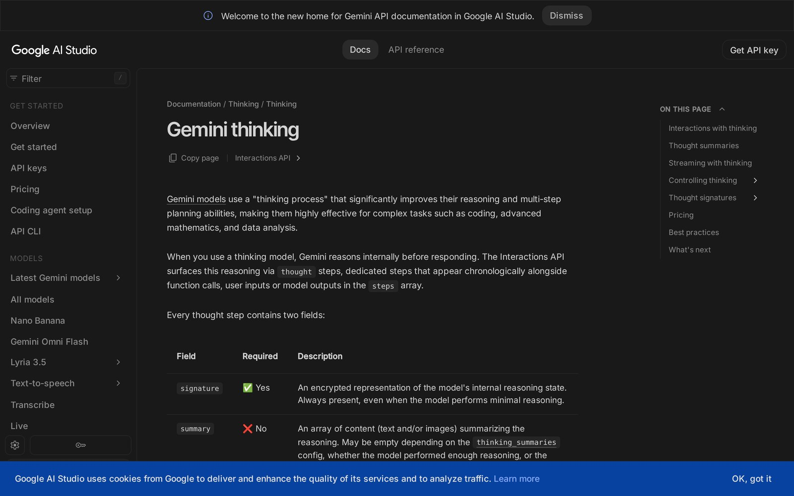

Gemini 4 для бизнеса стоит включать на долгие размышления только там, где нужна сложная логика: аудит кода, длинные договоры, нестандартные расчёты. Ответы клиентам, сортировка заявок и короткие сводки идут на низком уровне размышлений или на облегчённой Flash. Иначе ты платишь за мысли, которых никто не видит, а бот в Telegram обрывает ответы на полуслове.

Ниже разбираю, как устроен thinking budget в Gemini 4, сколько он стоит, как настроить его в API и что у меня ломалось в собственных ботах. Цифры свои с датами, чужие со ссылками.

## Что такое Thinking Budget в Gemini 4 и почему модель начала думать дольше?

Thinking Budget это сколько модель может рассуждать про себя перед ответом. Рассуждения идут отдельными токенами (токен это кусочек слова, по ним считают и цену, и лимиты). В новых моделях Gemini вместо числа токенов ставится уровень `thinking_level`: low, medium или high.

По [документации Gemini API](https://aistudio.google.com/docs/thinking), которую я читал 17.11.2026, у Gemini 4 Carbon и Gemini 4 Argon размышления включены по умолчанию на уровне medium. Доступны три уровня:

| Уровень | Что делает | Где брать |
|---|---|---|
| low | короткий проход, быстрый ответ | ответы клиентам, сортировка, сводки |
| medium | по умолчанию у Gemini 4 Carbon и Argon | разбор документа средней сложности |
| high | максимальная глубина рассуждений | аудит кода, расчёты, длинные цепочки условий |

Почему модель «начала думать дольше»? Раньше размышления надо было включать, теперь они стоят по умолчанию. Если ты подключил Gemini 4 и ничего не трогал, каждый запрос идёт со средним уровнем размышлений, даже «спасибо, заказ принят».

Есть уровень `minimal`, почти без размышлений, с самым быстрым ответом. По той же документации он не поддерживается у моделей Gemini 4 и у gemini-3.8-flash. Он есть у облегчённых моделей вроде gemini-3.1-flash-lite. Значит, у Gemini 4 полностью выключить размышления нельзя, самый быстрый вариант у неё это low.

Старый параметр `thinking_budget` с числом токенов в [документации Vertex AI](https://docs.cloud.google.com/vertex-ai/generative-ai/docs/thinking) оставлен для совместимости. Код со старым параметром работает, но Google называет этот путь устаревшим. Если передать оба параметра сразу, модель вернёт ошибку.

<!-- img: type=screenshot url=https://aistudio.google.com/docs/thinking caption="Таблица уровней размышлений в документации Gemini API: у Gemini 4 Carbon по умолчанию medium, minimal недоступен." alt="gemini thinking budget что это: таблица уровней thinking_level в документации Gemini API" -->

## Когда долгое размышление окупается, а где бизнесу нужен быстрый ответ?

Долгое размышление окупается там, где ошибка стоит дороже токенов и где ответ строится в несколько шагов. Быстрый ответ нужен везде, где задача короткая, типовая и повторяется сотни раз в день.

Gemini 4 Carbon сильна как раз в тяжёлых задачах. В посте канала [«4 новости недели»](https://t.me/solovarovp/2094) 30.10.2026 я разбирал её выход: первое место в рейтинге Artificial Analysis с 59 баллами и 88,2% точности в коде и поиске уязвимостей. Такие цифры получаются на высоком уровне размышлений. Платить за этот уровень на ответе «во сколько вы открываетесь» нет смысла.

Как я раскладываю задачи:

- **High.** Аудит кода и баз, поиск уязвимостей, разбор длинного договора на риски, финансовые расчёты в несколько шагов, план внедрения.
- **Medium.** Разбор документа на 5–10 страниц, сравнение двух предложений поставщиков, черновик регламента.
- **Low или облегчённая Flash.** Ответы клиентам по базе знаний, сортировка заявок по типу, короткая сводка переписки, алерты, благодарности, подписи к роликам.

Тот же принцип есть у Claude. В [схеме выбора моделей](https://app.notion.com/p/Claude-3f6dfdb1482281a886d8daa5f156cca0) на 11.10.2026 я описывал регулятор Effort: на Medium модель рассуждает короче и тратит меньше лимита, чем на High, а выводы остаются на уровне. Названия разные, суть одна: умную модель можно оставить, а глубину размышлений подобрать под задачу.

<!-- img: type=scheme what="роутинг запросов: входящий запрос → быстрая проверка типа задачи → короткая задача (ответ клиенту, сортировка, сводка) → Flash-Lite или low → ответ; сложная задача (аудит, договор, расчёт) → Gemini 4 на high → проверка ответа → ответ" caption="Как разводить запросы бота по уровням размышлений: рутина идёт быстрым путём, сложное уходит на глубокий." alt="gemini 4 для бизнеса: схема выбора уровня размышлений под задачу" -->

<figure class="scheme">
<svg width="100%" xmlns="http://www.w3.org/2000/svg" viewBox="0 0 1200 640" role="img" aria-label="Схема роутинга запросов бота по уровням размышлений: быстрая проверка типа задачи, короткие задачи уходят на Flash-Lite или low, сложные на Gemini 4 на high с проверкой ответа">
  <title>Роутинг запросов: рутина идёт быстрым путём, сложное уходит на глубокий</title>
  <defs>
    <marker id="arr" viewBox="0 0 10 10" refX="9" refY="5" markerWidth="9" markerHeight="9" orient="auto-start-reverse">
      <path d="M0 0 L10 5 L0 10 z" fill="var(--line)"/>
    </marker>
    <marker id="arrAccent" viewBox="0 0 10 10" refX="9" refY="5" markerWidth="9" markerHeight="9" orient="auto-start-reverse">
      <path d="M0 0 L10 5 L0 10 z" fill="var(--accent)"/>
    </marker>
  </defs>

  <!-- 1. Входящий запрос -->
  <rect x="400" y="20" width="400" height="80" rx="10" fill="var(--surface)" stroke="var(--line)" stroke-width="2"/>
  <circle cx="436" cy="60" r="16" fill="var(--accent)"/>
  <text x="436" y="67" text-anchor="middle" font-family="var(--font-display)" font-weight="600" font-size="20" fill="var(--surface)">1</text>
  <text x="470" y="68" font-family="var(--font-display)" font-weight="600" font-size="26" fill="var(--fg)">Входящий запрос</text>

  <!-- стрелка 1 -> 2 -->
  <line x1="600" y1="100" x2="600" y2="150" stroke="var(--accent)" stroke-width="3" marker-end="url(#arrAccent)"/>

  <!-- 2. Быстрая проверка -->
  <rect x="340" y="152" width="520" height="104" rx="10" fill="var(--surface)" stroke="var(--accent)" stroke-width="2"/>
  <circle cx="376" cy="204" r="16" fill="var(--accent)"/>
  <text x="376" y="211" text-anchor="middle" font-family="var(--font-display)" font-weight="600" font-size="20" fill="var(--surface)">2</text>
  <text x="408" y="198" font-family="var(--font-display)" font-weight="600" font-size="26" fill="var(--fg)">Быстрая проверка</text>
  <text x="408" y="230" font-family="var(--font-body)" font-size="19" fill="var(--muted)">Какого типа задача?</text>

  <!-- стрелки к ветвям -->
  <path d="M520 256 L520 290 L270 290 L270 324" fill="none" stroke="var(--line)" stroke-width="3" marker-end="url(#arr)"/>
  <path d="M680 256 L680 290 L930 290 L930 324" fill="none" stroke="var(--line)" stroke-width="3" marker-end="url(#arr)"/>
  <text x="400" y="282" text-anchor="middle" font-family="var(--font-body)" font-size="18" fill="var(--muted)">короткая</text>
  <text x="800" y="282" text-anchor="middle" font-family="var(--font-body)" font-size="18" fill="var(--muted)">сложная</text>

  <!-- 3. Короткая задача -->
  <rect x="40" y="326" width="460" height="130" rx="10" fill="var(--surface)" stroke="var(--line)" stroke-width="2"/>
  <circle cx="76" cy="358" r="16" fill="var(--accent)"/>
  <text x="76" y="365" text-anchor="middle" font-family="var(--font-display)" font-weight="600" font-size="20" fill="var(--surface)">3</text>
  <text x="104" y="366" font-family="var(--font-display)" font-weight="600" font-size="24" fill="var(--fg)">Короткая задача</text>
  <text x="68" y="404" font-family="var(--font-body)" font-size="18" fill="var(--muted)">Ответ клиенту, сортировка заявок,</text>
  <text x="68" y="430" font-family="var(--font-body)" font-size="18" fill="var(--muted)">сводка переписки</text>

  <!-- 3. Сложная задача -->
  <rect x="700" y="326" width="460" height="130" rx="10" fill="var(--surface)" stroke="var(--line)" stroke-width="2"/>
  <circle cx="736" cy="358" r="16" fill="var(--accent)"/>
  <text x="736" y="365" text-anchor="middle" font-family="var(--font-display)" font-weight="600" font-size="20" fill="var(--surface)">3</text>
  <text x="764" y="366" font-family="var(--font-display)" font-weight="600" font-size="24" fill="var(--fg)">Сложная задача</text>
  <text x="728" y="404" font-family="var(--font-body)" font-size="18" fill="var(--muted)">Аудит, разбор договора,</text>
  <text x="728" y="430" font-family="var(--font-body)" font-size="18" fill="var(--muted)">многошаговый расчёт</text>

  <!-- вниз к моделям -->
  <line x1="270" y1="456" x2="270" y2="496" stroke="var(--line)" stroke-width="3" marker-end="url(#arr)"/>
  <line x1="930" y1="456" x2="930" y2="496" stroke="var(--line)" stroke-width="3" marker-end="url(#arr)"/>

  <!-- 4. Flash-Lite / low -->
  <rect x="40" y="498" width="460" height="100" rx="10" fill="var(--surface)" stroke="var(--line)" stroke-width="2"/>
  <circle cx="76" cy="534" r="16" fill="var(--accent)"/>
  <text x="76" y="541" text-anchor="middle" font-family="var(--font-display)" font-weight="600" font-size="20" fill="var(--surface)">4</text>
  <text x="104" y="541" font-family="var(--font-display)" font-weight="600" font-size="24" fill="var(--fg)">Flash-Lite или low</text>
  <text x="68" y="578" font-family="var(--font-body)" font-size="18" fill="var(--muted)">Быстро и дёшево, сразу ответ</text>

  <!-- 4. Gemini 4 high -->
  <rect x="700" y="498" width="460" height="100" rx="10" fill="var(--surface)" stroke="var(--accent)" stroke-width="2"/>
  <circle cx="736" cy="534" r="16" fill="var(--accent)"/>
  <text x="736" y="541" text-anchor="middle" font-family="var(--font-display)" font-weight="600" font-size="20" fill="var(--surface)">4</text>
  <text x="764" y="541" font-family="var(--font-display)" font-weight="600" font-size="24" fill="var(--fg)">Gemini 4 на high</text>
  <text x="728" y="578" font-family="var(--font-body)" font-size="18" fill="var(--muted)">Долгое размышление, затем проверка ответа</text>
</svg>
<figcaption>Как разводить запросы бота по уровням размышлений: рутина идёт быстрым путём, сложное уходит на глубокий.</figcaption>
</figure>

## Сколько стоит работа Gemini 4 с размышлениями и как не сжечь лимиты?

Цена ответа равна сумме выходных токенов и токенов размышлений. Так прямо написано в [документации](https://aistudio.google.com/docs/thinking): платишь за все мысли, которые модель сгенерировала, даже если показала только краткую сводку. Поэтому каждый шаг вверх по уровню размышлений делает тот же ответ дороже.

Точных цен за миллион токенов для Gemini 4 я сюда не ставлю: они меняются, и верная цифра бывает только на странице цен Gemini API в день подключения. Зато есть замер самого Google. В [статье Google for Developers](https://developers.googleblog.com/cost-per-task-using-cheap-classifiers-to-route-across-gemini-models-and-thinking-levels/) от 3 ноября 2026 прогнали 50 задач для агента, который пишет код:

- Gemini 3.8 Flash на уровне low решила все 50 задач и обошлась заметно дешевле, чем на уровне по умолчанию.
- Связка «сначала Flash-Lite, сложное отдать 3.8 Flash на low» тоже решила 50 из 50 и снизила и цену, и время ответа.
- Flash-Lite одна отвечала на простые задачи за полсекунды, но провалила 6 сложных из 25.
- Ограничение длины ответа не помогло: модель тратила почти столько же токенов на размышления, а 7 сложных задач из 25 сломались.

Вывод Google совпадает с моим: ставь уровень размышлений напрямую, `thinkingLevel: "LOW"`, а не пытайся обрезать ответ лимитом.

Что у меня видно по счетам:

1. **Разбор роликов.** С 30.09.2026 чужие ролики смотрит Gemini Flash, разбор одного на платном тарифе стоит около цента. Подробно в статье [«Почему лимит Claude кончается к обеду»](/blog/pochemu-limit-claude-bystro-konchaetsya/).
2. **Счёт клиента.** В проекте JE 3.0 расходы за месяц на Gemini API и сервер вышли $46 вместе с двумя месяцами аренды (04.11.2026). Основную часть съедали алерты на Pro, которые запускаются каждые 5 минут. Об этом ниже, в разделе про свой опыт.

Как не сжечь лимиты:

- Посчитай, какой сценарий запускается чаще всего. Алерт раз в 5 минут даёт 288 вызовов в сутки, и уровень размышлений на нём важнее, чем на редком отчёте.
- Поставь каждому сценарию свою модель и свой уровень в настройках, а не одну на весь бот.
- Включи кэш контекста, если бот каждый раз отправляет одну и ту же инструкцию. В той же статье Google сказано, что повторный контекст из кэша стоит на 75–90% дешевле. Кэш привязан к одной модели, при смене модели скидка теряется.
- Поставь потолок расходов и предупреждение. 15.11.2026 у меня с 06:33 до 10:16 МСК кончился баланс Gemini (ошибка 402), и упали подпись ролика, утренние новости и план продюсера канала ([журнал изменений](https://app.notion.com/p/Gemini-419dfdb1482281d3a5aecb9774f7e920)). Теперь боты сами повторяют такие задачи через 30 минут, час и два часа.

## Как подключить Gemini 4 API в России и настроить бюджет размышлений?

Из России напрямую не подключиться: 02.11.2026 я проверял, Google AI Studio и Gemini API отвечают ошибкой 403. Рабочий путь у меня один, российский шлюз Polza.ai. В проекте [VetCT](/vetctschool/) с 30.10.2026 все запросы к Gemini идут через него, оплата в рублях, ключ передаётся тем же заголовком `x-goog-api-key`. Код почти не меняется, меняется адрес. Есть ли в шлюзе уже Gemini 4 Carbon, проверь перед подключением: у меня такого факта нет.

Ещё одно правило до первого запроса. На бесплатном тарифе Google AI Studio текст твоих запросов Google может брать на обучение моделей. Записал это в гайде от 09.11.2026. Для клиентских переписок, регламентов и договоров переводи проект на платный тариф с Cloud Billing.

Порядок настройки:

1. **Разбей бота на сценарии.** Ответ клиенту, сортировка заявки, сводка, отчёт. Каждому сценарию своя строка в настройках.
2. **Задай модель и уровень на сценарий.** Рутина: облегчённая Flash или low. Сложный разбор: Gemini 4 на high.
3. **Передавай уровень в запросе.** В `generation_config` ставится `thinking_level: "low"`. Старый `thinking_budget` в одном запросе с новым параметром не смешивай, получишь ошибку.
4. **Дай запас на длину ответа.** По документации `max_output_tokens` включает и размышления. Если модель упрётся в потолок, пока думает, она вернёт статус `incomplete`, а за мысли ты всё равно заплатишь. Лечится понижением уровня, а не уменьшением лимита.
5. **Выключи сводку мыслей, если она не нужна.** Параметр `thinking_summaries: "none"`. По умолчанию модель и так отдаёт только финальный ответ.
6. **Проверяй ответ перед действием.** Ответ не в JSON, значит один повтор. Нужной модели нет (ошибка 404), значит запрос уходит в запасную.

## Проверил на себе: как размышления обрывали ответы ботов и как я настроил связку

Самая наглядная история случилась с роботом Бадди, помощником в ботах «Снимай». Он отвечает людям через Gemini. Размышления у модели были включены, и они съедали лимит ответа: текст обрывался на полуслове, человек получал половину фразы.

12.11.2026 я выключил размышления в его запросах (`thinkingBudget: 0`, по [README проекта](https://github.com/solovarov90/ii-systema/blob/main/snimai/README.md)) и добавил страховку: если текст всё же оборван, бот режет его до последней целой фразы. После этого ответы перестали обрываться. Для помощника, который отвечает на «как записать дубль», размышления не нужны совсем.

<!-- img: type=gen prompt="a chat message bubble cut in half by a glowing golden hourglass, tokens as small gold cubes flowing away, dark graphite background, minimal" caption="Размышления и ответ делят один лимит токенов: если мысли съели его, ответ обрывается." alt="настройка режима thinking в gemini api: почему бот обрывает ответ" -->

Вторая история про деньги. В проекте JE 3.0 бот следит за группами клиента и ставит алерты по смыслу каждые 5 минут. Всё шло на тяжёлой Pro, и счёт за месяц вместе с арендой сервера вышел $46. 05.11.2026 я перевёл на Flash ([задача в Notion](https://app.notion.com/p/LLM-je30-server-Flash-40fdfdb1482281dd845fd6c683367685)):

- алерты по смыслу, на которые уходила основная часть счёта;
- карточки уснувших клиентов и «Другой вариант»;
- черновики «Клиент ждёт ответа» и благодарности.

На Pro остались загрузка знаний, долгий разговор без сделки, второй мозг и чат проекта. Там нужен большой контекст, и экономить на нём я не стал. У каждого сценария свой ключ модели в настройках, поэтому откатить один алерт обратно на Pro можно одной строкой, если ложных срабатываний станет больше.

Что сломалось по дороге:

- **Облегчённая модель на длинной инструкции.** 18.10.2026 в конвейере «Техномага» flash-lite вызвала запись файла без пути, и весь прогон упал. Длинные шаги я перевёл на gemini-3-flash-preview.
- **Старая модель пропала из API.** Gemini 1.5 Flash уже сняли, поэтому в JE 3.0 я поставил алиас `gemini-flash-latest`, а на случай 404 запрос уходит в Pro.
- **Кончился баланс.** Тот самый сбой 15.11.2026: три с половиной часа без ответов Gemini, пока я не пополнил счёт.
- **Ответ не в том формате.** Облегчённые модели чаще ломают JSON, поэтому один повтор стоит в каждом сценарии.

## Gemini 4 или Claude: какую нейросеть ставить под капот бизнес-процессов?

Ставь обе и раздели задачи. Gemini берёт поток: разбор видео, сортировку, подписи, алерты, всё, что бот запускает сотни раз. Claude берёт то, где нужно думать и писать с первой попытки: сценарии, статьи, работу с кодом.

Так у меня устроен медиа-штаб ii.systema. 30.09.2026 я перевёл разбор чужих роликов с Claude на Gemini, и с тех пор лимит подписки Claude уходит только на разговор и сценарии. Разбор одного ролика на Flash стоит около цента. Сценарии, хуки и статьи пишет Claude Opus 5.5 по подписке, без оплаты за каждый вызов. Как вся связка работает от референса до выкладки, видно в [кейсе ii.systema](/iisystema/).

| | Gemini по ключу | Claude по подписке |
|---|---|---|
| Как платишь | за каждый токен, включая размышления | фиксированно в месяц |
| Где упираешься | в деньги и баланс | в окно лимита подписки |
| Что у меня делает | разбор роликов, подписи, алерты, сводки | сценарии, статьи, код, разговор |
| Что настроить | уровень размышлений на сценарий | Effort и выбор модели |

Лидеры рейтингов меняются каждый месяц. В посте 30.10.2026 я писал, что на одну модель не завязываюсь: система собрана из модулей, и под аудит кода я подключаю ту, что сейчас сильнее. Gemini 4 Carbon в коде и уязвимостях сейчас в топе, значит, на такие задачи её и стоит пробовать, на высоком уровне.

## Gemma 4 локально: имеет ли смысл поднимать модель на своём сервере?

Для малого бизнеса чаще всего нет. Своя модель окупается, когда переписку и документы нельзя отдавать наружу совсем или когда запросов так много, что счёт за API выше аренды сервера с видеокартой. В остальных случаях Flash на low по ключу дешевле и проще.

Gemma 4 это открытая модель Google, её веса можно скачать и запустить у себя. У неё тоже есть режим размышлений, он включается отдельным служебным токеном, это разобрано в [статье на DEV Community](https://dev.to/pulkitgovrani/gemma-4s-thinking-mode-a-practical-guide-to-the-think-token-8c5). В [другом замере](https://dev.to/wildeconforce/i-ran-a-7500-token-architecture-spec-through-4-models-the-cheapest-one-caught-everything-the-9ka) Gemma 4 31B на разборе технического задания совпала с флагманами в 3 модулях из 4 примерно за 1/14 цены вызова.

Gemma 4 я сам ещё не запускал, поэтому своих цифр по ней нет. Что знаю по своим серверам: мой транскрибатор живёт на Hetzner с 2 ядрами и 4 ГБ памяти без видеокарты, и запись на 76 минут он расшифровывает за 25–40 минут (замер 13.06.2026). Языковой модели среднего размера на таком железе будет тесно. Перед покупкой сервера с видеокартой посчитай, сколько ты сейчас платишь за API в месяц, и сравни с арендой.

Когда своя модель всё же нужна:

- медицинские карты, юридические и финансовые документы, которые нельзя передавать сторонним сервисам;
- закрытый контур компании без выхода в интернет;
- очень большой поток однотипных запросов, где каждый цент за вызов складывается в заметную сумму.

## С чего начать, если Gemini уже стоит у тебя в боте?

Начни с аудита запросов, а не со смены модели. Открой настройки бота и выпиши, какие сценарии вызывают Gemini и как часто. Почти всегда окажется, что пара частых сценариев съедает основной счёт.

1. Выпиши сценарии и частоту вызовов за сутки.
2. Отметь, где нужна глубокая логика, а где хватит быстрого ответа.
3. Частым и простым поставь low или облегчённую Flash.
4. Сложным оставь high, но запускай их реже и проверяй ответ.
5. Через 1–2 дня сверь счёт и качество: ложных срабатываний не стало больше, ответы не обрываются.
6. Добавь повтор при сбое и предупреждение о балансе.

Если хочешь автоматизировать разбор заявок, поддержку или конвейер контента без переплат за лишние токены, напиши мне в личку [t.me/solovarov](https://t.me/solovarov) слово «система». Посмотрим, какие процессы у тебя можно перевести на быстрые и дешёвые модели, а где оставить глубокое размышление.
