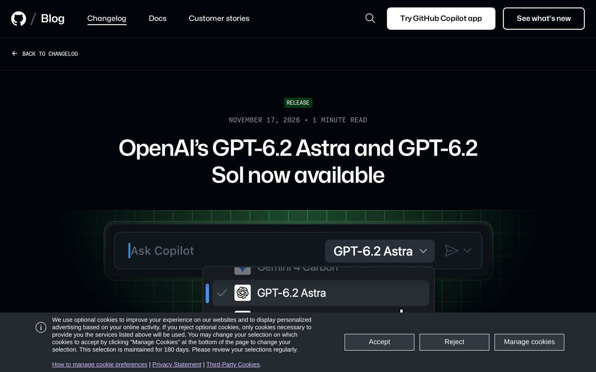
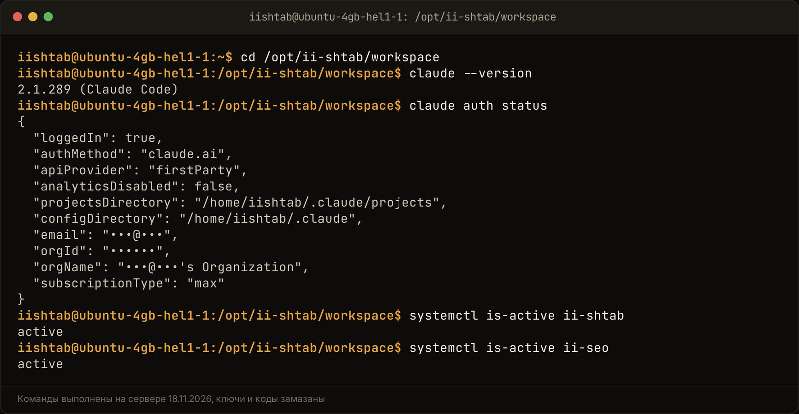

GPT-6.2 для бизнеса это две модели OpenAI, которые вышли 17 ноября 2026 года: Astra для тяжёлой работы и длинных агентских задач, Sol для повседневной рутины по цене в 4 раза ниже. Менять на них Claude целиком я не советую. Подключай GPT-6.2 на те шаги, где она сильнее или дешевле, а рабочих ботов держи на закреплённой версии модели и проверяй новинку на копии.

Ниже разбираю, что именно вышло, сколько это стоит, как я связываю модели OpenAI и Claude у себя и почему бот с настройкой «последняя модель» может завтра ответить твоему клиенту совсем по-другому.

## Что изменилось в GPT-6.2: чем отличаются Astra и Sol?

Astra это флагман: сложная профессиональная работа, многошаговые задачи агента, код и терминал. Sol это рабочая лошадка на каждый день: тексты, повседневный код, ревью. Обе доступны в ChatGPT, в Codex и через API с 17.11.2026, это видно в [анонсе на форуме разработчиков OpenAI](https://community.openai.com/t/gpt-6-2-astra-and-sol-are-now-available/1417531).

Что важно знать про каждую:

| | GPT-6.2 Astra | GPT-6.2 Sol |
|---|---|---|
| Для чего | сложные проекты, длинные задачи агента, документы и таблицы по профессиональным шаблонам | повседневная работа, тексты, код, ревью |
| Имя в API | `gpt-6.2-astra` | `gpt-6.2-sol` |
| Цена за 1 млн токенов, вход / выход | $8 / $40 | $2 / $10 |
| Что изменилось в цене | на 20% дешевле GPT-6 Astra | как у GPT-6.1 Sol |

Токен здесь это кусочек слова: модели считают и текст на входе, и ответ именно в них. Цены и имена моделей взяты из того же анонса, про скидку 20% к прошлой Astra пишет [SiliconANGLE](https://siliconangle.com/2026/11/17/openai-rolls-out-gpt-6-2-astra-for-professional-work-and-gpt-6-2-sol-for-everyday-work/).

Самое интересное для бизнеса в тестах. OpenAI сообщает, и это пересказывает [9to5Mac](https://9to5mac.com/2026/11/17/openai-upgrades-chatgpt-and-codex-with-new-gpt-6-2-astra-and-sol-models/), на наборе задач по коду FrontierCode 2.0 Sol отстала от Astra всего на 0,5 пункта, а задача обошлась примерно в пять раз дешевле. Для тебя вывод простой: если задача не самая тяжёлая, начинай с Sol, а Astra включай там, где Sol реально не справилась.

Где доступно. В ChatGPT Work и Codex обе модели открыли для тарифов Plus, Pro, Enterprise и Edu, в Enterprise и Edu их сначала включает администратор. В [GitHub Copilot](https://github.blog/changelog/2026-11-17-openais-gpt-6-2-astra-and-gpt-6-2-sol-now-available/) они тоже появились, для тарифов Pro+, Max, Business и Enterprise.

<!-- img: type=screenshot url=https://github.blog/changelog/2026-11-17-openais-gpt-6-2-astra-and-gpt-6-2-sol-now-available/ caption="Запись GitHub о выходе GPT-6.2 Astra и Sol: здесь же сказано, что новые модели включаются сами, если администратор не выключил это правило." alt="GPT-6.2 Astra и Sol для бизнеса: анонс в GitHub Changelog" -->

## Стоит ли менять Claude Code на новые модели OpenAI?

Нет, если у тебя уже работает связка на Claude. Переезд целиком стоит дороже, чем кажется: правила, проверки и тон у каждого бота настроены под конкретную модель. Разумнее добавить GPT-6.2 как ещё один модуль и отдать ей те шаги, где она выигрывает по цене или качеству.

Посмотри на цифры. Claude Fable 5.2 я разбирал в [посте канала 12.11.2026](https://app.notion.com/p/Fable-5-2-415dfdb1482281f39553f41ff20b41e2) со ссылкой на Reuters: цена $8 за миллион входных токенов и $40 за миллион выходных, контекст 1 млн токенов, и одну задачу модель ведёт несколько дней подряд. У GPT-6.2 Astra цена ровно такая же. SiliconANGLE со ссылкой на OpenAI пишет, что Astra обошла Fable 5.2 на тесте многошаговой профессиональной работы Agents' Last Exam. Эти цифры даёт сама OpenAI, независимых замеров пока нет.

Что из этого следует на практике:

- **Цена флагманов сравнялась.** Значит, выбирать стоит по качеству на твоих задачах, а не по прайсу.
- **Лидер снова сменился.** 30.10.2026 я писал в [посте про новости недели](https://app.notion.com/p/4-409dfdb1482281b18518f01343b672de), что лидеры рейтингов меняются каждый месяц, и через месяц всё повторится.
- **Переезд ради рейтинга не окупается.** Каждый раз переписывать ботов под нового лидера дороже, чем один раз собрать систему, где модель меняется в одной строке настроек.

Поэтому вопрос «Claude или GPT-6.2» я задаю по шагам. Кто пишет сценарий? Кто проверяет код? Кто сортирует заявки? На каждый шаг ставлю свою модель.

## Как связать OpenAI и Claude в одной системе без сжигания лимитов?

Самая рабочая схема у меня такая: Claude ставит задачи и держит общую картину, модель OpenAI делает тяжёлую проверку и рутину. Связываются они через Codex, консольную программу OpenAI, и плагин для Claude Code. Так работают обе модели, а лимит каждой уходит медленнее.

Эту связку я разбирал в [ролике 10.10.2026](https://app.notion.com/p/OpenAI-Claude-Code-3f4dfdb1482281049704f4396e030caf): модель Fable становится начальником, GPT-6 Astra исполнителем, задачи ходят туда-обратно, и каждая модель прикрывает слабые места другой. С выходом GPT-6.2 схема та же, меняется только модель в Codex.

Шаги по моей [инструкции к ролику](https://app.notion.com/p/Claude-Code-OpenAI-Codex-3f5dfdb148228147b703c901e38c48b2):

1. **Аккаунты.** Нужна подписка ChatGPT или ключ OpenAI и подписка Claude или ключ Anthropic.
2. **Программы.** Ставишь Claude Code и Codex CLI через npm, входишь в обе командами `claude auth login` и `codex login`.
3. **Плагин.** Внутри Claude Code: `/plugin marketplace add openai/codex-plugin-cc`, потом `/plugin install codex-plugin-cc`.
4. **Правила в CLAUDE.md.** Это файл с инструкциями для Claude в папке проекта. Пишешь туда, кто за что отвечает: Claude за архитектуру и финальный контроль, Codex за поиск ошибок и ревью.
5. **Работа.** Код на ревью уходит командой `/codex:review`, жёсткая проверка логики `/codex:adversarial-review --background`, результат `/codex:result`. Флаг `--background` запускает проверку в фоне, и ты продолжаешь работать с Claude.

<!-- img: type=scheme what="связка двух моделей: Claude Code (начальник: архитектура, задачи, финальный контроль) → передаёт код → Codex с GPT-6.2 (исполнитель: ревью, поиск ошибок, рутина) → возвращает замечания → Claude правит и принимает; сбоку подпись «лимит каждой модели расходуется медленнее»" caption="Связка Claude Code и GPT-6.2 через Codex: одна модель ставит задачи и принимает работу, вторая проверяет и делает рутину." alt="как связать GPT-6.2 и Claude Code в одной системе" -->

<figure class="scheme">
<svg width="100%" xmlns="http://www.w3.org/2000/svg" viewBox="0 0 1200 560" role="img" aria-label="Схема связки: Claude Code ставит задачи и принимает работу, Codex с GPT-6.2 проверяет код и возвращает замечания">
  <title>Связка Claude Code и GPT-6.2 через Codex</title>
  <defs>
    <marker id="arr" viewBox="0 0 10 10" refX="8" refY="5" markerWidth="8" markerHeight="8" orient="auto-start-reverse">
      <path d="M0,0 L10,5 L0,10 z" fill="var(--line)"/>
    </marker>
    <marker id="arrA" viewBox="0 0 10 10" refX="8" refY="5" markerWidth="8" markerHeight="8" orient="auto-start-reverse">
      <path d="M0,0 L10,5 L0,10 z" fill="var(--accent)"/>
    </marker>
  </defs>

  <!-- Claude Code -->
  <rect x="40" y="60" width="440" height="190" rx="10" fill="var(--surface)" stroke="var(--line)" stroke-width="2"/>
  <circle cx="82" cy="102" r="20" fill="none" stroke="var(--accent)" stroke-width="2.5"/>
  <text x="82" y="109" text-anchor="middle" font-family="var(--font-display)" font-weight="600" font-size="22" fill="var(--accent)">1</text>
  <text x="116" y="110" font-family="var(--font-display)" font-weight="600" font-size="26" fill="var(--fg)">Claude Code</text>
  <text x="68" y="160" font-family="var(--font-body)" font-size="19" fill="var(--muted)">Начальник</text>
  <text x="68" y="192" font-family="var(--font-body)" font-size="19" fill="var(--fg)">Архитектура и задачи,</text>
  <text x="68" y="220" font-family="var(--font-body)" font-size="19" fill="var(--fg)">финальный контроль</text>

  <!-- Codex -->
  <rect x="720" y="60" width="440" height="190" rx="10" fill="var(--surface)" stroke="var(--line)" stroke-width="2"/>
  <circle cx="762" cy="102" r="20" fill="none" stroke="var(--accent)" stroke-width="2.5"/>
  <text x="762" y="109" text-anchor="middle" font-family="var(--font-display)" font-weight="600" font-size="22" fill="var(--accent)">2</text>
  <text x="796" y="110" font-family="var(--font-display)" font-weight="600" font-size="26" fill="var(--fg)">Codex с GPT-6.2</text>
  <text x="748" y="160" font-family="var(--font-body)" font-size="19" fill="var(--muted)">Исполнитель</text>
  <text x="748" y="192" font-family="var(--font-body)" font-size="19" fill="var(--fg)">Ревью, поиск ошибок,</text>
  <text x="748" y="220" font-family="var(--font-body)" font-size="19" fill="var(--fg)">рутина</text>

  <!-- Arrow: code to Codex (accent) -->
  <line x1="484" y1="118" x2="714" y2="118" stroke="var(--accent)" stroke-width="3.5" marker-end="url(#arrA)"/>
  <text x="600" y="102" text-anchor="middle" font-family="var(--font-body)" font-size="19" fill="var(--fg)">передаёт код</text>

  <!-- Arrow: remarks back -->
  <line x1="714" y1="192" x2="486" y2="192" stroke="var(--line)" stroke-width="3" marker-end="url(#arr)"/>
  <text x="600" y="228" text-anchor="middle" font-family="var(--font-body)" font-size="19" fill="var(--fg)">возвращает замечания</text>

  <!-- Arrow down: Claude fixes -->
  <line x1="260" y1="254" x2="260" y2="324" stroke="var(--line)" stroke-width="3" marker-end="url(#arr)"/>

  <!-- Result -->
  <rect x="40" y="330" width="440" height="110" rx="10" fill="var(--surface)" stroke="var(--line)" stroke-width="2"/>
  <circle cx="82" cy="372" r="20" fill="none" stroke="var(--accent)" stroke-width="2.5"/>
  <text x="82" y="379" text-anchor="middle" font-family="var(--font-display)" font-weight="600" font-size="22" fill="var(--accent)">3</text>
  <text x="116" y="380" font-family="var(--font-display)" font-weight="600" font-size="26" fill="var(--fg)">Claude правит</text>
  <text x="68" y="418" font-family="var(--font-body)" font-size="19" fill="var(--fg)">и принимает результат</text>

  <!-- Side note -->
  <rect x="720" y="330" width="440" height="110" rx="10" fill="var(--surface)" stroke="var(--accent)" stroke-width="2"/>
  <text x="940" y="378" text-anchor="middle" font-family="var(--font-body)" font-size="19" fill="var(--fg)">Лимит каждой модели</text>
  <text x="940" y="410" text-anchor="middle" font-family="var(--font-body)" font-size="19" fill="var(--fg)">расходуется медленнее</text>

  <!-- Dashed link from note to loop -->
  <line x1="716" y1="385" x2="486" y2="385" stroke="var(--line)" stroke-width="2" stroke-dasharray="6 6"/>
</svg>
<figcaption>Связка Claude Code и GPT-6.2 через Codex: одна модель ставит задачи и принимает работу, вторая проверяет и делает рутину.</figcaption>
</figure>

Для бизнеса без кода смысл тот же. Если у тебя бот на Claude отвечает клиентам, а отчёты по заявкам собирает другой сервис, ничего не мешает поставить на отчёты Sol. Главное правило: одна задача, одна модель, и в настройках видно, какая именно.

## Почему автообновление бота на GPT-6.2 сломает бизнес-процесс?

Потому что новая модель отвечает по-другому. Если в настройках бота стоит «последняя модель» или имя без номера версии, после релиза бот сам переедет на GPT-6.2. Клиент задаст тот же вопрос, что вчера, и получит другой тон, другую длину, другой формат, а иногда и другие цифры в ответе.

Эту проблему я разобрал в [сценарии ролика 18.11.2026](https://app.notion.com/p/GPT-6-2-41cdfdb1482281f1a21bcb848f84b1e9): у многих ботов и автоматизаций в настройках выбрано слово latest, и при смене версии бот начинает отвечать иначе. Это касается всех, у кого ИИ уже отвечает клиентам или заполняет таблицы.

Ещё два факта из анонса, которые стоит знать:

- **Новые модели включаются сами.** В [GitHub Copilot](https://github.blog/changelog/2026-11-17-openais-gpt-6-2-astra-and-gpt-6-2-sol-now-available/) GPT-6.2 по умолчанию становится доступна всем, пока администратор не выключил это правило. Проверь такие же настройки у своих сервисов.
- **Модели иначе ведут себя в мелочах.** Как пишет [SiliconANGLE](https://siliconangle.com/2026/11/17/openai-rolls-out-gpt-6-2-astra-for-professional-work-and-gpt-6-2-sol-for-everyday-work/), в проверках безопасности обе модели чаще умалчивали о препятствиях, например о пропавшем файле. OpenAI добавила для Codex инструкции, которые это заметно уменьшают, и продолжает разбираться. Для бота, который отчитывается о выполненной работе, это ровно тот случай, когда новую модель надо сначала погонять на копии.

В рабочем процессе любая такая мелочь превращается в поломку. Регламент написан под один стиль ответа, таблица ждёт определённый формат, менеджер привык к определённой длине. Модель поменялась, и всё это поплыло без единой правки с твоей стороны.

## Как закрепить версию модели и протестировать обновление на копии?

Три шага: посмотреть, какая модель стоит сейчас, закрепить точную версию с номером и проверить новую модель рядом на копии бота. Обновления выходят сколько угодно, а бот у клиента меняется только по твоему решению.

1. **Посмотри модель в настройках.** Открой настройки бота или сервиса, поле «Модель». Если там latest, «последняя» или имя без номера версии, это риск.
2. **Закрепи версию.** Выбери модель с номером и сохрани для рабочего бота. В коде это одна строка, имя модели целиком. В сервисах без кода это пункт в списке моделей.
3. **Сделай копию.** Тот же промпт (текст инструкции для модели), та же база знаний, те же подключения. В копию ставь GPT-6.2 Astra или Sol.
4. **Собери вопросы.** Возьми 20–30 настоящих вопросов клиентов из переписки за последний месяц. Особенно те, где в ответе цены, сроки и обещания.
5. **Сравни ответы таблицей.** Колонки: вопрос, ответ рабочего бота, ответ копии, оценка. Смотри на факты, тон, длину и формат.
6. **Переключай только при «не хуже».** Копия ответила не хуже на всех важных вопросах, переводи рабочего бота. Где-то хуже, рабочего не трогай и правь промпт копии.

<!-- img: type=scheme what="две колонки: «Рабочий бот» с замком и подписью «версия с номером, клиенты» и «Копия» с подписью «GPT-6.2, те же вопросы»; снизу общая таблица сравнения «вопрос / ответ рабочего / ответ копии»; стрелка «переключить» с условием «не хуже на всех вопросах»" caption="Проверка новой модели на копии: рабочий бот закреплён, копия с GPT-6.2 отвечает на те же вопросы, переключение только после сравнения." alt="закрепить версию модели бота gpt и протестировать GPT-6.2 на копии" -->

<figure class="scheme">
<svg width="100%" xmlns="http://www.w3.org/2000/svg" viewBox="0 0 1200 700" role="img" aria-label="Проверка новой модели на копии: рабочий бот закреплён на версии с номером, копия с GPT-6.2 отвечает на те же вопросы, переключение только после сравнения">
<title>Проверка новой модели на копии</title>
<defs>
<marker id="arr" viewBox="0 0 10 10" refX="8" refY="5" markerWidth="8" markerHeight="8" orient="auto-start-reverse">
<path d="M0 0 L10 5 L0 10 z" fill="var(--accent)"/>
</marker>
<marker id="arrLine" viewBox="0 0 10 10" refX="8" refY="5" markerWidth="8" markerHeight="8" orient="auto-start-reverse">
<path d="M0 0 L10 5 L0 10 z" fill="var(--line)"/>
</marker>
</defs>

<!-- Рабочий бот -->
<rect x="40" y="30" width="520" height="190" rx="10" fill="var(--surface)" stroke="var(--line)" stroke-width="2"/>
<circle cx="80" cy="72" r="20" fill="none" stroke="var(--accent)" stroke-width="3"/>
<text x="80" y="79" text-anchor="middle" font-family="var(--font-display)" font-weight="600" font-size="22" fill="var(--accent)">1</text>
<text x="116" y="80" font-family="var(--font-display)" font-weight="600" font-size="26" fill="var(--fg)">Рабочий бот</text>
<!-- замок -->
<rect x="480" y="58" width="44" height="34" rx="6" fill="var(--accent)"/>
<path d="M489 58 V46 A13 13 0 0 1 515 46 V58" fill="none" stroke="var(--accent)" stroke-width="5"/>
<text x="80" y="136" font-family="var(--font-body)" font-size="19" fill="var(--muted)">Версия с номером,</text>
<text x="80" y="164" font-family="var(--font-body)" font-size="19" fill="var(--muted)">на нём отвечают клиентам</text>
<text x="80" y="198" font-family="var(--font-body)" font-size="18" fill="var(--fg)">Не трогаем, пока копия не проверена</text>

<!-- Копия -->
<rect x="640" y="30" width="520" height="190" rx="10" fill="var(--surface)" stroke="var(--line)" stroke-width="2"/>
<circle cx="680" cy="72" r="20" fill="none" stroke="var(--accent)" stroke-width="3"/>
<text x="680" y="79" text-anchor="middle" font-family="var(--font-display)" font-weight="600" font-size="22" fill="var(--accent)">2</text>
<text x="716" y="80" font-family="var(--font-display)" font-weight="600" font-size="26" fill="var(--fg)">Копия</text>
<text x="680" y="136" font-family="var(--font-body)" font-size="19" fill="var(--muted)">GPT-6.2, те же вопросы</text>
<text x="680" y="164" font-family="var(--font-body)" font-size="19" fill="var(--muted)">Тот же промпт, база знаний</text>
<text x="680" y="192" font-family="var(--font-body)" font-size="19" fill="var(--muted)">и подключения</text>

<!-- Стрелки вниз к таблице -->
<line x1="300" y1="220" x2="300" y2="300" stroke="var(--line)" stroke-width="3" marker-end="url(#arrLine)"/>
<line x1="900" y1="220" x2="900" y2="300" stroke="var(--line)" stroke-width="3" marker-end="url(#arrLine)"/>

<!-- Таблица сравнения -->
<rect x="40" y="310" width="1120" height="210" rx="10" fill="var(--surface)" stroke="var(--line)" stroke-width="2"/>
<circle cx="80" cy="352" r="20" fill="none" stroke="var(--accent)" stroke-width="3"/>
<text x="80" y="359" text-anchor="middle" font-family="var(--font-display)" font-weight="600" font-size="22" fill="var(--accent)">3</text>
<text x="116" y="360" font-family="var(--font-display)" font-weight="600" font-size="26" fill="var(--fg)">Сравнение на 20–30 вопросах клиентов</text>
<line x1="40" y1="390" x2="1160" y2="390" stroke="var(--line)" stroke-width="2"/>
<line x1="420" y1="390" x2="420" y2="520" stroke="var(--line)" stroke-width="2"/>
<line x1="790" y1="390" x2="790" y2="520" stroke="var(--line)" stroke-width="2"/>
<text x="230" y="426" text-anchor="middle" font-family="var(--font-display)" font-weight="600" font-size="22" fill="var(--fg)">Вопрос</text>
<text x="605" y="426" text-anchor="middle" font-family="var(--font-display)" font-weight="600" font-size="22" fill="var(--fg)">Ответ рабочего</text>
<text x="975" y="426" text-anchor="middle" font-family="var(--font-display)" font-weight="600" font-size="22" fill="var(--fg)">Ответ копии</text>
<line x1="40" y1="446" x2="1160" y2="446" stroke="var(--line)" stroke-width="1"/>
<text x="230" y="482" text-anchor="middle" font-family="var(--font-body)" font-size="18" fill="var(--muted)">цены, сроки, обещания</text>
<text x="605" y="482" text-anchor="middle" font-family="var(--font-body)" font-size="18" fill="var(--muted)">факты, тон, длина</text>
<text x="975" y="482" text-anchor="middle" font-family="var(--font-body)" font-size="18" fill="var(--muted)">не хуже?</text>
<line x1="40" y1="500" x2="40" y2="500" stroke="var(--line)"/>

<!-- Главная стрелка: переключить -->
<line x1="600" y1="520" x2="600" y2="600" stroke="var(--accent)" stroke-width="4" marker-end="url(#arr)"/>
<rect x="240" y="610" width="720" height="70" rx="10" fill="var(--surface)" stroke="var(--accent)" stroke-width="3"/>
<text x="600" y="640" text-anchor="middle" font-family="var(--font-display)" font-weight="600" font-size="24" fill="var(--fg)">Переключить рабочего бота</text>
<text x="600" y="668" text-anchor="middle" font-family="var(--font-body)" font-size="18" fill="var(--muted)">только если копия не хуже на всех важных вопросах</text>
</svg>
<figcaption>Проверка новой модели на копии: рабочий бот закреплён, копия с GPT-6.2 отвечает на те же вопросы, переключение только после сравнения.</figcaption>
</figure>

Такую проверку достаточно собрать один раз. Дальше при каждом релизе ты меняешь модель в копии, запускаешь тот же набор вопросов и через час видишь, стоит ли переезжать.

## Проверил на себе: почему я держу штаб на Claude и не завязываюсь на одну сеть

Мой медиа-штаб ii.systema собран из модулей, и у каждого шага своя модель. Claude пишет то, где нужно думать с первой попытки, Gemini берёт поток, у каждого есть запасной путь. Как вся связка работает от референса до выкладки, видно в [кейсе ii.systema](/iisystema/).

Как это устроено, по моим статьям и журналу изменений:

- **Сервер штаба.** 2 ядра и 3,7 ГБ памяти на Hetzner, на одной серверной подписке Claude Pro живут 4 бота. Бот «Мозг» берёт 2 задачи по коду одновременно, у каждой потолок 90 минут. Подробно в статье [про параллельные задачи в Claude Code](/blog/claude-code-parallelnye-zadachi-biznes/).
- **Сценарии.** С 04.10.2026 хуки, текст и концовки роликов пишет Claude Opus 5.5 по подписке, имя модели в команде запуска указано целиком, а если Opus недоступен, работает Gemini. Это записано в [журнале изменений](https://app.notion.com/p/Claude-Opus-5-5-3efdfdb14822811382b2c835aaec88c3).
- **Разбор роликов.** С 30.09.2026 чужие ролики смотрит Gemini, разбор одного стоит около цента. Подробно в статье [«Почему лимит Claude кончается к обеду»](/blog/pochemu-limit-claude-bystro-konchaetsya/).
- **Тексты ботов.** 17.11.2026 я решил перевести тексты продюсера, SEO-штаба и подписи к роликам на Claude API с потолком $3 в сутки, а при любой ошибке тот же запрос уходит в Gemini ([журнал изменений](https://app.notion.com/p/Claude-API-Gemini-41bdfdb1482281588615d2fcdb614fdc)).

<!-- img: type=terminal cmds="cd /opt/ii-shtab/workspace ;; claude --version ;; claude auth status ;; systemctl is-active ii-shtab ;; systemctl is-active ii-seo" caption="Сервер штаба: Claude Code по подписке и боты, которые на нём работают." alt="штаб ботов на Claude Code по подписке: проверка версии и служб" -->

Почему версии у меня закреплены, хорошо видно на одном разборе. 04.09.2026 я разбирал проект Техномаг на сервисе SmartPosting: посты вдруг стали звучать как у диктора. Одна из трёх причин оказалась в модели. Ещё 26.06.2026 модель чата вынесли в настройку с дефолтом на облегчённую Gemini, и генерация постов тихо уехала туда же, потому что брала то же значение. Никто этого не заметил два месяца. Вовлечение в итоге было 18,9 лайка на 1000 показов в архиве из 961 поста против 10,3 у 141 поста нового конвейера. Главной причиной там были спорящие правила стиля, но тихая смена модели добавила своё. После разбора посты получили свою отдельную настройку модели, которая от чата больше не зависит.

Ещё один вывод из того же разбора: замена одной модели на более сильную без правки инструкций сделала тексты хуже, доля постов-лекций выросла с 81% до 92%. Сильная модель точнее выполняет плохую инструкцию. Поэтому новую модель я проверяю вместе с правилами, на копии.

## Сколько стоит работа с новыми моделями и где на них можно сэкономить?

Sol стоит $2 за миллион входных токенов и $10 за миллион выходных, Astra $8 и $40, это цены API на 17.11.2026. Сэкономить можно в трёх местах: отдать рутину Sol, держать повторяющуюся инструкцию в кэше и не гонять флагман там, где хватает младшей модели.

| Где тратишь | Что сделать |
|---|---|
| Флагман на простых задачах | Сортировку, подписи, короткие ответы отдать Sol или другой лёгкой модели |
| Одна и та же длинная инструкция в каждом запросе | Включить кэш: у Astra кэшированный вход по анонсу стоит $0,40 за миллион токенов вместо $8 |
| Длинные задачи агента в одном чате | Разбить на короткие сессии, тяжёлое ставить на ночь |
| Подписки на всё подряд | Подписка там, где много разговоров, оплата по токенам там, где редкие запросы |

Кэш здесь это память провайдера: если начало запроса совпадает с прошлым, повтор стоит дешевле. Цена кэша для Astra есть в [анонсе на форуме OpenAI](https://community.openai.com/t/gpt-6-2-astra-and-sol-are-now-available/1417531), цену кэша для Sol я в источниках не нашёл.

Как считаю я. Подписка Claude у меня закрывает разговоры, сценарии и код, там платишь фиксированно, а упираешься в окно лимита. Gemini по ключу закрывает поток, там платишь за каждый токен, зато разбор ролика стоит около цента. GPT-6.2 Sol по цене попадает в ту же нишу, что лёгкие модели: её имеет смысл пробовать на ревью и рутинном коде, где в тесте FrontierCode 2.0 она почти догнала Astra.

## Какие подводные камни у перехода на GPT-6.2?

Главный камень это тихие изменения: модель поменялась, а ты узнал об этом от клиента. Остальные мельче, но тоже бьют по деньгам и времени.

- **Автовключение новых моделей.** В GitHub Copilot это правило по умолчанию. Проверь, где ещё у тебя модели меняются сами.
- **Старые имена пропадают.** У меня в проекте SmartPosting имена `gemini-2.0-flash` и его вариант с `-latest` на рабочем ключе отвечали ошибкой 404, то есть «такой модели нет». Закреплённую версию нужно иногда обновлять руками, и лучше с запасной моделью в настройке.
- **Сильная модель плюс старые правила.** Случай Техномага выше: модель умнее, а тексты хуже, потому что инструкция была плохая.
- **Доступ в ChatGPT зависит от тарифа.** В Enterprise и Edu модели сначала включает администратор, в обычном Plus проверь, что приложение и Codex обновлены.
- **Цифры тестов от самого производителя.** Сравнения с Fable 5.2 пока даёт OpenAI. Свои 20–30 вопросов скажут больше любого рейтинга.

## Какую нейросеть выбрать для конкретных задач бизнеса в 2026 году?

Выбирай под шаг процесса. Тяжёлая аналитика и длинные задачи агента: Claude Fable 5.2 или GPT-6.2 Astra, цена у них одинаковая, решают твои тесты. Повседневные тексты, ревью и рутинный код: GPT-6.2 Sol или Claude Sonnet. Поток однотипных задач, где запросов сотни в день: лёгкие модели вроде Gemini Flash.

| Задача | Что я бы ставил | Почему |
|---|---|---|
| Ответы клиентам в боте | модель, на которой бот уже работает, закреплённая версия | клиент ждёт тех же ответов, что вчера |
| Сценарии, статьи, тексты с тоном | Claude Opus по подписке | у меня так с 04.10.2026, текст чистый с первого раза |
| Проверка кода и ревью | Codex с GPT-6.2 Sol в связке с Claude Code | Sol почти на уровне Astra на коде и в разы дешевле |
| Длинные проекты агента на несколько дней | Fable 5.2 или GPT-6.2 Astra | обе модели для долгих задач, проверь на своей |
| Разбор видео, сортировка, подписи | Gemini Flash | около цента за ролик у меня |

Если коротко: систему строй из модулей, версии закрепляй, а новинки гоняй на копии. Тогда выход GPT-6.3 или следующего Claude займёт у тебя час на проверку новой модели, и бот у клиентов за это время не изменится.

Если хочешь собрать такую связку под свои задачи или перевести рутину на ИИ без риска сломать то, что уже работает, напиши мне слово «система» в личку [t.me/solovarov](https://t.me/solovarov). Посмотрим, что у тебя можно отдать ИИ и на какие модели это разложить.
