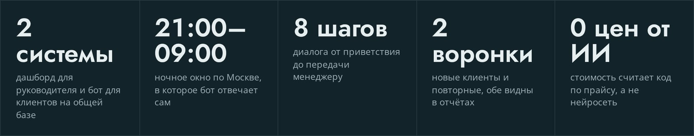

ИИ-администратор для фитнес-студии берёт на себя рутину стойки: отвечает клиентам в Telegram или WhatsApp, проверяет свободные места в расписании, записывает на занятие, напоминает о тренировке и за несколько дней до конца абонемента присылает ссылку на продление. Сложные случаи (скидки, жалобы, переносы с исключениями) он передаёт живому администратору готовой карточкой. Чтобы запустить такого бота, менять CRM не нужно: он подключается к таблице расписания или к системе, где студия уже ведёт клиентов.

Фитнес-студию я сам не автоматизировал, скажу это сразу. Но каждый кусок этой схемы у меня уже работает в других проектах: бот, который собирает заказ по шагам и не придумывает цены, продление подписки ссылкой в личку за 3 дня до конца, черновики ответов с кнопкой у человека. Ниже собираю из этих кусков администратора для студии и показываю, где он ломается.

## Какие задачи студии ИИ-администратор закрывает без человека?

Без человека бот закрывает всё, что повторяется по одним и тем же правилам: вопросы о расписании и ценах, запись и отмену по правилам студии, напоминания о занятии, напоминания об оплате. Решения, где нужно отступить от правил, остаются администратору.

Вот как я делю поток сообщений студии:

| Задача | Кто делает | Почему |
|---|---|---|
| «Во сколько завтра пилатес?», «Сколько стоит абонемент?» | бот | ответ есть в расписании и прайсе |
| Запись на занятие, где есть места | бот + код | место бронирует код, бот только понимает запрос |
| Отмена записи по правилам студии | бот + код | правило отмены прописано заранее |
| Напоминание о занятии | бот по расписанию | обычная проверка раз в час или раз в день |
| Напоминание о конце абонемента и ссылка на оплату | бот по расписанию | дата окончания лежит в базе |
| Скидка, заморозка, перенос по болезни | администратор по черновику бота | это исключение, решает человек |
| Жалоба на тренера или на зал | администратор | тон и последствия важнее скорости |

Главная выгода появляется вечером и в выходные. В кейсе [Orient](/orient/) (бюро переводов, кейс на 18.10.2026) менеджеры работают с 9 до 21, а с 21:00 до 09:00 бот отвечает сам: собирает заказ, называет точную цену и утром отдаёт менеджеру готовую сделку. Раньше ночной клиент ждал ответа до утра и к утру уже договаривался с другим бюро. У студии то же самое: человек решает записаться на утреннюю тренировку в 23:00, и ответ нужен ему сейчас.

## Как устроена схема: расписание, Telegram и нейросеть?

Схема собирается из пяти частей: мессенджер, где пишет клиент, нейросеть, которая понимает свободный текст, код с правилами студии, база с расписанием и абонементами и рабочий чат администратора. Нейросеть здесь отвечает только за разговор. Места, деньги и даты считает код.

<!-- img: type=scheme what="клиент пишет в Telegram или WhatsApp → нейросеть понимает запрос (занятие, дата, время) → код проверяет свободные места и правила студии → запись в таблицу расписания или CRM → подтверждение клиенту; отдельная стрелка: спорный случай → карточка администратору с кнопками «Отправить» и «Исправить»" caption="Схема ИИ-администратора студии: нейросеть ведёт разговор, а места и деньги считает код по таблице." alt="схема ИИ-администратора для фитнес-студии: запись на занятия через чат-бот и нейросеть" -->

<figure class="scheme">
<svg width="100%" xmlns="http://www.w3.org/2000/svg" viewBox="0 0 1200 640" role="img" aria-label="Схема ИИ-администратора студии: клиент пишет в мессенджер, нейросеть понимает запрос, код проверяет места и правила, запись попадает в таблицу, клиент получает подтверждение, а спорный случай уходит администратору">
<title>Схема ИИ-администратора студии: нейросеть ведёт разговор, а места и деньги считает код по таблице</title>
<defs>
<marker id="arr" viewBox="0 0 10 10" refX="9" refY="5" markerWidth="8" markerHeight="8" orient="auto-start-reverse">
<path d="M0 0 L10 5 L0 10 z" fill="var(--line)"/>
</marker>
<marker id="arrA" viewBox="0 0 10 10" refX="9" refY="5" markerWidth="8" markerHeight="8" orient="auto-start-reverse">
<path d="M0 0 L10 5 L0 10 z" fill="var(--accent)"/>
</marker>
</defs>

<!-- Строка 1: главный путь -->
<rect x="40" y="60" width="320" height="150" rx="10" fill="var(--surface)" stroke="var(--line)" stroke-width="2"/>
<circle cx="76" cy="96" r="18" fill="none" stroke="var(--accent)" stroke-width="2.5"/>
<text x="76" y="103" text-anchor="middle" font-family="var(--font-display)" font-weight="600" font-size="20" fill="var(--accent)">1</text>
<text x="108" y="104" font-family="var(--font-display)" font-weight="600" font-size="26" fill="var(--fg)">Клиент пишет</text>
<text x="64" y="144" font-family="var(--font-body)" font-size="19" fill="var(--muted)">Telegram или WhatsApp,</text>
<text x="64" y="170" font-family="var(--font-body)" font-size="19" fill="var(--muted)">обычным текстом:</text>
<text x="64" y="196" font-family="var(--font-body)" font-size="19" fill="var(--muted)">«Есть место на йогу?»</text>

<rect x="440" y="60" width="320" height="150" rx="10" fill="var(--surface)" stroke="var(--line)" stroke-width="2"/>
<circle cx="476" cy="96" r="18" fill="none" stroke="var(--accent)" stroke-width="2.5"/>
<text x="476" y="103" text-anchor="middle" font-family="var(--font-display)" font-weight="600" font-size="20" fill="var(--accent)">2</text>
<text x="508" y="104" font-family="var(--font-display)" font-weight="600" font-size="26" fill="var(--fg)">Нейросеть</text>
<text x="464" y="144" font-family="var(--font-body)" font-size="19" fill="var(--muted)">Понимает запрос:</text>
<text x="464" y="170" font-family="var(--font-body)" font-size="19" fill="var(--muted)">занятие, дата, время.</text>
<text x="464" y="196" font-family="var(--font-body)" font-size="19" fill="var(--muted)">Только разговор</text>

<rect x="840" y="60" width="320" height="150" rx="10" fill="var(--surface)" stroke="var(--line)" stroke-width="2"/>
<circle cx="876" cy="96" r="18" fill="none" stroke="var(--accent)" stroke-width="2.5"/>
<text x="876" y="103" text-anchor="middle" font-family="var(--font-display)" font-weight="600" font-size="20" fill="var(--accent)">3</text>
<text x="908" y="104" font-family="var(--font-display)" font-weight="600" font-size="26" fill="var(--fg)">Код студии</text>
<text x="864" y="144" font-family="var(--font-body)" font-size="19" fill="var(--muted)">Проверяет свободные</text>
<text x="864" y="170" font-family="var(--font-body)" font-size="19" fill="var(--muted)">места и правила.</text>
<text x="864" y="196" font-family="var(--font-body)" font-size="19" fill="var(--muted)">Места и деньги — тут</text>

<line x1="360" y1="135" x2="436" y2="135" stroke="var(--accent)" stroke-width="3" marker-end="url(#arrA)"/>
<line x1="760" y1="135" x2="836" y2="135" stroke="var(--accent)" stroke-width="3" marker-end="url(#arrA)"/>

<!-- Строка 2: запись и подтверждение (справа налево) -->
<rect x="840" y="290" width="320" height="130" rx="10" fill="var(--surface)" stroke="var(--line)" stroke-width="2"/>
<circle cx="876" cy="326" r="18" fill="none" stroke="var(--accent)" stroke-width="2.5"/>
<text x="876" y="333" text-anchor="middle" font-family="var(--font-display)" font-weight="600" font-size="20" fill="var(--accent)">4</text>
<text x="908" y="334" font-family="var(--font-display)" font-weight="600" font-size="26" fill="var(--fg)">Таблица</text>
<text x="864" y="374" font-family="var(--font-body)" font-size="19" fill="var(--muted)">Запись в расписание</text>
<text x="864" y="400" font-family="var(--font-body)" font-size="19" fill="var(--muted)">или в CRM</text>

<rect x="440" y="290" width="320" height="130" rx="10" fill="var(--surface)" stroke="var(--line)" stroke-width="2"/>
<circle cx="476" cy="326" r="18" fill="none" stroke="var(--accent)" stroke-width="2.5"/>
<text x="476" y="333" text-anchor="middle" font-family="var(--font-display)" font-weight="600" font-size="20" fill="var(--accent)">5</text>
<text x="508" y="334" font-family="var(--font-display)" font-weight="600" font-size="26" fill="var(--fg)">Подтверждение</text>
<text x="464" y="374" font-family="var(--font-body)" font-size="19" fill="var(--muted)">Клиент получает ответ:</text>
<text x="464" y="400" font-family="var(--font-body)" font-size="19" fill="var(--muted)">«Записала на 8:00»</text>

<!-- 3 -> 4 -->
<line x1="1000" y1="210" x2="1000" y2="286" stroke="var(--accent)" stroke-width="3" marker-end="url(#arrA)"/>
<!-- 4 -> 5 -->
<line x1="840" y1="355" x2="764" y2="355" stroke="var(--accent)" stroke-width="3" marker-end="url(#arrA)"/>

<!-- Спорный случай -->
<rect x="40" y="290" width="320" height="130" rx="10" fill="var(--surface)" stroke="var(--line)" stroke-width="2" stroke-dasharray="8 6"/>
<text x="64" y="334" font-family="var(--font-display)" font-weight="600" font-size="24" fill="var(--fg)">Спорный случай</text>
<text x="64" y="374" font-family="var(--font-body)" font-size="19" fill="var(--muted)">Возврат, исключение,</text>
<text x="64" y="400" font-family="var(--font-body)" font-size="19" fill="var(--muted)">жалоба, неясный запрос</text>

<path d="M900 210 L900 250 L200 250 L200 286" fill="none" stroke="var(--line)" stroke-width="2.5" stroke-dasharray="8 6" marker-end="url(#arr)"/>
<text x="560" y="240" text-anchor="middle" font-family="var(--font-body)" font-size="18" fill="var(--muted)">код не уверен — не отвечает сам</text>

<!-- Карточка администратору -->
<rect x="40" y="480" width="560" height="130" rx="10" fill="var(--surface)" stroke="var(--accent)" stroke-width="2.5"/>
<text x="64" y="522" font-family="var(--font-display)" font-weight="600" font-size="26" fill="var(--fg)">Карточка администратору</text>
<text x="64" y="558" font-family="var(--font-body)" font-size="19" fill="var(--muted)">В рабочем чате: что спросил клиент и какой</text>
<text x="64" y="584" font-family="var(--font-body)" font-size="19" fill="var(--muted)">ответ предложен. Кнопки «Отправить» и «Исправить»</text>

<line x1="200" y1="420" x2="200" y2="476" stroke="var(--accent)" stroke-width="3" marker-end="url(#arrA)"/>

<!-- Возврат к клиенту -->
<path d="M600 545 L660 545 L660 450 L600 450 L600 424" fill="none" stroke="var(--line)" stroke-width="2.5" marker-end="url(#arr)"/>
<text x="680" y="500" font-family="var(--font-body)" font-size="18" fill="var(--muted)">ответ человека уходит клиенту</text>
</svg>
<figcaption>Схема ИИ-администратора студии: нейросеть ведёт разговор, а места и деньги считает код по таблице.</figcaption>
</figure>

Как это работает по шагам:

1. **Мессенджер.** Клиент пишет в Telegram или WhatsApp. В Orient оба канала подключены через сервис Wazzup и прямого Telegram-бота.
2. **Нейросеть.** Языковая модель (программа, которая понимает и пишет текст) достаёт из сообщения суть: какое занятие, какой день, какое время, кто пишет. Фраза «можно завтра вечером на растяжку?» превращается в аккуратный запрос.
3. **Код с правилами.** Обычная программа сверяет запрос с расписанием: есть ли такое занятие, остались ли места, действует ли абонемент. Это обычный код, он не ошибается творчески.
4. **База.** Таблица, CRM или журнал записей, где у студии уже лежат клиенты, группы и абонементы. Бот читает её и пишет туда бронь.
5. **Администратор.** Всё, что не прошло правила, приходит в рабочий чат карточкой: что спросил клиент, что предлагает бот, кнопки.

Ответы на вопросы о студии (правила отмены, что взять на первое занятие, как добраться) бот берёт из базы знаний, то есть из набора документов студии. В кейсе [JE 3.0](/je30/) поиск по такой базе гибридный: по смыслу и по словам, свежий проверенный материал выигрывает у старого. Ответ приходит в Telegram примерно за полминуты, и рядом указан источник, по кейсу на 18.10.2026. Для студии это значит, что бот отвечает по правилам, которые утвердила студия, а не по тому, что модель «помнит» про фитнес вообще.

## Как ИИ проверяет слоты и записывает на занятие без накладок?

Накладок не будет, если бронь ставит код, а нейросеть в этом не участвует. Модель понимает, куда хочет клиент, код за одно действие проверяет остаток мест и записывает. Двух людей на последнее место такая связка не пустит.

Этот принцип я проверил на деньгах. В Orient главное решение проекта такое: нейросеть ведёт разговор, но цену не считает. Диалог идёт по состояниям, и на каждом шаге код знает, чего ещё не хватает. Что заказывает клиент, модель вытаскивает из реплик клиента, а сумму считает функция по таблице цен. В промпт (задание для нейросети) попадает готовое число, и называть другое боту запрещено. В кейсе на 18.10.2026 так и записано: в Orient ноль цен от ИИ: стоимость всегда считает код.

Для записи в студию я бы сделал так:

1. Опиши занятия в таблице: название, тренер, день, время, вместимость зала, сколько уже записано.
2. Дай боту два инструмента, то есть две команды, которые нейросеть может вызвать: «найти занятия» и «записать клиента». Агент в этой схеме и есть нейросеть с такими инструментами.
3. «Найти занятия» возвращает только то, где есть места. Модель не видит полные группы и не может их предложить.
4. «Записать клиента» перед записью ещё раз проверяет остаток. Мест нет, значит, отказ и следующий ближайший вариант.
5. Бот отвечает клиенту, только когда команда вернула «записан». До этого никаких «вы записаны».
6. Каждая бронь и отказ пишутся в журнал. В Orient журнал действий бота окупился в первую же неделю: без него спорные случаи не разобрать.

Ещё одно правило из Orient, которое переносится на студию напрямую: бот уступает место человеку. Если сделку уже взял менеджер, бот молча перестаёт отвечать, чтобы не спорить с живым сотрудником. В студии это значит: администратор вошёл в диалог, бот замолчал.

<!-- img: type=screenshot url=https://petrsolovarov.ru/orient/ selector=".figures" caption="Цифры кейса Orient: ночное окно, 8 шагов диалога и ноль цен от ИИ. Тот же подход годится для записи на занятия." alt="ИИ-бот записи клиентов: цифры кейса Orient на petrsolovarov.ru" -->

## Как автоматизировать продление абонементов и напоминания об оплате?

Продление автоматизируется проверкой по расписанию: раз в день бот смотрит в базе, у кого абонемент кончается через несколько дней, и пишет клиенту в личку с его персональной ссылкой на оплату. Оплата прошла, и бот сам продлевает срок. Не оплатил, бот напоминает ещё раз и потом передаёт клиента администратору.

Так у меня с 01.11.2026 продлевается клуб ii.systema. По README продюсер-бота на 15.11.2026 цепочка такая:

1. В 10:00 бот проверяет даты. За 3 дня до конца оплаченного периода участник получает в личку свою ссылку на продление.
2. Личка у человека закрыта, тогда карточка приходит мне, и я пишу ему сам.
3. Платёжный сервис присылает боту уведомление об оплате. Бот добавляет участнику 30 дней, мне приходит карточка «💳».
4. Не продлил через 3 дня после конца, бот выводит участника из группы и пишет об этом нам обоим.

С 02.11.2026 к этому добавилось автосписание: подписка в Продамусе сама списывает деньги раз в 30 дней, при неудаче пробует ещё 10 раз через каждые 8 часов (запись в «Журнале изменений» от 02.11.2026). Пока автосписание действует, бот не шлёт ссылку на продление, чтобы человек не заплатил дважды. Важная оговорка: подписки в Продамусе принимают только карты РФ.

Что из этого берёт студия:

- **Источник даты.** Дата окончания абонемента должна лежать в базе, а не в голове администратора. Если её там нет, это первое, что нужно навести.
- **Личная ссылка.** У каждого клиента своя ссылка на оплату, по ней платёжный сервис понимает, чей абонемент продлевать.
- **Уведомление об оплате.** Платёжный сервис стучится на адрес бота (это и есть вебхук: адрес, куда сервис сам присылает событие). Без него бот не узнает, что человек заплатил.
- **Напоминание о занятии.** Та же проверка по расписанию, только по записям: накануне вечером или за пару часов до тренировки. Клиент отвечает «не приду», и код освобождает место для следующего.

## Где граница: когда ИИ обязан передать диалог человеку?

Человеку уходит всё, где есть деньги сверх прайса, исключения из правил, жалобы и вопросы, на которые нет ответа в базе знаний. В этих случаях бот не отвечает клиенту сам, а готовит черновик и присылает администратору карточку с кнопками.

Это первое правило всех моих проектов с клиентской перепиской: бот сам клиентам не пишет то, что может стоить денег или отношений. В кейсе [JE 3.0](/je30/) сообщение уходит клиенту только после кнопки «Отправил» у менеджера. В статье про [разбор обращений через ИИ](/blog/razbor-obrascheniy-klientov-ii-chernoviki/) я разбирал схему подробно: под черновиком кнопки «Отправить», «Исправить» и «Пропустить», а внимательно читать нужно только черновики с пометкой «Сомневаюсь» и темы про деньги, договоры и жалобы.

Для студии я бы прописал такой список передачи:

- просьба о скидке, заморозке или возврате;
- перенос сверх правил отмены («заболел, верните занятие»);
- жалоба на тренера, зал, раздевалку;
- вопрос, ответа на который нет в документах студии;
- клиент злится или пишет третий раз подряд одно и то же;
- просьба позвать человека.

С базой знаний тоже нужна защита. В JE 3.0 новый документ можно загрузить в чат или в панель, бот находит затронутые карточки и предлагает замены, но изменение вступает в силу только после кнопки «Согласен» у администратора. Для студии это спасает от простой беды: кто-то загрузил старый прайс, и бот неделю называет неправильные цены.

## Проверил на себе: как работают подтверждения и продления в моих ботах

Фитнес-клиента у меня пока не было, поэтому опираюсь на три своих системы, где каждый кусок этой схемы уже работает: продление клуба, бот приёма заявок Orient и черновики ответов в JE 3.0 и в моём боте «Мозг».

<!-- img: type=telegram chat=producer topic="🏛 Клуб" find="карточка об оплате или продлении участника клуба" caption="Тема «🏛 Клуб» в группе продюсера: сюда приходят карточки об оплате и продлении, напоминания участникам бот шлёт сам." alt="ИИ бот продление абонемента: карточка оплаты в Telegram" -->

**Продление клуба.** Работает с 01.11.2026. От меня тут остаётся одна задача: написать человеку, если у него закрыта личка. Напоминание, ссылка, проверка оплаты, плюс 30 дней и выход из группы для тех, кто не продлил, идут без меня. Сломалось здесь вот что: в Продамусе все четыре адреса для уведомлений уже были заняты другими проектами. Пришлось настроить сервер так, чтобы он отдавал боту клуба копию каждого уведомления об оплате, а остальные проекты получали их как раньше. Вывод для студии: заранее проверь, куда твой платёжный сервис шлёт уведомления и не занят ли этот адрес.

**Orient.** Бот ведёт клиента по 8 шагам, от приветствия до передачи менеджеру, по кейсу на 18.10.2026. Пара правил оттуда, которые я бы забрал в студию. Контакты бот просит только после того, как клиент согласился с ценой, иначе диалог похож на анкету. Повторного клиента бот узнаёт по телефону в CRM и не спрашивает имя второй раз. Прайс и синонимы названий лежат в панели, а не в коде, потому что меняются чаще всего. Что честно не измерено: сколько ночных заявок бот довёл до оплаты. Эти цифры принадлежат заказчику, и без его согласия я их не называю.

**Черновики с кнопкой.** В боте «Мозг» на вопрос клиента в группе проекта ИИ готовит два текста: ответ мне (что на самом деле, со ссылкой на файл) и черновик клиенту. Под черновиком «Отправить в группу», и только второе нажатие «Да, отправить» отправляет его. Поправить можно словами: «короче», «добавь, что…». Для администратора студии это та же экономия: он не набирает ответ с нуля, он проверяет и жмёт.

Отдельно про первый бот Orient. Его я собирал на жёстких ветках с кнопками, и первый же живой клиент написал нестандартный запрос сразу про два языка, да ещё и с архивом. Бот запрос не понял, зациклился и стал спамить одним и тем же вопросом. Отсюда правило, которое я теперь ставлю всегда: свободный текст понимает нейросеть, а шаги и деньги держит код.

## Сколько стоит разработка и поддержка ИИ-администратора для студии?

Содержание складывается из трёх строк: сервер, нейросеть и платёжный сервис. Разработка зависит от того, где сейчас лежат расписание и абонементы и сколько у студии каналов. Цены на настройку под ключ и сопровождение стоят в блоке под статьёй.

Что я знаю по своим проектам:

| Статья расходов | Цифра | Откуда |
|---|---|---|
| Сервер под ботов | от 500 ₽ в месяц | мой стек, статья про [задачи голосом](/blog/zadachi-ii-golosom-telegram/), 01.11.2026 |
| Сервер клиентского проекта с базой знаний | около $12 в месяц | JE 3.0, договорённость с заказчиком 02.11.2026 |
| Ответ базы знаний на один вопрос | около 2 центов | кейс [JE 3.0](/je30/), 18.10.2026 |
| Расшифровка голосовых | бесплатно на своём сервере | Whisper, статья про задачи голосом |
| Подписка с автосписанием в Продамусе | подключение 2 000 ₽, +1% к каждому списанию | «Журнал изменений», 02.11.2026 |

Как удешевить, не потеряв в качестве. В JE 3.0 я перевёл часть запросов с дорогой модели Gemini Pro на модели семейства Flash, когда посчитал расходы за месяц. Простые вопросы о расписании спокойно отвечает быстрая и дешёвая модель, сильную оставляй для разбора жалоб и сложных черновиков.

Чего в смете нет: стоимости CRM или программы записи, если студия ими уже пользуется. Бот подключается к ним, а не заменяет их.

## Как внедрить и проверить ИИ-администратора за 7 дней на одной группе?

Начинай с одной группы и одного канала, например с вечернего пилатеса и Telegram. За неделю ты проверишь запись, напоминания и передачу человеку на живых клиентах, а ошибки останутся маленькими.

Пошаговый план:

1. **День 1. Наведи порядок в таблице.** Одна таблица: занятия, вместимость, записи, клиенты, дата конца абонемента. Если этого нет, остальное подождёт.
2. **День 2. Собери базу знаний.** Правила отмены, прайс, адрес, что взять с собой, ответы на 20 частых вопросов. Каждый документ утверждает администратор.
3. **День 3. Подключи инструменты.** «Найти занятия», «записать», «отменить». Проверь руками: попробуй записать двух человек на последнее место.
4. **День 4. Пропиши границу.** Список тем, которые уходят человеку, и карточка для администратора с кнопками «Отправить» и «Исправить».
5. **День 5. Напоминания.** Напоминание о занятии накануне и о конце абонемента за 3 дня, со ссылкой на оплату. Проверь на себе: заплати тестовую сумму и посмотри, продлился ли срок.
6. **День 6. Запасной путь.** Сообщение клиента пишется в базу до запроса к нейросети. Таймаут модели держи на 10–15 секундах, а если нейросеть не ответила, клиент получает честное «приняли, администратор ответит».
7. **День 7. Разбор журнала.** Прочитай все диалоги недели. Где бот переспрашивал лишний раз, где отдал человеку то, что мог решить сам, где ошибся. Поправь правила и только потом подключай остальные группы.

## Что ломается чаще всего?

Ломается почти всегда на стыках, а не в нейросети. Вот пять мест, которые я бы проверил первыми:

- **Расписание в двух местах.** Администратор правит бумажный журнал, бот смотрит в таблицу. Через день они расходятся. Источник правды должен быть один.
- **Бот обещает до записи.** Модель пишет «вы записаны», а код ещё не ответил или отказал. Лечится правилом: подтверждение только по ответу команды.
- **Старый прайс в базе знаний.** Без кнопки «Согласен» у администратора любая загрузка документа меняет ответы бота сразу.
- **Уведомление об оплате не доходит.** Адрес занят, подпись не сошлась, и бот не знает, что клиент заплатил. В итоге человек получает напоминание после оплаты и злится.
- **Бот спорит с администратором.** Оба отвечают в одном диалоге. Нужна отметка «диалог у человека», после которой бот молчит.

Вся моя система ботов, баз и проверок собрана в [кейсе ii.systema](/iisystema/), там видно, как эти куски живут вместе.

Если хочешь отдать рутину стойки боту и настроить его под своё расписание, напиши мне в личку слово «система»: https://t.me/solovarov. Разберём, как сейчас идут запись и продление, и посмотрим, какие задачи администратора можно спокойно передать нейросети.
