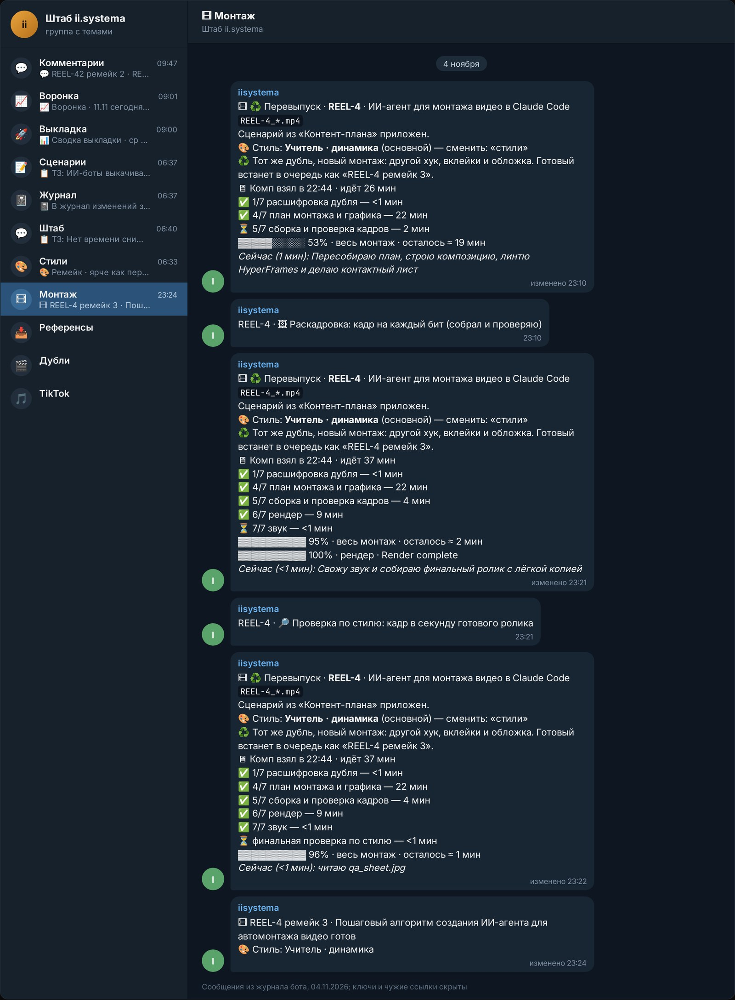

10 ноября 2026 года Adobe встроила ИИ-агента в Premiere и ещё четыре свои программы: пишешь задачу словами, и помощник выполняет её в несколько шагов прямо в проекте. Photoshop получил отдельный режим правки с ИИ, а внешние нейросети вроде Claude и ChatGPT смогут управлять программами Adobe с начала 2027 года. Нейросеть монтирует видео автоматически уже сейчас, но агент Adobe рассчитан на человека за таймлайном, а для потока роликов без монтажёра нужна другая схема.

Ниже разбираю, что именно показали, чем помощник в программе отличается от моего автомонтажа и кому что брать.

## Что изменилось в Photoshop и Premiere с приходом ИИ-агентов?

В Premiere, Illustrator, InDesign, After Effects и Frame.io появился AI Assistant (beta). Это часть Adobe Creative Agent: ты описываешь, что нужно, и он выполняет сложную задачу в несколько шагов в контексте твоего проекта. Так это сформулировано в [блоге Adobe от 10 ноября 2026](https://blog.adobe.com/en/publish/2026/11/10/explore-new-ways-create-across-creative-cloud-adobe-firefly-while-advancing-craft-precision-choice-control).

Photoshop в этом списке нет. Для него показали AI Assisted Editor, упрощённый режим правки с ИИ, плюс Relight (пересвет кадра) и Generative Restyle (смена стиля по текстовому запросу с ползунком).

Для Premiere вышли отдельные функции, без агента:

- **Color Mode** для цветокоррекции, уже для всех.
- **Генерация на таймлайн**: видео, звуки, фоновая атмосфера и музыка. Можно закрыть дыру, где не хватает перебивки. Модели на выбор: Firefly, Google, Kling, Runway, Luma.
- **Очистка звука**: улучшение голоса и разделение речи двух людей.
- **Generative Remove (beta)**: выделяешь объект, программа ведёт его по кадрам и удаляет.

По данным [TechCrunch](https://techcrunch.com/2026/11/10/adobe-adds-more-ai-to-its-products-and-launches-an-mcp/), Adobe ещё делает агента «всегда включённым», чтобы он лучше понимал контекст работы.

## Как работает монтаж по текстовой задаче внутри Premiere Pro?

Ты пишешь помощнику задачу, он делает её шагами внутри открытого проекта, а ты смотришь и правишь. Конкретных примеров для Premiere в анонсе 10 ноября нет. Про вырезку неудачных дублей, пауз и автоматические субтитры Adobe не пишет ни слова.

Поэтому честно: насколько хорошо агент нарежет разговорный дубль, пока неизвестно. Я бы ждал проверок на живых роликах, прежде чем перестраивать под него работу.

Вторая новость интереснее для автоматизации. Adobe готовит MCP. Это способ подключить внешнего ИИ-агента к программе, чтобы он нажимал её функции сам. Через него ChatGPT, Claude или Gemini смогут вызывать Photoshop, Illustrator, Premiere и After Effects. Работа идёт в твоих родных файлах проекта, слои и последовательности остаются редактируемыми. Срок, по словам Adobe, начало 2027 года.

<!-- img: type=screenshot url=https://blog.adobe.com/en/publish/2026/11/10/explore-new-ways-create-across-creative-cloud-adobe-firefly-while-advancing-craft-precision-choice-control caption="Анонс Adobe от 10 ноября 2026: AI Assistant (beta) в Premiere и других программах Creative Cloud." alt="ИИ-агенты Adobe Premiere: анонс AI Assistant на MAX 2026" -->

## Чем агент внутри программы отличается от серверного контент-конвейера?

Агент Adobe ускоряет того, кто сам сидит в Premiere. Конвейер работает без человека: дубль уходит в чат, обратно приходит готовый ролик. Разница в том, кто держит мышку.

| | Агент в Premiere | Автомонтаж конвейером |
|---|---|---|
| Кто запускает | монтажёр в программе | бот по приходу дубля |
| Где работает | открытый проект на компьютере | очередь задач, компьютер без присмотра |
| Что на выходе | правки в проекте | готовый ролик и обложки |
| Статус | бета с 10.11.2026 | у меня работает с октября 2026 |

Похожие инструменты я уже разбирал в роликах. 6 октября 2026 года это был Tesseract: расширение режет сырой файл, убирает паузы и ставит субтитры по запросу прямо в ChatGPT ([карточка в Notion](https://app.notion.com/p/Tesseract-ChatGPT-3efdfdb14822814aab81f81565160873)). 29 октября разбирал связку Claude и DaVinci Resolve через MCP. Там подвох: внешние скрипты работают только в платной DaVinci Resolve Studio ([инструкция](https://app.notion.com/p/DaVinci-Resolve-Claude-MCP-408dfdb1482281da8075ed27ed32b8ee)). 5 ноября смотрел MoneyPrinterTurbo, он собирает вертикальный ролик из одной строчки темы и набрал +617 звёзд на GitHub за сутки ([карточка](https://app.notion.com/p/MoneyPrinterTurbo-40fdfdb1482281bf8ed6df8ba7963c6c)).

<!-- img: type=scheme what="две дорожки рядом. Сверху «Агент в программе»: человек → Premiere → задача словами → агент правит проект → человек проверяет и выгружает. Снизу «Конвейер»: дубль в Telegram → бот → автомонтаж на компьютере → готовый ролик в чат → выкладка по расписанию" caption="Агент в Premiere помогает монтажёру, конвейер монтирует без него: дубль на входе, ролик на выходе." alt="автоматизация монтажа видео нейросетью: агент в программе и конвейер" -->

<figure class="scheme">
<svg width="100%" xmlns="http://www.w3.org/2000/svg" viewBox="0 0 1200 430" role="img" aria-label="Две дорожки: агент в Premiere помогает монтажёру правкой проекта по задаче словами, конвейер превращает дубль из Telegram в готовый ролик и выкладывает его по расписанию">
<title>Агент в программе и серверный конвейер: две дорожки</title>
<defs>
<marker id="arL" viewBox="0 0 10 10" refX="8" refY="5" markerWidth="9" markerHeight="9" orient="auto"><path d="M1 1 L9 5 L1 9 Z" fill="var(--line)" stroke="var(--line)" stroke-linejoin="round"/></marker>
<marker id="arA" viewBox="0 0 10 10" refX="8" refY="5" markerWidth="9" markerHeight="9" orient="auto"><path d="M1 1 L9 5 L1 9 Z" fill="var(--accent)" stroke="var(--accent)" stroke-linejoin="round"/></marker>
</defs>

<text x="30" y="42" font-family="var(--font-display)" font-weight="600" font-size="26" fill="var(--fg)">Агент в программе</text>
<text x="1170" y="42" text-anchor="end" font-family="var(--font-body)" font-size="18" fill="var(--muted)">помощник монтажёра</text>

<rect x="30" y="64" width="320" height="116" rx="10" fill="var(--surface)" stroke="var(--line)" stroke-width="2"/>
<circle cx="68" cy="122" r="19" fill="none" stroke="var(--accent)" stroke-width="2"/>
<text x="68" y="129" text-anchor="middle" font-family="var(--font-display)" font-weight="600" font-size="19" fill="var(--accent)">1</text>
<text x="100" y="112" font-family="var(--font-display)" font-weight="600" font-size="22" fill="var(--fg)">Задача словами</text>
<text x="100" y="140" font-family="var(--font-body)" font-size="18" fill="var(--muted)">в Premiere</text>
<text x="100" y="163" font-family="var(--font-body)" font-size="18" fill="var(--muted)">или Photoshop</text>

<rect x="440" y="64" width="320" height="116" rx="10" fill="var(--surface)" stroke="var(--line)" stroke-width="2"/>
<circle cx="478" cy="122" r="19" fill="none" stroke="var(--accent)" stroke-width="2"/>
<text x="478" y="129" text-anchor="middle" font-family="var(--font-display)" font-weight="600" font-size="19" fill="var(--accent)">2</text>
<text x="510" y="112" font-family="var(--font-display)" font-weight="600" font-size="22" fill="var(--fg)">Агент правит</text>
<text x="510" y="140" font-family="var(--font-body)" font-size="18" fill="var(--muted)">проект по задаче,</text>
<text x="510" y="163" font-family="var(--font-body)" font-size="18" fill="var(--muted)">правки внутри</text>

<rect x="850" y="64" width="320" height="116" rx="10" fill="var(--surface)" stroke="var(--line)" stroke-width="2"/>
<circle cx="888" cy="122" r="19" fill="none" stroke="var(--accent)" stroke-width="2"/>
<text x="888" y="129" text-anchor="middle" font-family="var(--font-display)" font-weight="600" font-size="19" fill="var(--accent)">3</text>
<text x="920" y="112" font-family="var(--font-display)" font-weight="600" font-size="22" fill="var(--fg)">Человек проверяет</text>
<text x="920" y="140" font-family="var(--font-body)" font-size="18" fill="var(--muted)">и сам выгружает</text>
<text x="920" y="163" font-family="var(--font-body)" font-size="18" fill="var(--muted)">готовое</text>

<line x1="358" y1="122" x2="432" y2="122" stroke="var(--line)" stroke-width="3" marker-end="url(#arL)"/>
<line x1="768" y1="122" x2="842" y2="122" stroke="var(--line)" stroke-width="3" marker-end="url(#arL)"/>

<line x1="30" y1="222" x2="1170" y2="222" stroke="var(--line)" stroke-width="1.5" stroke-dasharray="6 8"/>

<text x="30" y="270" font-family="var(--font-display)" font-weight="600" font-size="26" fill="var(--fg)">Конвейер</text>
<text x="1170" y="270" text-anchor="end" font-family="var(--font-body)" font-size="18" fill="var(--muted)">монтаж без человека</text>

<rect x="30" y="292" width="320" height="116" rx="10" fill="var(--surface)" stroke="var(--accent)" stroke-width="2"/>
<circle cx="68" cy="350" r="19" fill="none" stroke="var(--accent)" stroke-width="2"/>
<text x="68" y="357" text-anchor="middle" font-family="var(--font-display)" font-weight="600" font-size="19" fill="var(--accent)">1</text>
<text x="100" y="340" font-family="var(--font-display)" font-weight="600" font-size="22" fill="var(--fg)">Дубль в Telegram</text>
<text x="100" y="368" font-family="var(--font-body)" font-size="18" fill="var(--muted)">снял на телефон</text>
<text x="100" y="391" font-family="var(--font-body)" font-size="18" fill="var(--muted)">и отправил боту</text>

<rect x="440" y="292" width="320" height="116" rx="10" fill="var(--surface)" stroke="var(--accent)" stroke-width="2"/>
<circle cx="478" cy="350" r="19" fill="none" stroke="var(--accent)" stroke-width="2"/>
<text x="478" y="357" text-anchor="middle" font-family="var(--font-display)" font-weight="600" font-size="19" fill="var(--accent)">2</text>
<text x="510" y="340" font-family="var(--font-display)" font-weight="600" font-size="22" fill="var(--fg)">Автомонтаж</text>
<text x="510" y="368" font-family="var(--font-body)" font-size="18" fill="var(--muted)">на компьютере,</text>
<text x="510" y="391" font-family="var(--font-body)" font-size="18" fill="var(--muted)">без присмотра</text>

<rect x="850" y="292" width="320" height="116" rx="10" fill="var(--surface)" stroke="var(--accent)" stroke-width="2"/>
<circle cx="888" cy="350" r="19" fill="none" stroke="var(--accent)" stroke-width="2"/>
<text x="888" y="357" text-anchor="middle" font-family="var(--font-display)" font-weight="600" font-size="19" fill="var(--accent)">3</text>
<text x="920" y="340" font-family="var(--font-display)" font-weight="600" font-size="22" fill="var(--fg)">Готовый ролик</text>
<text x="920" y="368" font-family="var(--font-body)" font-size="18" fill="var(--muted)">приходит в чат,</text>
<text x="920" y="391" font-family="var(--font-body)" font-size="18" fill="var(--muted)">выходит по слоту</text>

<line x1="358" y1="350" x2="432" y2="350" stroke="var(--accent)" stroke-width="3" marker-end="url(#arA)"/>
<line x1="768" y1="350" x2="842" y2="350" stroke="var(--accent)" stroke-width="3" marker-end="url(#arA)"/>
</svg>
<figcaption>Агент в Premiere помогает монтажёру, конвейер монтирует без него: дубль на входе, ролик на выходе.</figcaption>
</figure>

## Сколько стоит такое решение по сравнению с работой живого монтажёра?

Цены на агентов Adobe в анонсе нет. В апреле 2026 года Adobe говорила [VentureBeat](https://venturebeat.com/technology/adobes-new-firefly-ai-assistant-wants-to-run-photoshop-premiere-illustrator-and-more-from-one-prompt), что для помощника нужна подписка с нужными программами, а генеративные действия тратят кредиты. И добавила, что условия могут поменяться.

Для сравнения с монтажёром у меня есть только чужая цифра. В референсе, который я разбирал 29 октября 2026 года, автор платил за монтаж одного ролика 3000 рублей и ждал день, а после автомонтажа через Claude получал ролик за 10 минут ([карточка](https://app.notion.com/p/Claude-DaVinci-408dfdb1482281d9961acab7b4c6f53a)). Свою смету конвейера я расписал в статье [сколько стоит ИИ-конвейер роликов](/blog/skolko-stoit-ii-konveyer-rolikov/).

## Проверил на себе: как я настроил связку со сценариями и где споткнулся алгоритм?

У меня автомонтаж работает с 1 октября 2026 года. Под дублем в Telegram кнопка «Смонтировать», бот берёт сценарий ролика из Notion и ставит задачу на мой компьютер. Там Claude Code собирает ролик по правилам стиля, а готовая копия приходит обратно в чат. Задачи идут по одной, на каждую лимит 2 часа ([журнал от 01.10.2026](https://app.notion.com/p/Telegram-Claude-Code-3ecdfdb1482281108dc4c35381092ae6)).

Что делает связка: распознаёт речь, режет паузы, рисует вставки по колонке «Вклейка» из сценария, кладёт субтитры, делает две обложки. Из 108 секунд сырого дубля REEL-6 вышло 82 секунды ролика ([кейс](/iisystema/)).

<!-- img: type=telegram chat=shtab topic="🎞 Монтаж" find="живой статус монтажа с шагами, процентами и «осталось ≈»" caption="Статус автомонтажа в Telegram: шаги, проценты и сколько осталось, человек в это время не нужен." alt="автомонтаж рилс нейросетью: статус монтажа в Telegram" -->

Где споткнулось:

1. **Лимит подписки.** Первый монтаж встал на шаге 4 из 7. Теперь система ждёт сброса и продолжает с того же места.
2. **Вырезка фигуры на процессоре** шла больше 35 минут на дубль. На видеокарте стало около 2,5 минуты на минуту дубля.
3. **Сон компьютера** 10 октября оборвал монтаж восьми роликов. Помогли автоповторы.

Полный список поломок есть в статье [про медиа-конвейер](/blog/media-konveyer-na-ii/). С 29 октября тот же раннер монтирует дубли и в проекте «Снимай»: агент @snimai_agent отдаёт ему чужие дубли в стиле «Учитель · динамика» ([Notion](https://app.notion.com/p/408dfdb14822810097b7d967df060986)).

## Какие задачи по видео пока нельзя отдавать нейросетям?

Постановочные ролики с актёрами, сложную графику и тонкий звук пока держи за человеком. Плюс любое решение «выкладывать или нет».

- **Проверка до выкладки.** Мой монтаж собирает раскадровку, и я смотрю её глазами.
- **Звук.** У меня эффекты тонули под тихим голосом, пришлось замерить громкость и закрепить правило.
- **Новые факты.** Нейросеть монтирует то, что ты сказал. Цифры в ролике проверяешь сам.

## Как встроить ИИ-монтаж в рабочий процесс эксперта или компании?

Сначала реши, кто монтирует. Есть монтажёр в Premiere: дай ему агента, когда выйдет бета, и меряй время на ролик. Монтажёра нет и роликов надо много: собирай конвейер.

1. Запиши правила стиля на одну страницу: темп, субтитры, вставки, финальная плашка.
2. Сделай сценарий с колонкой «что показать на экране», монтажу так проще.
3. Запусти автомонтаж на 5 роликах и сравни с ручным.
4. Только потом подключай выкладку по расписанию.

Инструкции к моим роликам про монтаж лежат на странице [Материалы](https://video.petrsolovarov.ru/materials).

Если хочешь понять, какую часть роликов отдать ИИ уже сейчас, напиши слово «система» мне в Telegram: https://t.me/solovarov. Посмотрим твою съёмку и площадки и решим, что брать: помощника в программе или конвейер.
