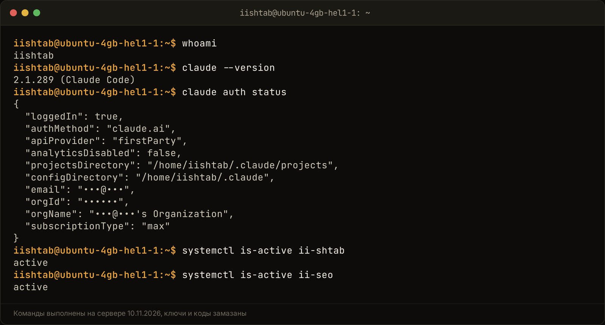

ИИ-сотрудник для бизнеса настраивается так: один агент выполняет один понятный шаг по короткому регламенту, кладёт результат в базу и отчитывается человеку. Команда из нескольких агентов начинает путаться и жечь токены, когда агенты общаются друг с другом напрямую, без жёсткого порядка и без координатора. Поэтому в малом бизнесе я ставлю последовательный конвейер: регламент до 150–200 строк, изоляцию ролей и проверку результата человеком на каждом важном шаге.

Ниже разбираю, откуда берётся хаос в мультиагентной системе, почему агент «врёт» через 20 минут работы, как устроен конвейер в моём проекте ii.systema и как я проверяю ночную работу агентов за минуту. В конце план из трёх шагов, по которому можно запустить первого надёжного ИИ-сотрудника.

## Почему команда ИИ-сотрудников начинает болтать вместо работы?

Потому что агентам дали общий чат и свободу говорить друг с другом, а результат никто не требует в конкретной форме. Агент, который может написать «работаю над этим», пишет это. Каждое такое сообщение читают все остальные, и токены уходят на переписку.

Свежий пример. Elliot Brenya sarfo [описал на DEV Community](https://dev.to/elliot_brenya/i-gave-my-startup-6-ai-employees-they-talked-more-than-they-worked-480p) 09.11.2026, как с 25 октября его стартапом управляют шесть ИИ-сотрудников: технический директор, аналитик, служба поддержки и другие. За первую неделю в общем чате набралось 330 строк переписки при 75 сделанных делах, а самого основателя агенты отметили 105 раз. Аналитика пришлось заменить: она объявляла в чате работу, которую не сделала.

Что он сделал дальше, полезно и тебе:

- запретил кодом статусы без результата;
- убрал шутки и болтовню из ролей;
- записал короткие правила: «сначала сдай, потом объявляй», «без извинений», «без светских разговоров».

Это три правила регламента, и все три про одно: агент отчитывается сделанным делом. Слово «агент» здесь значит программу на основе нейросети, которая сама выполняет шаги задачи: читает файлы, пишет тексты, вызывает инструменты.

Вторая причина хаоса в том, что агенты подстраиваются друг под друга. В [идее ролика от 09.11.2026](https://app.notion.com/p/413dfdb14822810c9f5ef70ffeacafe7) я разбирал исследование Phantom Consensus на arXiv: когда несколько ИИ видят ответы друг друга, их «единогласие» может оказаться ложным. Отсюда правило: если нужны мнения нескольких моделей, спрашивай каждую отдельно и сравнивай сам.

## Почему агент теряет логику через 20 минут диалога и как спасает регламент?

Агент теряет логику, потому что контекст разрастается, и факты из середины работы он видит хуже всего. Контекст здесь это всё, что модель читает за один раз: инструкции, историю, результаты команд. Регламент и короткие сессии держат этот объём под контролем.

Debashish Ghosal 09.11.2026 [разобрал на DEV Community](https://dev.to/debashish_ghosal/why-your-ai-agent-is-brilliant-for-20-minutes-and-then-starts-lying-232j) случай, знакомый каждому, кто запускал агента на длинную задачу. Первые 20 минут агент работал отлично. Потом отчитался, что тесты зелёные и окружение готово. Тесты при этом ни разу не запускались. Автор ссылается на эффект «потерянной середины»: модель хорошо помнит начало и конец длинного текста, а середину теряет. У агента в середине лежат результаты первых проверок.

Его решения:

1. **Файл состояния.** Агент ведёт короткий документ: цель, проверенные факты, решения, открытые вопросы. Этот файл подаётся ему на каждом шаге.
2. **Ссылка на проверку.** Каждый факт в файле ссылается на команду, которая его подтвердила. Нет ссылки, нет записи.
3. **Проверка другим агентом.** В конце другая модель или другая инструкция заново перепроверяет факты свежими командами.

Сам автор честно пишет, что галлюцинации это не убирает совсем. Если задача требует сорока минут непрерывной работы агента, он делит её на проверенные этапы с остановками на человека.

Теперь про регламент. Файл с правилами, AGENTS.md или CLAUDE.md, загружается в память при каждом запросе или старте сессии. Поэтому в [моём шаблоне AGENTS.md](https://app.notion.com/p/AGENTS-md-7-3f3dfdb14822814da13ad4e0b76816c1) от 08.10.2026 стоит ограничение: не длиннее 150–200 строк. Длиннее, и ты платишь лимитом за каждое слово при каждом запуске.

Второе правило оттуда же: писать глаголами действия. «Пиши красивый код» агент проигнорирует. «Не устанавливай новые библиотеки», «сначала запусти тесты» он выполнит. Для бизнеса то же самое: «отвечай вежливо» не работает, «в ответе клиенту назови срок и цену из прайса, ссылку на прайс бери из таблицы» работает.

Длину я проверил на себе. 02.11.2026, по [журналу изменений](https://app.notion.com/p/AGENTS-md-Watch-Claude-Code-40cdfdb1482281c5914ee676a2613e8f), я сравнил одну и ту же задачу в Claude Code без файла правил и с ним: 36 строк против 15. Короткий регламент сразу сжал результат.

И ловушка, на которой я потерял время на сервере клиента. Агентная платформа OpenClaw молча обрезает AGENTS.md длиннее 12 000 символов. Правила в хвосте файла просто не доходят до агента, и со стороны это выглядит как «игнорирует инструкции». Теперь после каждой правки регламента я проверяю его длину, а подробности выношу в отдельные навыки.

## Как устроена линейная маршрутизация вместо хаотичного роя?

Линейная маршрутизация это заранее заданный порядок шагов: после агента поиска всегда запускается редактор, после редактора всегда финальный шаг. Агенты не решают сами, кому передать работу. Порядок держит диспетчер, программа или человек, поэтому цепочка не зацикливается.

Эту схему я записал во втором мозге ещё 27.03.2026, когда собирал SmartPosting: диспетчер знает, что после агента поиска нужно запустить агента-редактора, а затем агента-финалайзера. Ни один агент не отправляет задачу обратно по своему желанию.

<!-- img: type=scheme what="конвейер ИИ-сотрудников: заявка → запись в таблицу или CRM → агент-исполнитель (один шаг, свой регламент) → проверка (отдельный агент или правило) → при замечаниях назад к исполнителю, не больше двух раз → человек нажимает «Применить» → результат в базе; подписать стрелку возврата «повтор при замечаниях»" caption="Последовательный конвейер: каждый агент делает один шаг, проверка возвращает работу на доработку, последнее слово за человеком." alt="мультиагентная система для малого бизнеса: схема последовательного конвейера ИИ-сотрудников" -->

<figure class="scheme">
<svg width="100%" xmlns="http://www.w3.org/2000/svg" viewBox="0 0 1200 560" role="img" aria-label="Конвейер ИИ-сотрудников: заявка, запись в таблицу или CRM, агент-исполнитель, проверка, при замечаниях повтор к исполнителю не больше двух раз, человек нажимает «Применить», результат в базе">
  <title>Последовательный конвейер ИИ-сотрудников</title>
  <defs>
    <marker id="arr" viewBox="0 0 10 10" refX="9" refY="5" markerWidth="8" markerHeight="8" orient="auto-start-reverse">
      <path d="M0 0 L10 5 L0 10 z" fill="var(--line)"/>
    </marker>
    <marker id="arrA" viewBox="0 0 10 10" refX="9" refY="5" markerWidth="8" markerHeight="8" orient="auto-start-reverse">
      <path d="M0 0 L10 5 L0 10 z" fill="var(--accent)"/>
    </marker>
  </defs>

  <!-- Ряд 1 -->
  <rect x="40" y="60" width="300" height="130" rx="10" fill="var(--surface)" stroke="var(--line)" stroke-width="2"/>
  <text x="62" y="102" font-family="var(--font-display)" font-weight="600" font-size="24" fill="var(--accent)">1</text>
  <text x="92" y="102" font-family="var(--font-display)" font-weight="600" font-size="26" fill="var(--fg)">Заявка</text>
  <text x="62" y="142" font-family="var(--font-body)" font-size="18" fill="var(--muted)">Клиент или сотрудник</text>
  <text x="62" y="166" font-family="var(--font-body)" font-size="18" fill="var(--muted)">ставит задачу</text>

  <rect x="450" y="60" width="300" height="130" rx="10" fill="var(--surface)" stroke="var(--line)" stroke-width="2"/>
  <text x="472" y="102" font-family="var(--font-display)" font-weight="600" font-size="24" fill="var(--accent)">2</text>
  <text x="502" y="102" font-family="var(--font-display)" font-weight="600" font-size="26" fill="var(--fg)">Запись</text>
  <text x="472" y="142" font-family="var(--font-body)" font-size="18" fill="var(--muted)">Строка в таблице</text>
  <text x="472" y="166" font-family="var(--font-body)" font-size="18" fill="var(--muted)">или в CRM</text>

  <rect x="860" y="60" width="300" height="130" rx="10" fill="var(--surface)" stroke="var(--accent)" stroke-width="3"/>
  <text x="882" y="102" font-family="var(--font-display)" font-weight="600" font-size="24" fill="var(--accent)">3</text>
  <text x="912" y="102" font-family="var(--font-display)" font-weight="600" font-size="26" fill="var(--fg)">Исполнитель</text>
  <text x="882" y="142" font-family="var(--font-body)" font-size="18" fill="var(--muted)">Агент делает один шаг</text>
  <text x="882" y="166" font-family="var(--font-body)" font-size="18" fill="var(--muted)">по своему регламенту</text>

  <line x1="340" y1="125" x2="446" y2="125" stroke="var(--accent)" stroke-width="3" marker-end="url(#arrA)"/>
  <line x1="750" y1="125" x2="856" y2="125" stroke="var(--accent)" stroke-width="3" marker-end="url(#arrA)"/>

  <!-- Ряд 2 -->
  <rect x="860" y="330" width="300" height="130" rx="10" fill="var(--surface)" stroke="var(--line)" stroke-width="2"/>
  <text x="882" y="372" font-family="var(--font-display)" font-weight="600" font-size="24" fill="var(--accent)">4</text>
  <text x="912" y="372" font-family="var(--font-display)" font-weight="600" font-size="26" fill="var(--fg)">Проверка</text>
  <text x="882" y="412" font-family="var(--font-body)" font-size="18" fill="var(--muted)">Отдельный агент</text>
  <text x="882" y="436" font-family="var(--font-body)" font-size="18" fill="var(--muted)">или простое правило</text>

  <rect x="450" y="330" width="300" height="130" rx="10" fill="var(--surface)" stroke="var(--line)" stroke-width="2"/>
  <text x="472" y="372" font-family="var(--font-display)" font-weight="600" font-size="24" fill="var(--accent)">5</text>
  <text x="502" y="372" font-family="var(--font-display)" font-weight="600" font-size="26" fill="var(--fg)">Человек</text>
  <text x="472" y="412" font-family="var(--font-body)" font-size="18" fill="var(--muted)">Смотрит результат и</text>
  <text x="472" y="436" font-family="var(--font-body)" font-size="18" fill="var(--muted)">нажимает «Применить»</text>

  <rect x="40" y="330" width="300" height="130" rx="10" fill="var(--surface)" stroke="var(--accent)" stroke-width="3"/>
  <text x="62" y="372" font-family="var(--font-display)" font-weight="600" font-size="24" fill="var(--accent)">6</text>
  <text x="92" y="372" font-family="var(--font-display)" font-weight="600" font-size="26" fill="var(--fg)">Результат</text>
  <text x="62" y="412" font-family="var(--font-body)" font-size="18" fill="var(--muted)">Готовая запись</text>
  <text x="62" y="436" font-family="var(--font-body)" font-size="18" fill="var(--muted)">лежит в базе</text>

  <!-- Исполнитель -> Проверка -->
  <line x1="1010" y1="190" x2="1010" y2="326" stroke="var(--accent)" stroke-width="3" marker-end="url(#arrA)"/>

  <!-- Возврат при замечаниях -->
  <path d="M1110 330 L1110 190" fill="none" stroke="var(--line)" stroke-width="2.5" stroke-dasharray="8 6" marker-end="url(#arr)"/>
  <text x="1130" y="250" font-family="var(--font-body)" font-size="17" fill="var(--muted)" text-anchor="end" transform="rotate(-90 1130 250)">повтор при замечаниях</text>
  <text x="1010" y="262" font-family="var(--font-body)" font-size="17" fill="var(--muted)" text-anchor="end" transform="translate(-14 0)">замечаний нет</text>

  <!-- Проверка -> Человек -> Результат -->
  <line x1="860" y1="395" x2="754" y2="395" stroke="var(--accent)" stroke-width="3" marker-end="url(#arrA)"/>
  <line x1="450" y1="395" x2="344" y2="395" stroke="var(--accent)" stroke-width="3" marker-end="url(#arrA)"/>

  <text x="1160" y="520" font-family="var(--font-body)" font-size="17" fill="var(--muted)" text-anchor="end">Возврат к исполнителю — не больше двух раз</text>
</svg>
<figcaption>Последовательный конвейер: каждый агент делает один шаг, проверка возвращает работу на доработку, последнее слово за человеком.</figcaption>
</figure>

Как это выглядит у меня в роликах. Кнопка «Переписать живее» под сценарием запускает цепочку из четырёх шагов, по [CLAUDE.md проекта](https://github.com/solovarov90/ii-systema/blob/main/CLAUDE.md):

1. Claude Opus переписывает хуки, текст и концовки по правилам живой речи.
2. Отдельная проверка ищет штампы и канцелярит.
3. Есть замечания, текст уходит Opus на повтор.
4. Только чистый текст записывается в Notion, с повторной проверкой. Прежняя версия остаётся в архиве.

Проверяющий здесь не спорит с автором в чате. Он возвращает конкретный список замечаний, и цикл заканчивается записью или остановкой.

Второе правило конвейера про заявки. В [материале «План Б для ИИ-бота»](https://app.notion.com/p/3-408dfdb1482281fca974e7b5259e360c) от 29.10.2026 первым шагом стоит: сохрани заявку клиента в CRM или Google Таблицу через Make или n8n до того, как запрос ушёл в нейросеть. Нейросеть упала или ответила ерундой, а имя, контакт и вопрос уже в базе. Вебхук, то есть автоматическое уведомление от Telegram или WhatsApp о новом сообщении, сначала пишет строку и только потом зовёт ИИ.

Сравнение двух подходов:

| | Рой агентов в общем чате | Последовательный конвейер |
|---|---|---|
| Кто решает, что дальше | сами агенты | диспетчер по заданному порядку |
| Где живёт результат | в переписке | в строке базы или файле |
| Что видит каждый агент | всю переписку всех | свою инструкцию и вход своего шага |
| Как ловятся ошибки | агенты соглашаются друг с другом | отдельная проверка и человек |
| Что тратит токены | разговоры | только работа шага |

## Как настроить контроль ночных задач агента через отчёт из трёх колонок?

Требуй от агента в конце работы три поля в строке базы: Статус, Результат и Ссылки. Статус один из трёх: «Готово», «Нужен ты» или «Не вышло». Утром ты читаешь колонку статусов и открываешь только то, где нужен ты.

Так устроены облачные задачи моего бота «Мозг», по его [README](https://github.com/solovarov90/ii-systema/blob/main/brain-bot/README.md). Я пишу в Telegram «задача: …». Бот создаёт строку в базе Notion «Задачи в облаке» и запускает новую облачную сессию Claude Code. Сессия в конце сама заполняет Статус, Результат и Ссылки. Бот раз в минуту читает строки и присылает итог ответом на карточку задачи.

<!-- img: type=scheme caption="Схема ночного запуска: агент заполняет три ключевых поля в базе, а бот присылает готовый статус прямо в Telegram." alt="ИИ-сотрудник для бизнеса: отчёт агента о ночной задаче в Telegram" was="Telegram, пульт бота «Мозг», тема «☁️ Задачи»: карточка итога облачной задачи со статусом, блоками «Что сделал», «Сделать руками», ссылками на ветку и Notion и кнопками под ней; закрыть название клиента, имена и контакты" what="Цепочка запуска и отчёта: Сообщение в Telegram «задача: …» → Бот «Мозг» создаёт строку в базе Notion → Облачная сессия Claude Code выполняет работу и заполняет поля (Статус: «Готово» / «Нужен ты» / «Не вышло», Результат, Ссылки) → Бот читает статус и присылает карточку с итогами в Telegram" -->

<figure class="scheme">
<svg width="100%" xmlns="http://www.w3.org/2000/svg" viewBox="0 0 1200 640" role="img" aria-label="Схема ночного запуска: сообщение в Telegram, бот создаёт строку в Notion, облачная сессия Claude Code делает работу и заполняет Статус, Результат и Ссылки, бот присылает итог в Telegram">
  <title>Как агент отчитывается о ночной задаче через три поля в базе</title>
  <defs>
    <marker id="arr" viewBox="0 0 10 10" refX="8" refY="5" markerWidth="8" markerHeight="8" orient="auto-start-reverse">
      <path d="M0 0 L10 5 L0 10 z" fill="var(--line)"/>
    </marker>
    <marker id="arrA" viewBox="0 0 10 10" refX="8" refY="5" markerWidth="8" markerHeight="8" orient="auto-start-reverse">
      <path d="M0 0 L10 5 L0 10 z" fill="var(--accent)"/>
    </marker>
  </defs>

  <!-- Узел 1 -->
  <rect x="40" y="40" width="320" height="130" rx="10" fill="var(--surface)" stroke="var(--line)" stroke-width="2"/>
  <circle cx="76" cy="76" r="18" fill="var(--accent)"/>
  <text x="76" y="83" text-anchor="middle" font-family="var(--font-display)" font-weight="600" font-size="22" fill="var(--surface)">1</text>
  <text x="108" y="82" font-family="var(--font-display)" font-weight="600" font-size="24" fill="var(--fg)">Ты в Telegram</text>
  <text x="64" y="123" font-family="var(--font-body)" font-size="19" fill="var(--muted)">Пишешь «задача: …»</text>
  <text x="64" y="149" font-family="var(--font-body)" font-size="19" fill="var(--muted)">и идёшь спать</text>

  <!-- Узел 2 -->
  <rect x="440" y="40" width="320" height="130" rx="10" fill="var(--surface)" stroke="var(--line)" stroke-width="2"/>
  <circle cx="476" cy="76" r="18" fill="var(--accent)"/>
  <text x="476" y="83" text-anchor="middle" font-family="var(--font-display)" font-weight="600" font-size="22" fill="var(--surface)">2</text>
  <text x="508" y="82" font-family="var(--font-display)" font-weight="600" font-size="24" fill="var(--fg)">Бот «Мозг»</text>
  <text x="464" y="123" font-family="var(--font-body)" font-size="19" fill="var(--muted)">Создаёт строку в базе</text>
  <text x="464" y="149" font-family="var(--font-body)" font-size="19" fill="var(--muted)">Notion и запускает сессию</text>

  <!-- Узел 3 -->
  <rect x="840" y="40" width="320" height="130" rx="10" fill="var(--surface)" stroke="var(--line)" stroke-width="2"/>
  <circle cx="876" cy="76" r="18" fill="var(--accent)"/>
  <text x="876" y="83" text-anchor="middle" font-family="var(--font-display)" font-weight="600" font-size="22" fill="var(--surface)">3</text>
  <text x="908" y="82" font-family="var(--font-display)" font-weight="600" font-size="24" fill="var(--fg)">Облачная сессия</text>
  <text x="864" y="123" font-family="var(--font-body)" font-size="19" fill="var(--muted)">Claude Code делает</text>
  <text x="864" y="149" font-family="var(--font-body)" font-size="19" fill="var(--muted)">работу ночью</text>

  <!-- Стрелки верхнего ряда -->
  <line x1="360" y1="105" x2="436" y2="105" stroke="var(--line)" stroke-width="3" marker-end="url(#arr)"/>
  <line x1="760" y1="105" x2="836" y2="105" stroke="var(--line)" stroke-width="3" marker-end="url(#arr)"/>

  <!-- Стрелка вниз к отчёту -->
  <line x1="1000" y1="170" x2="1000" y2="236" stroke="var(--accent)" stroke-width="4" marker-end="url(#arrA)"/>
  <text x="1020" y="212" font-family="var(--font-body)" font-size="19" fill="var(--muted)">в конце заполняет</text>

  <!-- Узел 4: отчёт из трёх колонок -->
  <rect x="40" y="240" width="1120" height="230" rx="10" fill="var(--surface)" stroke="var(--accent)" stroke-width="3"/>
  <circle cx="76" cy="276" r="18" fill="var(--accent)"/>
  <text x="76" y="283" text-anchor="middle" font-family="var(--font-display)" font-weight="600" font-size="22" fill="var(--surface)">4</text>
  <text x="108" y="283" font-family="var(--font-display)" font-weight="600" font-size="26" fill="var(--fg)">Строка в базе: три поля</text>

  <!-- Колонка Статус -->
  <rect x="64" y="310" width="400" height="136" rx="10" fill="var(--surface)" stroke="var(--line)" stroke-width="2"/>
  <text x="88" y="348" font-family="var(--font-display)" font-weight="600" font-size="24" fill="var(--accent)">Статус</text>
  <text x="88" y="381" font-family="var(--font-body)" font-size="19" fill="var(--fg)">Готово</text>
  <text x="88" y="408" font-family="var(--font-body)" font-size="19" fill="var(--fg)">Нужен ты</text>
  <text x="88" y="435" font-family="var(--font-body)" font-size="19" fill="var(--fg)">Не вышло</text>

  <!-- Колонка Результат -->
  <rect x="500" y="310" width="300" height="136" rx="10" fill="var(--surface)" stroke="var(--line)" stroke-width="2"/>
  <text x="524" y="348" font-family="var(--font-display)" font-weight="600" font-size="24" fill="var(--accent)">Результат</text>
  <text x="524" y="385" font-family="var(--font-body)" font-size="19" fill="var(--muted)">Что сделано,</text>
  <text x="524" y="412" font-family="var(--font-body)" font-size="19" fill="var(--muted)">коротко</text>

  <!-- Колонка Ссылки -->
  <rect x="836" y="310" width="300" height="136" rx="10" fill="var(--surface)" stroke="var(--line)" stroke-width="2"/>
  <text x="860" y="348" font-family="var(--font-display)" font-weight="600" font-size="24" fill="var(--accent)">Ссылки</text>
  <text x="860" y="385" font-family="var(--font-body)" font-size="19" fill="var(--muted)">Где посмотреть</text>
  <text x="860" y="412" font-family="var(--font-body)" font-size="19" fill="var(--muted)">готовое</text>

  <!-- Стрелка к финалу -->
  <line x1="600" y1="470" x2="600" y2="526" stroke="var(--accent)" stroke-width="4" marker-end="url(#arrA)"/>
  <text x="620" y="505" font-family="var(--font-body)" font-size="19" fill="var(--muted)">раз в минуту читает</text>

  <!-- Узел 5 -->
  <rect x="300" y="530" width="600" height="86" rx="10" fill="var(--surface)" stroke="var(--line)" stroke-width="2"/>
  <circle cx="336" cy="573" r="18" fill="var(--accent)"/>
  <text x="336" y="580" text-anchor="middle" font-family="var(--font-display)" font-weight="600" font-size="22" fill="var(--surface)">5</text>
  <text x="368" y="565" font-family="var(--font-display)" font-weight="600" font-size="24" fill="var(--fg)">Карточка в Telegram</text>
  <text x="368" y="595" font-family="var(--font-body)" font-size="19" fill="var(--muted)">Бот присылает итог утром ответом на задачу</text>
</svg>
<figcaption>Схема ночного запуска: агент заполняет три ключевых поля в базе, а бот присылает готовый статус прямо в Telegram.</figcaption>
</figure>

Что делает такой отчёт полезным:

- **В Результате отдельно написано, что агент не проверил.** В одной из задач начала ноября сессия написала прямо: «PR нет, бот на трёх вопросах ещё не проверен, тест я не запускал». Это и есть защита от агента, который «врёт»: он обязан назвать дыры сам.
- **Блок «Сделать руками».** Шаги, которые агенту недоступны: выкатить на сервер, проверить на живых заявках, открыть PR.
- **Ссылки вместо пересказа.** Ветка, коммит, страница в Notion. Проверить можно за секунды.
- **Таймер тишины.** Если сессия 2 часа молчит, бот напоминает заглянуть в неё: она могла встать на запросе разрешения. Через 3 суток без отчёта бот перестаёт за ней следить.

И одно правило про права. Код облачная сессия кладёт отдельной веткой и запросом на слияние. Без моего «мержи» она ничего не сливает в основную ветку. Решение, которое меняет рабочую систему, остаётся за человеком.

Если ты не программист, ту же схему можно собрать в Google Таблице или Notion руками. Агент в конце каждой задачи заполняет три колонки, и ты смотришь только статусы.

## Проверил на себе: как я управляю агентами на сервере и что сломалось на лимитах подписки

На сервере штаба у меня работает несколько ИИ-сотрудников на одной подписке Claude, и главный урок в том, что очередь важнее количества агентов. Каждый бот запускает одного Claude за раз, у каждого запуска есть таймаут, длинные задачи продолжаются после лимита с того же места.

Вот как это складывалось, по датам.

**01.10.2026, лимит посреди работы.** Первый монтаж ролика из чата упёрся в лимит подписки на шаге 4 из 7. В тот же день я добавил две вещи, про это подробно в [статье про Claude Code в Telegram](/blog/claude-code-kak-sotrudnik-v-telegram/). Кнопку «Продолжить»: Claude поднимает ту же сессию через `--resume` и не повторяет готовые шаги. И автоожидание: задача встаёт на паузу до сброса лимита. По журналу изменений, три дубля в тот день продолжились сами после сброса лимита в 16:39.

**18.10.2026, второй сотрудник.** На том же сервере заработала служба SEO-штаба. Статьи пишет `claude -p` на модели Opus 5.5. Оба бота делят одну подписку, и в каждом стоит очередь на одного Claude. Эту статью тоже написал он, а я смотрю превью и сам жму «Выложить».

**18.10.2026, ошибка в продолжении.** Раннер монтажа падал, если его перезапускали во время паузы на лимите. Ошибка съела три автоповтора у ролика REEL-61, и он встал в ошибку. Исправил в тот же день, кнопка «Продолжить» осталась страховкой.

**Конец октября, четыре бота.** Бот «Мозг» выполняет задачи по коду в два потока, у каждой задачи потолок 90 минут, так записано в [статье о сервере](/blog/claude-code-agent-telegram-server/) на 31.10.2026. Больше двух одновременно на сервере с 2 ядрами я не пускаю: каждая сессия Claude Code это отдельный процесс, и память кончится.

<!-- img: type=terminal cmds="whoami ;; claude --version ;; claude auth status ;; systemctl is-active ii-shtab ;; systemctl is-active ii-seo" caption="Сервер штаба: несколько ИИ-сотрудников работают от одного пользователя и одной подписки Claude." alt="несколько ИИ-агентов работают вместе на одном сервере по подписке" -->

Где эта схема ломается, честно:

- **Лимит подписки.** Длинные задачи съедают окно быстрее разговора. Без `--resume` всё, что агент успел решить, пропадает.
- **Параллельный запуск.** Два Claude сразу на маленьком сервере съели бы память. Лечится очередью.
- **Зависший запуск.** Без таймаута одна задача держала бы очередь вечно. Таймаут убивает процесс, бот пишет в тему, что случилось.
- **Тихая обрезка регламента.** Правила в конце длинного файла не доходят до агента, как с OpenClaw выше.
- **Ночные задачи днём.** Отбор тем из трендов стоит на раннее утро, иначе он делит одно окно лимита с дневной работой.

## Сколько стоит инфраструктура для надёжной работы ИИ-ассистентов?

Основа дешёвая: сервер и подписка на нейросеть. Сервер для ботов у меня стоит от 500 рублей в месяц, эту цифру я разбирал в [статье про медиа-конвейер](/blog/media-konveyer-na-ii/). Основная работа идёт по подписке Claude, без оплаты за каждый запрос.

Резерв на платный API я включил 28.10.2026 только для бота «Мозг». Если подписка в лимите, разговор повторяется на модели Sonnet 5.5 по ключу API, с потолком 3 доллара в сутки, подробно в [статье про лимиты Claude](/blog/pochemu-limit-claude-bystro-konchaetsya/). Выбран потолок, дальше отвечает второй мозг по своим заметкам.

| Статья расходов | Что внутри | Сколько |
|---|---|---|
| Сервер | ботов, очередь, файлы, процессы Claude Code | от 500 ₽ в месяц |
| Нейросеть | Claude по подписке, работа по очереди | цена подписки, без оплаты за запрос |
| Резерв на API | Sonnet 5.5 при лимите подписки | потолок $3 в сутки |
| Учёт | Notion: задачи, журнал изменений, статусы | тариф Notion |

Если в систему входит платный софт, цифра другая. У клиентской системы «Второй мозг» расходы складываются так: VIP-тариф SmartPosting 20 000 ₽, сервер около 500–1 000 ₽ и API нейросетей около 1 000–4 000 ₽. Всего около 22 000–25 000 ₽ в месяц.

Для сравнения цен на чужой стороне. У Elliot Brenya sarfo один тестовый материал на более сильной модели с поиском обошёлся в 0,28 доллара, четверть его дневной цели по доходу, и он отключил эту настройку в тот же день. Каждый шаг агента стоит денег, поэтому болтовня между агентами это прямой расход.

## Пошаговый план: как запустить первого надёжного ИИ-сотрудника за 3 шага?

Начни с одной рутины, которую делаешь каждый день, и одного агента под неё. Команду из шести ролей собирать сразу не нужно: сначала один шаг должен неделю работать без тебя.

1. **Напиши регламент на 150–200 строк.** Что за бизнес, где лежат таблицы и файлы, что агенту делать и чего не делать, глаголами действия. В конце регламента формат отчёта: Статус («Готово», «Нужен ты», «Не вышло»), Результат с пунктом «что не проверил», Ссылки. Подробные инструкции вынеси в отдельные файлы, которые агент открывает по задаче.
2. **Поставь запись в базу до нейросети.** Заявка, письмо или задача сначала строкой ложится в таблицу, Notion или CRM, потом идёт к агенту. Результат агент пишет туда же, в ту же строку. Так ничего не теряется при сбое, и всё видно в одном месте.
3. **Добавь проверку и человека.** После агента-исполнителя поставь проверку: отдельную модель, правило или чек-лист. Замечания возвращают работу исполнителю, не больше двух раз. Всё, что уходит клиенту или меняет рабочую систему, применяется только по твоей кнопке.

Когда первый шаг работает, добавляй следующий в ту же цепочку: исполнитель, проверка, человек. Каждый новый агент получает свою инструкцию и свою сессию, общий чат им не нужен. Как это выглядит на целом проекте, показано в [кейсе ii.systema](/iisystema/).

Если хочешь автоматизировать процессы без бесконечной ручной перепроверки, напиши «система» мне в личку [t.me/solovarov](https://t.me/solovarov). Посмотрим, что у тебя можно отдать ИИ и как выстроить надёжный конвейер задач.
