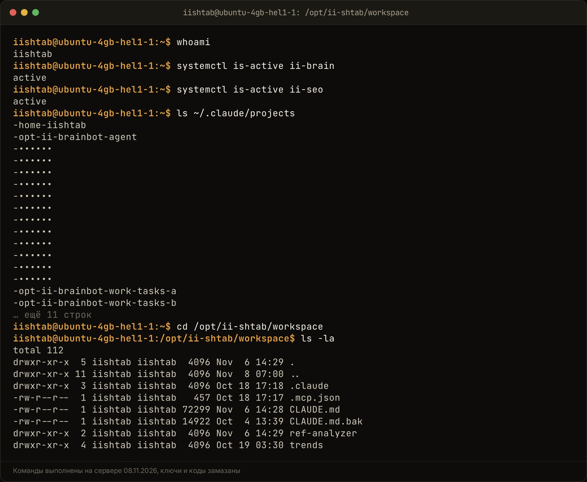

Чтобы Claude помнил контекст твоего бизнеса между сессиями и не путал факты, память делят на уровни. Правила и профиль проекта лежат в файле `CLAUDE.md`, клиенты, регламенты и решения живут в Notion или в markdown-файлах, а историю сессий сохраняет плагин вроде claude-mem. Один длинный чат для этого не годится: с каждым сообщением он отправляет модели всю переписку целиком и быстро съедает лимит подписки.

Я держу на одной подписке Claude несколько агентов проекта ii.systema: штаб роликов, SEO-штаб, бота «Мозг». Ниже разбираю, как у них устроена память, какие команды и файлы для этого нужны и где я сам ошибался.

## Почему Claude забывает контекст и почему длинные диалоги не спасают?

Claude забывает, потому что у модели нет своей памяти между запросами. Каждый раз программа собирает стопку из правил, истории чата, файлов и нового вопроса и отправляет её целиком. Закрыл сессию, и стопка пропала.

Длинный диалог кажется решением: пусть всё лежит в одном чате. На деле он ломается с двух сторон.

- **Лимит.** Двадцатое сообщение в чате несёт с собой девятнадцать предыдущих. Чем длиннее переписка, тем дороже каждый следующий вопрос, даже короткий. Подробно эту механику я разбирал в [статье про лимиты Claude](/blog/pochemu-limit-claude-bystro-konchaetsya/).
- **Протухание.** В моих ботах разговор держится через флаг `--resume`, он поднимает прошлую сессию. Со временем сессия перестаёт открываться, и бот начинает разговор заново. Всё, что было сказано только в чате, пропадает.

Поэтому у меня с 21.10.2026 записано правило (оно есть в [статье про Claude Code в Telegram](/blog/claude-code-sotrudnik-telegram/)): память разговора и память проекта это разные вещи. Всё, что должно пережить новую сессию, кладу в `CLAUDE.md` или в Notion. Если я объяснил агенту что-то второй раз, это пора записать в файл.

Вторая привычка из той же практики: отдельная сессия на каждую тему. Сценарии роликов, статьи и разговор с продюсером идут в разных сессиях, и ни одна не тащит чужую историю.

## Из каких уровней состоит рабочая память ИИ-агента?

Рабочая память агента состоит из четырёх уровней: текущий разговор, короткие факты и правила, рабочие блоки под проекты и архив с поиском. Каждый уровень живёт в своём месте и попадает в запрос, только когда нужен.

Эту схему я взял из разбора открытой системы TencentDB Agent Memory, который делал к ролику 05.10.2026 ([материал в Notion](https://app.notion.com/p/TencentDB-3f0dfdb14822811abad1fb3930fe93d1)). Там память разложена так:

| Уровень | Что внутри | Где это у меня |
|---|---|---|
| L0, разговор | текущий диалог без сжатия | сессия Claude Code |
| L1, атомы | факты, предпочтения, запреты: «отвечать на ты», «без эмодзи» | `CLAUDE.md` и файлы автопамяти |
| L2, сценарии | блоки под конкретный проект или задачу | навыки (skills) и страницы Notion проекта |
| L3, архив | всё остальное с поиском | второй мозг: индекс Notion, сайта и заметок |

<!-- img: type=scheme what="четыре уровня памяти ИИ-агента сверху вниз: L0 Разговор (текущая сессия) → L1 Атомы (CLAUDE.md, автопамять) → L2 Сценарии (навыки, страницы Notion проекта) → L3 Архив (второй мозг с поиском); сбоку стрелка «в каждый запрос» у L0 и L1, «по запросу» у L2 и L3" caption="Четыре уровня памяти агента: первые два едут в каждый запрос, остальные агент достаёт сам, когда задача этого требует." alt="как сделать память для claude: четыре уровня памяти ИИ-агента" -->

<figure class="scheme">
<svg width="100%" xmlns="http://www.w3.org/2000/svg" viewBox="0 0 1200 600" role="img" aria-label="Четыре уровня памяти ИИ-агента: разговор и атомы едут в каждый запрос, сценарии и архив достаются по запросу">
<title>Четыре уровня памяти ИИ-агента</title>
<defs>
<marker id="arr" viewBox="0 0 10 10" refX="8" refY="5" markerWidth="8" markerHeight="8" orient="auto-start-reverse">
<path d="M0 0 L10 5 L0 10 z" fill="var(--accent)"/>
</marker>
<marker id="arrl" viewBox="0 0 10 10" refX="8" refY="5" markerWidth="8" markerHeight="8" orient="auto-start-reverse">
<path d="M0 0 L10 5 L0 10 z" fill="var(--line)"/>
</marker>
</defs>

<rect x="40" y="30" width="760" height="110" rx="10" fill="var(--surface)" stroke="var(--line)" stroke-width="2"/>
<text x="70" y="75" font-family="var(--font-display)" font-weight="600" font-size="26" fill="var(--accent)">L0</text>
<text x="120" y="75" font-family="var(--font-display)" font-weight="600" font-size="26" fill="var(--fg)">Разговор</text>
<text x="70" y="112" font-family="var(--font-body)" font-size="19" fill="var(--muted)">Текущая сессия Claude Code, без сжатия</text>

<rect x="40" y="170" width="760" height="110" rx="10" fill="var(--surface)" stroke="var(--line)" stroke-width="2"/>
<text x="70" y="215" font-family="var(--font-display)" font-weight="600" font-size="26" fill="var(--accent)">L1</text>
<text x="120" y="215" font-family="var(--font-display)" font-weight="600" font-size="26" fill="var(--fg)">Атомы</text>
<text x="70" y="252" font-family="var(--font-body)" font-size="19" fill="var(--muted)">Факты и запреты в CLAUDE.md и автопамяти</text>

<rect x="40" y="310" width="760" height="110" rx="10" fill="var(--surface)" stroke="var(--line)" stroke-width="2"/>
<text x="70" y="355" font-family="var(--font-display)" font-weight="600" font-size="26" fill="var(--accent)">L2</text>
<text x="120" y="355" font-family="var(--font-display)" font-weight="600" font-size="26" fill="var(--fg)">Сценарии</text>
<text x="70" y="392" font-family="var(--font-body)" font-size="19" fill="var(--muted)">Навыки и страницы Notion под проект</text>

<rect x="40" y="450" width="760" height="110" rx="10" fill="var(--surface)" stroke="var(--line)" stroke-width="2"/>
<text x="70" y="495" font-family="var(--font-display)" font-weight="600" font-size="26" fill="var(--accent)">L3</text>
<text x="120" y="495" font-family="var(--font-display)" font-weight="600" font-size="26" fill="var(--fg)">Архив</text>
<text x="70" y="532" font-family="var(--font-body)" font-size="19" fill="var(--muted)">Второй мозг: Notion, сайт, заметки, с поиском</text>

<line x1="420" y1="140" x2="420" y2="168" stroke="var(--line)" stroke-width="2" marker-end="url(#arrl)"/>
<line x1="420" y1="280" x2="420" y2="308" stroke="var(--line)" stroke-width="2" marker-end="url(#arrl)"/>
<line x1="420" y1="420" x2="420" y2="448" stroke="var(--line)" stroke-width="2" marker-end="url(#arrl)"/>

<path d="M830 85 H870 V235 H830" fill="none" stroke="var(--accent)" stroke-width="3" marker-end="url(#arr)"/>
<line x1="870" y1="160" x2="920" y2="160" stroke="var(--accent)" stroke-width="3" marker-end="url(#arr)"/>
<rect x="930" y="110" width="230" height="100" rx="10" fill="var(--surface)" stroke="var(--accent)" stroke-width="2"/>
<text x="1045" y="152" text-anchor="middle" font-family="var(--font-display)" font-weight="600" font-size="24" fill="var(--fg)">В каждый</text>
<text x="1045" y="184" text-anchor="middle" font-family="var(--font-display)" font-weight="600" font-size="24" fill="var(--fg)">запрос</text>

<path d="M830 365 H870 V505 H830" fill="none" stroke="var(--line)" stroke-width="3" marker-end="url(#arrl)"/>
<line x1="870" y1="435" x2="920" y2="435" stroke="var(--line)" stroke-width="3" marker-end="url(#arrl)"/>
<rect x="930" y="385" width="230" height="100" rx="10" fill="var(--surface)" stroke="var(--line)" stroke-width="2"/>
<text x="1045" y="427" text-anchor="middle" font-family="var(--font-display)" font-weight="600" font-size="24" fill="var(--fg)">По запросу</text>
<text x="1045" y="459" text-anchor="middle" font-family="var(--font-body)" font-size="19" fill="var(--muted)">агент достаёт сам</text>
</svg>
<figcaption>Четыре уровня памяти агента: первые два едут в каждый запрос, остальные агент достаёт сам, когда задача этого требует.</figcaption>
</figure>


Главная мысль таблицы в правой колонке. В каждый запрос попадают только L0 и L1, поэтому они должны быть короткими. L2 и L3 могут быть сколь угодно большими: агент открывает их по необходимости, как сотрудник открывает папку с регламентом.

## Как настроить базовые файлы инструкций, чтобы агент не путал факты?

Базовая память Claude Code это два вида файлов: `CLAUDE.md`, который пишешь ты, и автопамять, которую агент ведёт сам. Оба читаются при старте сессии, поэтому оба держи коротким.

По [документации Claude Code](https://code.claude.com/docs/en/memory) (проверено 08.11.2026) `CLAUDE.md` бывает нескольких уровней: общий для пользователя в `~/.claude/CLAUDE.md`, проектный в корне папки проекта и локальный `CLAUDE.local.md`. Claude читает их все и складывает в один контекст. Документация советует держать каждый файл короче 200 строк.

Автопамять лежит в папке `~/.claude/projects/<проект>/memory/`. Там индекс `MEMORY.md` и по файлу на каждую запись. При старте сессии загружаются только первые 200 строк или 25 КБ индекса, смотря что наступит раньше. Поэтому индекс служит оглавлением: одна строка на заметку, сама заметка в отдельном файле. Посмотреть и выключить автопамять можно командой `/memory`.

Как я пишу `CLAUDE.md`:

1. **Как памятку новому сотруднику.** Что за проект, кто автор, где база, чего делать нельзя.
2. **Без истории.** Как мы пришли к решению, хранится в журнале изменений. В файле только итог.
3. **С датой у решений.** «Бесплатно ничего не делаем (решение 02.11.2026)». Дата нужна, чтобы через месяц было видно, какое правило свежее.
4. **Без секретов.** Ключи и пароли в файл не пишутся. Пишется, где они лежат.

То же правило про секреты стоит в моём наборе «Свой Джарвис». Его `CLAUDE.md` от 02.11.2026 говорит агенту: попросили «запомни» или узнал устойчивый факт (имя клиента, срок, привычку), допиши строку в `memory.md` с датой. Пароли, ключи и номера карт не записывай. Попросили, откажись и объясни почему.

Если правил пока нет совсем, начни с четырёх: не усложняй, не додумывай факты, меняй только то, что просили, проверяй перед словом «готово». Этот короткий набор я разбирал в материале к ролику от 03.10.2026, его легко вставить в любой проект.

## Как связать Claude с внешней базой знаний и Notion через MCP?

Внешняя база подключается через MCP. Это переходник между Claude и сервисом: подключил его один раз, и агент сам читает и пишет в Notion, Google Диск или CRM. В Claude это делается в настройках, раздел Connectors, кнопка Connect у нужного сервиса.

Что класть в Notion, а что в `CLAUDE.md`, я решаю по одному вопросу: нужно ли это агенту в каждом запросе.

| В CLAUDE.md | В Notion |
|---|---|
| кто ты и чем занимается бизнес | карточки клиентов и сделок |
| тон, запреты, формат ответов | регламенты и инструкции |
| где лежат базы и как они называются | контент-план, задачи, статусы |
| три-пять правил, которые нарушать нельзя | журнал решений с датами |

В моём `CLAUDE.md` штаба роликов нет ни одного сценария. Там записано, где лежит «Контент-план» в Notion и по каким правилам писать. Сценарии агент открывает сам, когда я прошу переписать конкретный ролик.

Отдельно про журнал изменений. В правилах штаба стоит строка: любое решение по проекту записывается строкой в «Журнал изменений» в Notion. Это память для людей и для агента сразу. Через месяц агент находит там, почему поменяли правило, и не возвращает старое.

## Как плагин claude-mem чинит неверные заметки и сохраняет сессии?

Плагин claude-mem сохраняет решения, контекст и историю команд между сессиями Claude Code, и повторять инструкции при новом запуске не нужно. Чинить заметки сам он не обещает: он помнит, а проверять, правда ли записано, остаётся твоей задачей.

Установка по [моему материалу](https://app.notion.com/p/5-Claude-3f7dfdb1482281a9bbcdf75eac7f9a86) от 12.10.2026, две команды в терминале Claude Code:

```
/plugin marketplace add thedotmack/claude-mem
/plugin install claude-mem
```

После установки перезапусти Claude Code. Контекст прошлых сессий подтягивается сам, а просмотр памяти открывается в браузере по адресу `http://localhost:37777`. Там видно, что именно агент запомнил, и лишнее можно убрать.

Рядом есть похожие проекты. Открытый [ai-memory](https://github.com/akitaonrails/ai-memory) 19.10.2026 набрал 512 звёзд за один день, так записано в моём [разборе трендов](https://app.notion.com/p/3fedfdb14822819184a5cf460147dba5). Его идея: память, которую можно передать агенту другого производителя. Кончился лимит у Claude, переключаешься на другого агента, и он подхватывает тот же контекст.

Теперь про починку. 6 ноября 2026 Anthropic выпустила исследование [The components of agent memory](https://www.anthropic.com/research/components-of-agent-memory). Там разобран процесс, который называют dreaming, «сон» агента: отдельная сессия перечитывает журналы прошлой работы и исправляет заметки.

Пример оттуда. Claude играл в Pokémon Red и записал в память, что Pokémon Center стоит с восточной стороны горы Mt. Moon. Это было неверно. Дальше он решил, что гору уже прошёл, и ходил по кругу. В «сне» Claude сверил заметку с записью сессии, нашёл ошибку и переписал её. С исправленной заметкой он дошёл до следующего города, без исправления не дошёл.

Второй пример про бизнес-задачу. Несколько агентов разбирали контракты и писали условия в одну общую таблицу. В итоговую сводку попал 41 факт из 57: агенты затирали работу друг друга. Когда у каждого контракта появилась своя страница с одним автором и условия стали цитировать слово в слово, сохранились все 57.

В продукте это Dreams API в Claude Managed Agents. По [разбору на DEV Community](https://dev.to/axrisi/agent-memory-how-claude-repairs-wrong-notes-with-dreaming-5fho) от 07.11.2026 он пока в исследовательском доступе, оплачивается по токенам через API, а результат пишет в отдельное хранилище, которое человек проверяет перед подключением. Для малого бизнеса я бы взял оттуда сам принцип: у каждого факта один владелец и одна страница, а заметки регулярно сверяются с первоисточником.

## Проверил на себе: как устроен «Второй Мозг» ii.systema и где я ошибся

Мой третий уровень памяти, архив с поиском, это второй мозг. Я собрал его 18.10.2026 для SEO-штаба, чтобы статьи опирались на мои факты с источниками. Эту статью он тоже питал: каждая цифра выше взята из его кусков.

Как он устроен, по [странице SEO-блога в Notion](https://app.notion.com/p/SEO-petrsolovarov-ru-3fddfdb14822814a81fed922afdf7dbb) на 18.10.2026:

- **4 344 куска** по 300–500 слов. У каждого тип (факт, цифра, мнение, история, правило), источник, ссылка и дата.
- **Источники:** Notion (508 кусков: страницы штаба и базы), сайт (23) и статьи блога (13), рабочие папки агентов (3 541), память Claude по проектам (259).
- **Обновление:** инкремент каждый час, полная пересборка ночью в 05:10 МСК.
- **Доступ для агента:** MCP-сервер `brain` с тремя командами: найти куски по теме, записать заметку, прочитать карту автора.

Память Claude с моего компьютера попадает туда скриптом [`sync_memory.sh`](https://github.com/solovarov90/ii-systema/blob/main/brain/sync_memory.sh). Он берёт только markdown-файлы из папок `memory` по проектам, пропускает временные сессии и отправляет их на сервер. Там сборщик раз в час подхватывает новое. Так заметка, которую агент сделал у меня на ноутбуке, через час доступна агентам на сервере.

<!-- img: type=terminal cmds="whoami ;; systemctl is-active ii-brain ;; systemctl is-active ii-seo ;; ls ~/.claude/projects ;; cd /opt/ii-shtab/workspace ;; ls -la" caption="Сервер штаба: служба второго мозга работает, рядом папки памяти Claude по проектам и рабочая папка агента с CLAUDE.md." alt="память ии агента между сессиями: служба второго мозга и папки памяти Claude на сервере" -->




После каждого черновика статьи бот сверяет числа с индексом. Цифра без куска в мозге и без внешней ссылки подсвечивается в превью словом «не подтверждено», и я вижу её до публикации. Это и есть моя ручная версия «сна»: сверка заметок с источником перед тем, как они уйдут к людям.

Где я ошибся:

- **Чужой проект в моей памяти.** Сначала я подключил к мозгу рабочие папки клиентского агента. Карта автора один раз подхватила оттуда чужие факты. 19.10.2026 я убрал этот проект из индекса и из сборщика, ушло 1 190 источников ([журнал изменений](https://app.notion.com/p/Graph-View-Obsidian-canvas-3fedfdb14822816d8283dd401821dd7f)). Вывод: память одного бизнеса не смешивается с памятью другого, даже если удобно искать в одном месте.
- **Сайт без обновления.** Сборщик читал копию сайта на сервере и не подтягивал свежие правки из git. Я поправил статьи с компьютера, а мозг ещё помнил старый текст. 20.10.2026 я обновил копию руками и пересобрал индекс. С тех пор после правки сайта с компьютера это шаг в чек-листе.
- **Типы кусков на глаз.** Тип «правило» программа ставит по эвристике и ставит слишком часто. Статусы и типы я правлю руками в интерфейсе мозга.

## Что делать, когда цены и правила в компании изменились, а ИИ помнит старые?

Когда цена, регламент или условие поменялись, обнови их в одном месте и пометь старое. Агент верит любой строке в файле, поэтому две версии одного факта в разных местах дадут путаницу.

Порядок, который работает у меня:

1. **Найди, откуда агент берёт старое.** Спроси его прямо: «откуда ты это знаешь?». Обычно ответ один из четырёх: `CLAUDE.md`, файл автопамяти, база в Notion, текущий чат.
2. **Исправь в первоисточнике.** Цена поменялась, значит меняется карточка продукта в Notion. Копия в `CLAUDE.md` удаляется, там остаётся ссылка на карточку.
3. **Пометь устаревшее.** Не удаляй историю молча. В моём мозге у каждого куска есть статус: ok, не подтверждено, устарело. Куски со статусом «устарело» в статьи не идут.
4. **Ставь дату у каждого решения.** «С 01.01.2027 клуб стоит столько-то». Когда правила спорят, свежая дата побеждает, и агенту это легко объяснить одной строкой в `CLAUDE.md`.
5. **Начни новую сессию.** Старый чат держит прежнюю версию в своей стопке. Пока ты в нём, исправление в файле может не сработать.

И раз в неделю пробегай файл автопамяти глазами. В Claude Code это `/memory`, в claude-mem это страница на `localhost:37777`. Пять минут на чтение экономят час на разбор, почему агент снова написал клиенту старую цену.

## С чего начать память агента в своём бизнесе?

Начни с одного файла и одной базы. Сложные системы с векторным поиском нужны, когда знаний тысячи страниц, а первые недели хватает простого.

1. **Напиши `CLAUDE.md` на одну страницу:** кто ты, чем занимается бизнес, тон, три-пять запретов, где лежат базы.
2. **Подключи Notion через коннектор** и заведи там три базы: клиенты, регламенты, журнал решений.
3. **Включи автопамять** в Claude Code и раз в неделю читай, что агент записал.
4. **Поставь claude-mem**, если работаешь в Claude Code каждый день и устал пересказывать вчерашнее.
5. **Держи правило второго раза:** объяснил агенту одно и то же дважды, записал в файл.
6. **Архив с поиском добавляй последним,** когда база выросла и агент начал теряться в ней.

Готовые инструкции к роликам про Claude, включая установку плагинов, лежат на странице [Материалы](https://video.petrsolovarov.ru/materials).

Если хочешь перестать каждое утро заново объяснять нейросети устройство своего бизнеса, напиши слово «система» мне в личные сообщения [t.me/solovarov](https://t.me/solovarov). Посмотрим, как связать твои регламенты, задачи и Claude в одну память без рутины.
