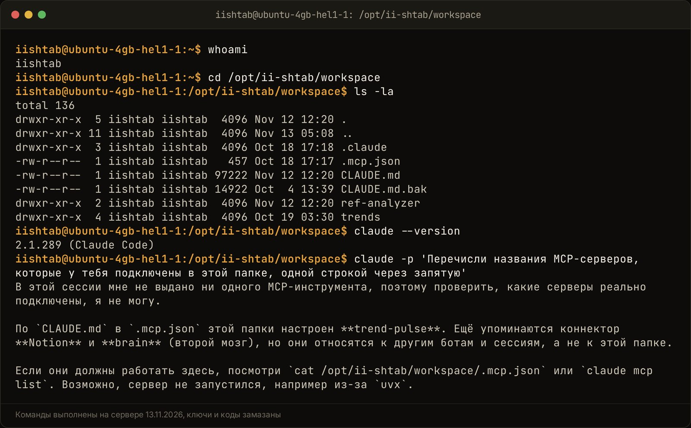

MCP-коннекторы делают Claude глупее, когда их подключено много: каждый сервер отдаёт модели описания своих инструментов, и эти описания съедают контекст ещё до твоего вопроса. Модель выбирает из длинного списка похожих действий, путает параметры и хуже держит суть разговора. Чтобы этого не было, держи постоянно включёнными два-три базовых сервера, а узкие коннекторы подключай под конкретную задачу и выключай после.

Ниже разбираю, как это устроено, сколько стоит в токенах, какие серверы держать всегда, как подключить их в Claude Desktop и Claude Code и как у меня настроены инструменты в штабе ii.systema, где на Claude работают несколько ботов.

## Что такое протокол MCP и как он связывает нейросеть с сервисами?

MCP (Model Context Protocol) это открытый стандарт Anthropic, по которому Claude подключается к внешним сервисам и базам данных. Ты подключаешь сервис один раз, и дальше Claude сам туда ходит: читает базу, создаёт задачу, генерирует картинку. Копировать текст между вкладками больше не нужно. Так записано в [моём материале к ролику про коннекторы](https://app.notion.com/p/MCP-Claude-3f3dfdb14822810f913fee58bf3f3b0d), актуальном на 08.10.2026.

Слова, которые дальше встретятся:

- **MCP-сервер** это маленькая программа-переходник для одного сервиса. Она знает, что умеет сервис, и передаёт это Claude.
- **Инструмент** это одно действие сервера: «найти страницу», «создать строку в базе», «прочитать файл». У сервера их бывает от одного до сотни.
- **Коннектор** так называется подключённый сервер в интерфейсе Claude. По сути то же самое.
- **Контекст** это всё, что модель видит за один раз: правила, историю чата, файлы, описания инструментов и твой вопрос. Токены это кусочки текста, в которых этот объём считают.

Серверы бывают двух видов. Удалённые живут в интернете по адресу HTTPS, их добавляют в меню Connectors на claude.ai или в Claude Desktop. Локальные запускаются на твоём компьютере или сервере как программа, например сервер файловой системы `@modelcontextprotocol/server-filesystem`, который открывает Claude одну папку на диске.

Тема живая. Мой ролик про подключение коннекторов вышел 11.10.2026 и к 10.11.2026 набрал в Instagram 3 174 просмотра и 148 сохранений, под ним 28 человек написали кодовое слово ([по Контент-плану](https://app.notion.com/p/MCP-Claude-3f3dfdb1482281dbae32fd6b9cd7c4cf)). Люди сохраняют такие ролики, подключают всё подряд и потом удивляются, почему ассистент стал хуже.

## Почему подключение десятка инструментов ломает логику Claude?

Модель выбирает инструмент по его названию и описанию. Когда в списке пять понятных действий, выбор простой. Когда их сотня, и у трёх сервисов есть свой «search», модель начинает ошибаться. В [документации Claude Code](https://code.claude.com/docs/en/agent-sdk/tool-search) (проверено 13.11.2026) так и написано: точность выбора инструмента падает, когда одновременно загружено больше 30–50 инструментов.

Как это выглядит на практике:

1. **Зовёт не тот инструмент.** Просишь найти заметку в Notion, а Claude ищет на Google Диске, потому что у обоих сервисов есть поиск.
2. **Путает поля.** Подставляет параметр от соседнего инструмента или пропускает обязательный, и сервис отвечает ошибкой.
3. **Отказывается.** Пишет «у меня нет доступа к этому сервису», хотя коннектор включён. Нужный инструмент просто потерялся в списке.
4. **Забывает задачу.** К середине длинного разговора теряет условия, которые ты дал в начале. На них не хватило места.

Anthropic в [посте от 24 ноября 2025 года](https://www.anthropic.com/engineering/advanced-tool-use) показала это цифрами на своих внутренних проверках. Когда Claude получил поиск по инструментам вместо полного списка, точность Opus 4 выросла с 49% до 74%, а Opus 4.5 с 79,5% до 88,1%. Разница между этими числами и есть цена лишних инструментов в контексте.

<!-- img: type=scheme what="контекстное окно Claude как шкала: слева блоки «правила проекта», «описания инструментов: Notion, GitHub, Google Диск, почта, календарь» занимают большую часть, справа узкий остаток «твоя задача и история разговора»; под шкалой второй вариант: два коннектора и широкое место под задачу" caption="Каждый коннектор занимает место в контексте до первого вопроса, и на саму задачу остаётся меньше." alt="mcp коннекторы claude занимают контекст описаниями инструментов: схема" -->

<figure class="scheme">
<svg width="100%" xmlns="http://www.w3.org/2000/svg" viewBox="0 0 1200 560" role="img" aria-label="Контекстное окно Claude как шкала: при десяти коннекторах описания инструментов занимают большую часть, на задачу остаётся узкий остаток; при двух коннекторах место под задачу широкое">
  <title>Сколько места в контексте остаётся на задачу при десяти коннекторах и при двух</title>
  <defs>
    <marker id="arr" viewBox="0 0 10 10" refX="9" refY="5" markerWidth="8" markerHeight="8" orient="auto-start-reverse">
      <path d="M0 0 L10 5 L0 10 z" fill="var(--accent)"/>
    </marker>
  </defs>

  <text x="60" y="52" font-family="var(--font-display)" font-weight="600" font-size="26" fill="var(--fg)">Десять коннекторов</text>
  <text x="60" y="84" font-family="var(--font-body)" font-size="18" fill="var(--muted)">Контекстное окно уже заполнено до первого вопроса</text>

  <rect x="60" y="108" width="190" height="110" rx="10" fill="var(--surface)" stroke="var(--line)" stroke-width="2"/>
  <text x="155" y="156" text-anchor="middle" font-family="var(--font-display)" font-weight="600" font-size="22" fill="var(--fg)">Правила</text>
  <text x="155" y="186" text-anchor="middle" font-family="var(--font-body)" font-size="18" fill="var(--muted)">проекта</text>

  <rect x="260" y="108" width="640" height="110" rx="10" fill="var(--surface)" stroke="var(--line)" stroke-width="2"/>
  <text x="580" y="150" text-anchor="middle" font-family="var(--font-display)" font-weight="600" font-size="22" fill="var(--fg)">Описания инструментов</text>
  <text x="580" y="182" text-anchor="middle" font-family="var(--font-body)" font-size="18" fill="var(--muted)">Notion, GitHub, Google Диск, почта, календарь</text>
  <text x="580" y="204" text-anchor="middle" font-family="var(--font-body)" font-size="18" fill="var(--muted)">и ещё пять</text>

  <rect x="910" y="108" width="230" height="110" rx="10" fill="var(--surface)" stroke="var(--accent)" stroke-width="3"/>
  <text x="1025" y="156" text-anchor="middle" font-family="var(--font-display)" font-weight="600" font-size="22" fill="var(--accent)">Твоя задача</text>
  <text x="1025" y="186" text-anchor="middle" font-family="var(--font-body)" font-size="18" fill="var(--muted)">и история разговора</text>

  <line x1="60" y1="244" x2="1140" y2="244" stroke="var(--line)" stroke-width="2"/>
  <text x="600" y="276" text-anchor="middle" font-family="var(--font-body)" font-size="18" fill="var(--muted)">Контекстное окно Claude</text>

  <text x="60" y="336" font-family="var(--font-display)" font-weight="600" font-size="26" fill="var(--fg)">Два коннектора</text>
  <text x="60" y="368" font-family="var(--font-body)" font-size="18" fill="var(--muted)">Под задачу остаётся широкое место</text>

  <rect x="60" y="392" width="190" height="110" rx="10" fill="var(--surface)" stroke="var(--line)" stroke-width="2"/>
  <text x="155" y="440" text-anchor="middle" font-family="var(--font-display)" font-weight="600" font-size="22" fill="var(--fg)">Правила</text>
  <text x="155" y="470" text-anchor="middle" font-family="var(--font-body)" font-size="18" fill="var(--muted)">проекта</text>

  <rect x="260" y="392" width="170" height="110" rx="10" fill="var(--surface)" stroke="var(--line)" stroke-width="2"/>
  <text x="345" y="440" text-anchor="middle" font-family="var(--font-display)" font-weight="600" font-size="22" fill="var(--fg)">Инструменты</text>
  <text x="345" y="470" text-anchor="middle" font-family="var(--font-body)" font-size="18" fill="var(--muted)">только два</text>

  <rect x="440" y="392" width="700" height="110" rx="10" fill="var(--surface)" stroke="var(--accent)" stroke-width="3"/>
  <text x="790" y="440" text-anchor="middle" font-family="var(--font-display)" font-weight="600" font-size="22" fill="var(--accent)">Твоя задача</text>
  <text x="790" y="470" text-anchor="middle" font-family="var(--font-body)" font-size="18" fill="var(--muted)">и история разговора: условия не теряются</text>
</svg>
<figcaption>Каждый коннектор занимает место в контексте до первого вопроса, и на саму задачу остаётся меньше.</figcaption>
</figure>

## Сколько контекста и денег сжирают описания инструментов в каждом запросе?

Описание одного инструмента это название, пара абзацев текста и список параметров с типами. Без поиска по инструментам все эти описания уходят модели в каждом запросе. По [документации Claude Code](https://code.claude.com/docs/en/agent-sdk/tool-search) 50 инструментов обычно занимают 10–20 тысяч токенов. Тяжёлые серверы весят больше.

Замеры из открытых источников:

| Что подключено | Сколько токенов до первого вопроса | Источник |
|---|---|---|
| GitHub, 35 инструментов | около 26 000 | [Anthropic, 24.11.2025](https://www.anthropic.com/engineering/advanced-tool-use) |
| Пять серверов: GitHub, Slack, Sentry, Grafana, Splunk, 58 инструментов | около 55 000 | [Anthropic, 24.11.2025](https://www.anthropic.com/engineering/advanced-tool-use) |
| Notion | около 9 000 | [MCP Playground, 12.09.2026](https://mcpplaygroundonline.com/blog/mcp-context-bloat-tool-search) |
| Семь типовых серверов | 67 300, треть окна в 200 тысяч | [MCP Playground, 12.09.2026](https://mcpplaygroundonline.com/blog/mcp-context-bloat-tool-search) |

Что это значит для кошелька, зависит от того, как ты платишь.

- **Подписка.** Лимит Claude считает объём текста, который прочитала модель. Описания инструментов читаются каждый раз, поэтому лимит тает быстрее. Подробно механику я разобрал в статье [почему лимит Claude кончается к обеду](/blog/pochemu-limit-claude-bystro-konchaetsya/).
- **API.** Платишь за каждый токен на входе. Тысячи запросов в день с тяжёлым набором коннекторов дают заметный счёт за текст, который модель даже не использовала.
- **Качество.** Это главная цена. Лишние описания вытесняют из контекста то, что действительно важно для ответа.

Отдельная статья расходов это сами вызовы инструментов. Описание лежит в контексте, а вызов тратит деньги у сервиса. Я это проходил: за сутки 01–02.08.2026 поисковые агенты на моих серверах сделали 651 запрос к Brave Search на $3,26 и получили 544 ошибки «429», это ответ «слишком много запросов». Причина была в одном ключе на три сервера и отсутствии пауз между вызовами. Починил сменой поискового провайдера на Gemini и бюджетом поиска на каждый прогон (запись в моей базе знаний от 18.10.2026). Правило с тех пор: у каждого агента с платным инструментом есть потолок вызовов.

## Какие коннекторы нужны постоянно, а какие лучше выключать?

Постоянно держи то, что нужно почти в каждой задаче: базу знаний, где живут твои правила и цифры, и один рабочий сервис. Остальное включай под задачу. Если коннектор нужен раз в неделю, ему незачем висеть в каждом разговоре.

| Держать всегда | Включать под задачу | Убрать совсем |
|---|---|---|
| база знаний (Notion, свой поиск по заметкам) | генерация картинок и видео | дубли: два сервера с одинаковым поиском |
| файлы проекта, если работаешь с кодом или документами | реклама, аналитика соцсетей | сервисы, которыми не пользовался месяц |
| один главный рабочий сервис (CRM или задачник) | почта, календарь, таблицы для разовой выгрузки | тестовые коннекторы из роликов «подключи за 2 минуты» |

Как решить по конкретному серверу, три вопроса:

1. **Сколько у него инструментов?** Счётчик видно в списке серверов, в Claude Code это команда `/mcp`. Сервер на 40 действий, из которых ты пользуешься двумя, лучше включать по требованию.
2. **Что он умеет менять?** Сервер, который только читает, безопаснее держать включённым. Тот, что пишет в CRM или отправляет письма, включай под задачу.
3. **Есть ли пересечения?** Два сервиса с поиском и похожими названиями действий путают модель сильнее всего.

У MCP-серверов бывает и обратная польза. Есть серверы, которые экономят токены. В [моей инструкции от 04.10.2026](https://app.notion.com/p/Markitdown-Claude-MCP-3efdfdb148228179a655f1d550962248) разобран Markitdown от Microsoft: он превращает PDF, Word и Excel в чистый текст на твоём компьютере, и Claude не тратит токены на картинки страниц. Такой сервер окупает своё место в контексте, если ты каждый день работаешь с документами.

## Как подключить MCP-сервер в Claude Desktop и Claude Code без ошибок?

В Claude Desktop удалённый коннектор добавляется в меню Connectors, а локальный сервер прописывается в файле `claude_desktop_config.json`. В Claude Code сервер добавляется командой `claude mcp add`, и сразу выбирается, где он будет виден: в одном проекте или во всех.

**Claude Desktop, удалённый коннектор** (по [материалу от 08.10.2026](https://app.notion.com/p/MCP-Claude-3f3dfdb14822810f913fee58bf3f3b0d)):

1. Скопируй адрес MCP-сервера на сайте сервиса. Нужен адрес HTTPS.
2. В Claude открой Customize, вкладку Connectors, нажми Add custom connector.
3. Впиши название и адрес, нажми Add, потом Connect и подтверди вход в сервис кнопкой Authorize.
4. В окне ввода, в меню коннекторов под значком плюса, проверь, что включены только нужные для этого чата.

**Claude Desktop, локальный сервер:** Settings, раздел Developer, кнопка Edit Config. В файле `claude_desktop_config.json` добавь сервер в блок `mcpServers`, сохрани и полностью перезапусти приложение. Самая частая ошибка, по [моему гайду](https://app.notion.com/p/Claude-3efdfdb1482281a08313c8afa59efcf1), это лишняя запятая или скобка в этом файле: одна опечатка, и не запускается ни один сервер.

<!-- img: type=scheme caption="Подключайте к диалогу только те инструменты, которые нужны для текущей задачи, чтобы избежать перегрузки контекста." alt="настройка mcp в claude desktop: меню коннекторов с переключателями" was="Claude Desktop на компьютере: открыто меню коннекторов под значком плюса в строке ввода, видно несколько коннекторов с переключателями, включены только два" what="Схема переключения инструментов в чате: блок «Строка ввода (значок +)» со стрелкой к «Меню коннекторов», от него две ветки: правильная — «Включены 1–2 нужных сервера» → «Быстрый ответ и чистый контекст», ошибочная — «Включены все серверы подряд» → «Перегруз промпта и ошибки модели»." -->

<figure class="scheme">
<svg width="100%" xmlns="http://www.w3.org/2000/svg" viewBox="0 0 1200 600" role="img" aria-label="Схема переключения инструментов в чате: из строки ввода открывается меню коннекторов. Если включить один-два нужных сервера, ответ быстрый и контекст чистый. Если включить все серверы подряд, промпт перегружен и модель ошибается.">
  <title>Какие коннекторы включать в чате</title>
  <defs>
    <marker id="arr" viewBox="0 0 10 10" refX="8" refY="5" markerWidth="8" markerHeight="8" orient="auto-start-reverse">
      <path d="M0 0 L10 5 L0 10 z" fill="var(--line)"/>
    </marker>
    <marker id="arrAccent" viewBox="0 0 10 10" refX="8" refY="5" markerWidth="8" markerHeight="8" orient="auto-start-reverse">
      <path d="M0 0 L10 5 L0 10 z" fill="var(--accent)"/>
    </marker>
  </defs>

  <rect x="60" y="50" width="400" height="110" rx="10" fill="var(--surface)" stroke="var(--line)" stroke-width="2"/>
  <text x="260" y="95" text-anchor="middle" font-family="var(--font-display)" font-weight="600" font-size="24" fill="var(--fg)">Строка ввода</text>
  <text x="260" y="128" text-anchor="middle" font-family="var(--font-body)" font-size="18" fill="var(--muted)">значок «+» под полем чата</text>

  <line x1="460" y1="105" x2="590" y2="105" stroke="var(--line)" stroke-width="3" marker-end="url(#arr)"/>

  <rect x="600" y="50" width="540" height="110" rx="10" fill="var(--surface)" stroke="var(--line)" stroke-width="2"/>
  <text x="870" y="95" text-anchor="middle" font-family="var(--font-display)" font-weight="600" font-size="24" fill="var(--fg)">Меню коннекторов</text>
  <text x="870" y="128" text-anchor="middle" font-family="var(--font-body)" font-size="18" fill="var(--muted)">список подключённых серверов</text>

  <path d="M870 160 L870 205 L330 205 L330 250" fill="none" stroke="var(--accent)" stroke-width="4" marker-end="url(#arrAccent)"/>
  <path d="M870 160 L870 205 L870 250" fill="none" stroke="var(--line)" stroke-width="3" marker-end="url(#arr)"/>

  <text x="60" y="235" font-family="var(--font-body)" font-size="19" font-weight="600" fill="var(--accent)">Правильно</text>
  <text x="900" y="235" font-family="var(--font-body)" font-size="19" fill="var(--muted)">Ошибка</text>

  <rect x="60" y="260" width="540" height="110" rx="10" fill="var(--surface)" stroke="var(--accent)" stroke-width="3"/>
  <circle cx="105" cy="315" r="22" fill="none" stroke="var(--accent)" stroke-width="3"/>
  <text x="105" y="323" text-anchor="middle" font-family="var(--font-display)" font-weight="600" font-size="22" fill="var(--accent)">1</text>
  <text x="145" y="308" font-family="var(--font-display)" font-weight="600" font-size="24" fill="var(--fg)">Включены 1–2</text>
  <text x="145" y="342" font-family="var(--font-display)" font-weight="600" font-size="24" fill="var(--fg)">нужных сервера</text>

  <rect x="630" y="260" width="510" height="110" rx="10" fill="var(--surface)" stroke="var(--line)" stroke-width="2"/>
  <circle cx="675" cy="315" r="22" fill="none" stroke="var(--line)" stroke-width="3"/>
  <text x="675" y="323" text-anchor="middle" font-family="var(--font-display)" font-weight="600" font-size="22" fill="var(--muted)">2</text>
  <text x="715" y="308" font-family="var(--font-display)" font-weight="600" font-size="24" fill="var(--fg)">Включены все</text>
  <text x="715" y="342" font-family="var(--font-display)" font-weight="600" font-size="24" fill="var(--fg)">серверы подряд</text>

  <line x1="330" y1="370" x2="330" y2="440" stroke="var(--accent)" stroke-width="4" marker-end="url(#arrAccent)"/>
  <line x1="885" y1="370" x2="885" y2="440" stroke="var(--line)" stroke-width="3" marker-end="url(#arr)"/>

  <rect x="60" y="450" width="540" height="110" rx="10" fill="var(--surface)" stroke="var(--accent)" stroke-width="3"/>
  <text x="330" y="495" text-anchor="middle" font-family="var(--font-display)" font-weight="600" font-size="24" fill="var(--fg)">Быстрый ответ</text>
  <text x="330" y="528" text-anchor="middle" font-family="var(--font-body)" font-size="18" fill="var(--muted)">и чистый контекст</text>

  <rect x="630" y="450" width="510" height="110" rx="10" fill="var(--surface)" stroke="var(--line)" stroke-width="2"/>
  <text x="885" y="495" text-anchor="middle" font-family="var(--font-display)" font-weight="600" font-size="24" fill="var(--fg)">Перегруз промпта</text>
  <text x="885" y="528" text-anchor="middle" font-family="var(--font-body)" font-size="18" fill="var(--muted)">и ошибки модели</text>
</svg>
<figcaption>Подключайте к диалогу только те инструменты, которые нужны для текущей задачи, чтобы избежать перегрузки контекста.</figcaption>
</figure>

**Claude Code.** По [документации](https://code.claude.com/docs/en/mcp) (проверено 13.11.2026) есть три области:

| Область | Где хранится | Кому виден |
|---|---|---|
| local, по умолчанию | `~/.claude.json` | только тебе, только в этой папке |
| project | `.mcp.json` в корне проекта | всем, кто работает с проектом |
| user | `~/.claude.json` | только тебе, во всех проектах |

Команды такие: `claude mcp add --transport http notion https://mcp.notion.com/mcp` для удалённого сервера, `claude mcp add <имя> -- <команда>` для локального, `claude mcp list` чтобы посмотреть список, `claude mcp remove <имя>` чтобы удалить. Флаг `--scope project` кладёт сервер в общий `.mcp.json`, `--scope user` делает его видимым везде.

Совет из практики: в область user клади только то, что действительно нужно в каждом проекте. Всё остальное держи в project, тогда в чужой папке лишние инструменты не появятся.

Хорошая новость про Claude Code. По той же [документации про поиск инструментов](https://code.claude.com/docs/en/agent-sdk/tool-search) он по умолчанию не грузит описания MCP-инструментов в контекст целиком. Модель видит короткую сводку, а когда нужна возможность, ищет подходящие инструменты по названию и описанию и подгружает до пяти самых подходящих. Переменная `ENABLE_TOOL_SEARCH=false` возвращает старое поведение, когда все описания уходят в каждый запрос. Поиск стоит одного лишнего шага на каждую подгрузку, поэтому при наборе меньше десятка инструментов быстрее грузить всё сразу.

Это сильно помогает, но не решает всё. Модель всё равно может найти не тот инструмент из двух похожих, а в обычном чате Claude и в Claude Desktop поиск по инструментам может работать иначе. Чем короче набор, тем меньше поводов ошибиться.

## Проверил на себе: как я настраивал коннекторы для базы знаний и рабочих агентов

В штабе ii.systema на сервере работают несколько ботов на Claude Code: сценарии роликов, SEO-штаб, который пишет эти статьи, продюсер канала. Им всем нужен Notion, поиск по моим знаниям и тренды. Я держу на сервере короткий общий набор и режу каждому боту доступ под его задачу.

**Общий набор.** В файле `.mcp.json` рабочей папки штаба ровно два сервера, оба локальные:

- `trend-pulse` собирает тренды из открытых источников для отбора тем;
- `brain` это мой второй мозг, поиск по Notion, сайту и заметкам. У него три инструмента: `brain_search`, `brain_note` и `brain_map` ([код сервера](https://github.com/solovarov90/ii-systema/blob/main/brain/mcp_server.py)).

Notion подключён коннектором claude.ai на уровне аккаунта. Свой сервер для базы знаний я написал с тремя инструментами специально: модели не из чего выбирать, и ошибиться в выборе почти негде.

<!-- img: type=terminal cmds="whoami ;; cd /opt/ii-shtab/workspace ;; ls -la ;; claude --version ;; claude -p 'Перечисли названия MCP-серверов, которые у тебя подключены в этой папке, одной строкой через запятую'" caption="Рабочая папка штаба: рядом с правилами проекта лежит .mcp.json с двумя серверами, и Claude сам называет, что у него подключено." alt="mcp коннекторы claude code на сервере: файл .mcp.json и список серверов" -->

**Доступ под задачу.** У каждого бота свой список разрешённых инструментов, флаг `--allowedTools`. Как это устроено, я разбирал в статье [про безопасность Claude Code на сервере](/blog/bezopasno-li-puskat-claude-code-na-server/), коротко:

- SEO-штаб пишет статью с поиском по второму мозгу и одной командой в терминале: проверкой текста на штампы;
- продюсер канала с 19.10.2026 Notion только читает, процессы других ботов он предлагает из белого списка, а запускаются они по моей кнопке.

Так у бота в голове только то, что нужно для его работы. Статья не может случайно что-то удалить в Notion, потому что инструмента записи у неё нет.

**Что сломалось и чему научило.**

- **Сервер «для всех проектов» на компьютере.** 11.07.2026 я поставил на ноутбук codebase-memory-mcp, это сервер, который индексирует код проекта в граф. Зарегистрировал его в области user, `~/.claude.json`, и он стал виден во всех папках. Индексы у проектов разного размера, от 110 до примерно 4 000 узлов графа. Удобно, но его инструменты теперь есть и там, где я пишу тексты и код вообще не нужен. Вывод: в user кладу только то, что нужно везде.
- **Платный инструмент без потолка.** История с Brave Search выше: 651 запрос за сутки и 544 ошибки. После неё у каждого поискового агента есть бюджет вызовов.
- **Коннекторы протухают.** По [моему материалу про Instagram от 11.10.2026](https://app.notion.com/p/MCP-Claude-Instagram-3f6dfdb148228172a655c1a02fb08025) вход через Meta живёт до 60 дней, потом коннектор молча перестаёт отвечать. Адрес уже добавленного коннектора в Claude поменять нельзя, только удалить и добавить заново.

Вся система штаба с цифрами описана в [кейсе ii.systema](/iisystema/).

<!-- img: type=gen prompt="a minimalist workbench with only two precise golden tools neatly laid out, while a large heap of unused tools sits blurred in the dark background, dark graphite surface, warm gold accent light" caption="Пара точных инструментов под рукой работает лучше, чем ящик со всем подряд." alt="как выбрать mcp сервер для ии: мало инструментов вместо многих" -->

## Что делать, если у нужного сервиса нет готового MCP-сервера?

Есть три пути: поискать готовый сервер в открытых каталогах, дать Claude Code командную строку сервиса или написать маленький свой сервер на несколько инструментов. Последний вариант часто лучший: ты сам решаешь, какие действия нужны, и не тащишь в контекст сотню лишних.

1. **Готовый сервер.** Проверь сайт сервиса и [документацию MCP](https://modelcontextprotocol.io). Перед подключением посмотри, сколько у сервера инструментов и что они умеют менять.
2. **Командная строка.** Если у сервиса есть своя программа для терминала или понятный API, Claude Code сам наберёт нужную команду и запустит её. MCP для этого не нужен, а в контексте не висит ни одного лишнего описания. В моём сценарии ролика про CRM этот выбор так и звучит: есть готовый переходник, ставь его, нет переходника, но есть командная строка, это работа для Claude Code.
3. **Свой сервер.** Сервер `brain` у меня это один файл на Python с тремя функциями. Такой сервер под свою задачу пишется за вечер, и Claude Code может написать его сам.

Как не прогадать с первым заходом: один сервис, одна задача. Например, заносить заявки в CRM. Прогони через ИИ десять заявок, проверь каждую руками и только потом отдавай остальное.

## Пошаговый чек-лист: как собрать чистый стек инструментов для бизнеса

Чистый стек это короткий постоянный набор, правила доступа и привычка выключать лишнее. Вот порядок, по которому я бы собирал его с нуля:

1. **Выпиши задачи, а не сервисы.** Что Claude должен делать каждый день: отвечать по базе знаний, заносить заявки, готовить отчёт. Под каждую задачу один сервис.
2. **Оставь в постоянных два-три сервера.** База знаний и главный рабочий сервис. Всё остальное по требованию.
3. **Проверь число инструментов.** Если сервер приносит десятки действий, а нужны два, ищи сервер поуже или пиши свой.
4. **Разведи чтение и запись.** Читающие коннекторы можно держать включёнными. Пишущие включай под задачу и проси Claude показывать план перед изменениями.
5. **В Claude Code раздели области.** Общее для проекта в `.mcp.json`, личное и нужное везде в user, остальное в local.
6. **Режь права агентам.** Для ботов на сервере задай `--allowedTools` и правила deny. Подробно в статье [про безопасность Claude Code](/blog/bezopasno-li-puskat-claude-code-na-server/).
7. **Поставь потолок платным инструментам.** Поиск, генерация картинок, рассылки: у каждого бюджет вызовов на прогон.
8. **Раз в месяц делай ревизию.** Убери то, чем не пользовался, переподключи протухшие коннекторы и запиши изменения в журнал.
9. **Длинные задачи начинай в новом чате.** Даже с чистым набором коннекторов длинная история забивает контекст. Как это влияет на память агента, я разбирал в статье [про память ИИ-агента](/blog/pamyat-ii-agenta-dlya-biznesa-claude/).

Если хочешь, чтобы Claude работал с твоими сервисами и не путался, напиши слово «система» мне в личку [t.me/solovarov](https://t.me/solovarov). Разберём твои рабочие задачи и посмотрим, какие коннекторы и связки действительно нужны твоему бизнесу, а что только перегружает модель и сливает бюджет.
