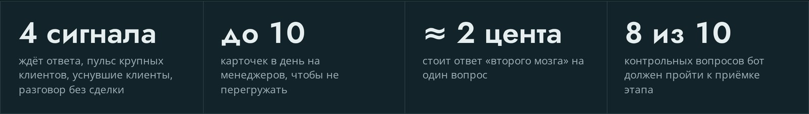

Нейросеть для обработки обращений клиентов работает надёжно, когда она готовит черновик, а отправляет ответ человек. Схема из трёх звеньев: заявка сразу пишется в базу, ИИ находит ответ в базе знаний компании и ставит себе оценку уверенности, а менеджер жмёт «Отправить» или правит текст словами. Так поток разбирает машина, а за каждое слово перед клиентом отвечает живой сотрудник.

Ниже разбираю, как это собрать по шагам, где ставить проверку и что у меня ломалось. Примеры из двух моих проектов: JE 3.0, где компания ведёт сотни клиентов в отдельных Telegram-группах, и мой собственный поток сообщений после роликов ii.systema.

## Почему слепой автоответ роботом портит отношения с клиентом?

Слепой автоответ портит отношения, потому что модель ошибается уверенно, а клиент видит ошибку первым. Неверная цена, выдуманный срок или ответ невпопад на жалобу стоят дороже, чем десять минут ожидания. Поэтому первое правило всех моих проектов с клиентской перепиской: бот сам клиентам не пишет.

В кейсе [JE 3.0](/je30/) это правило закреплено с первого дня, по данным на 18.10.2026: сообщение уходит клиенту только после кнопки «Отправил» у менеджера. Менеджеры и порядок работы остаются прежними, ИИ читает переписку и таблицу сделок и подсказывает.

Вторая крайность тоже плохая. Если перечитывать каждый ответ нейросети целиком, автоматизация ничего не экономит. Ты нанял помощника и сам работаешь у него контролёром. Решение посередине: ИИ готовит всё, человек смотрит быстро, а внимательно читает только спорное. Про это ниже, в шаге 3.

Что именно идёт не так при автоответе без человека:

- **Выдумки.** Модель отвечает гладко даже тогда, когда в базе нет нужного факта.
- **Тон.** Шаблонная вежливость там, где клиент зол, звучит как издёвка.
- **Деньги и обязательства.** Скидка, возврат или срок, названные роботом, клиент считает обещанием компании.
- **Контекст.** Бот не знает, что этому клиенту договорились напоминать раз в три месяца, если это не записано.

## Как устроена схема «ИИ готовит черновик, человек утверждает»?

Схема состоит из пяти узлов: приём, запись в базу, поиск по базе знаний, черновик с меткой уверенности и кнопка у человека. Каждый узел делает одно дело, и поломка одного не роняет остальные. Если нейросеть легла, заявка уже лежит в таблице. Если человек не успел, карточка ждёт и напоминает о себе.

<!-- img: type=scheme what="обращение клиента (Telegram, WhatsApp, почта) → запись в таблицу или CRM → поиск по базе знаний компании → черновик ответа с меткой «Уверен» или «Сомневаюсь» → карточка менеджеру в Telegram с кнопками «Отправить», «Исправить», «Пропустить» → ответ клиенту" caption="Схема разбора обращений через ИИ: заявка сохраняется до нейросети, а клиенту отвечает человек по готовому черновику." alt="схема обработки обращений клиентов нейросетью с черновиком и проверкой человеком" -->

<figure class="scheme">
<svg width="100%" xmlns="http://www.w3.org/2000/svg" viewBox="0 0 1200 620" role="img" aria-label="Схема разбора обращений через ИИ: обращение клиента записывается в таблицу, ИИ ищет ответ в базе знаний и готовит черновик с меткой уверенности, менеджер в Telegram отправляет, исправляет или пропускает, и ответ уходит клиенту">
  <title>Схема разбора обращений через ИИ: заявка сохраняется до нейросети, а клиенту отвечает человек по готовому черновику</title>
  <defs>
    <marker id="arr" viewBox="0 0 10 10" refX="8" refY="5" markerWidth="8" markerHeight="8" orient="auto-start-reverse">
      <path d="M0 0 L10 5 L0 10 z" fill="var(--line)"/>
    </marker>
    <marker id="arrA" viewBox="0 0 10 10" refX="8" refY="5" markerWidth="8" markerHeight="8" orient="auto-start-reverse">
      <path d="M0 0 L10 5 L0 10 z" fill="var(--accent)"/>
    </marker>
  </defs>

  <!-- Ряд 1 -->
  <rect x="40" y="40" width="320" height="140" rx="10" fill="var(--surface)" stroke="var(--line)" stroke-width="2"/>
  <circle cx="78" cy="78" r="20" fill="var(--accent)"/>
  <text x="78" y="86" text-anchor="middle" font-family="var(--font-display)" font-weight="600" font-size="22" fill="var(--surface)">1</text>
  <text x="112" y="86" font-family="var(--font-display)" font-weight="600" font-size="26" fill="var(--fg)">Приём</text>
  <text x="64" y="128" font-family="var(--font-body)" font-size="18" fill="var(--muted)">Обращение клиента:</text>
  <text x="64" y="154" font-family="var(--font-body)" font-size="18" fill="var(--muted)">Telegram, WhatsApp, почта</text>

  <rect x="440" y="40" width="320" height="140" rx="10" fill="var(--surface)" stroke="var(--line)" stroke-width="2"/>
  <circle cx="478" cy="78" r="20" fill="var(--accent)"/>
  <text x="478" y="86" text-anchor="middle" font-family="var(--font-display)" font-weight="600" font-size="22" fill="var(--surface)">2</text>
  <text x="512" y="86" font-family="var(--font-display)" font-weight="600" font-size="26" fill="var(--fg)">Запись</text>
  <text x="464" y="128" font-family="var(--font-body)" font-size="18" fill="var(--muted)">Заявка в таблице или CRM.</text>
  <text x="464" y="154" font-family="var(--font-body)" font-size="18" fill="var(--muted)">Лежит, даже если ИИ упал</text>

  <rect x="840" y="40" width="320" height="140" rx="10" fill="var(--surface)" stroke="var(--line)" stroke-width="2"/>
  <circle cx="878" cy="78" r="20" fill="var(--accent)"/>
  <text x="878" y="86" text-anchor="middle" font-family="var(--font-display)" font-weight="600" font-size="22" fill="var(--surface)">3</text>
  <text x="912" y="86" font-family="var(--font-display)" font-weight="600" font-size="26" fill="var(--fg)">Поиск</text>
  <text x="864" y="128" font-family="var(--font-body)" font-size="18" fill="var(--muted)">Ответ ищется в базе</text>
  <text x="864" y="154" font-family="var(--font-body)" font-size="18" fill="var(--muted)">знаний компании</text>

  <!-- Стрелки ряд 1 -->
  <line x1="360" y1="110" x2="436" y2="110" stroke="var(--line)" stroke-width="3" marker-end="url(#arr)"/>
  <line x1="760" y1="110" x2="836" y2="110" stroke="var(--line)" stroke-width="3" marker-end="url(#arr)"/>

  <!-- Перенос вниз -->
  <path d="M1000 180 L1000 250 L600 250 L600 290" fill="none" stroke="var(--line)" stroke-width="3" marker-end="url(#arr)"/>

  <!-- Ряд 2 -->
  <rect x="440" y="290" width="320" height="170" rx="10" fill="var(--surface)" stroke="var(--accent)" stroke-width="3"/>
  <circle cx="478" cy="328" r="20" fill="var(--accent)"/>
  <text x="478" y="336" text-anchor="middle" font-family="var(--font-display)" font-weight="600" font-size="22" fill="var(--surface)">4</text>
  <text x="512" y="336" font-family="var(--font-display)" font-weight="600" font-size="26" fill="var(--fg)">Черновик</text>
  <text x="464" y="378" font-family="var(--font-body)" font-size="18" fill="var(--muted)">Ответ с меткой</text>
  <text x="464" y="404" font-family="var(--font-body)" font-size="18" fill="var(--fg)">«Уверен» или «Сомневаюсь»</text>
  <text x="464" y="436" font-family="var(--font-body)" font-size="18" fill="var(--muted)">Спорное читают внимательно</text>

  <rect x="40" y="290" width="320" height="170" rx="10" fill="var(--surface)" stroke="var(--line)" stroke-width="2"/>
  <circle cx="78" cy="328" r="20" fill="var(--accent)"/>
  <text x="78" y="336" text-anchor="middle" font-family="var(--font-display)" font-weight="600" font-size="22" fill="var(--surface)">6</text>
  <text x="112" y="336" font-family="var(--font-display)" font-weight="600" font-size="26" fill="var(--fg)">Клиент</text>
  <text x="64" y="378" font-family="var(--font-body)" font-size="18" fill="var(--muted)">Получает ответ</text>
  <text x="64" y="404" font-family="var(--font-body)" font-size="18" fill="var(--muted)">от человека, а не</text>
  <text x="64" y="430" font-family="var(--font-body)" font-size="18" fill="var(--muted)">от робота</text>

  <rect x="840" y="290" width="320" height="170" rx="10" fill="var(--surface)" stroke="var(--line)" stroke-width="2"/>
  <circle cx="878" cy="328" r="20" fill="var(--accent)"/>
  <text x="878" y="336" text-anchor="middle" font-family="var(--font-display)" font-weight="600" font-size="22" fill="var(--surface)">5</text>
  <text x="912" y="336" font-family="var(--font-display)" font-weight="600" font-size="26" fill="var(--fg)">Менеджер</text>
  <text x="864" y="378" font-family="var(--font-body)" font-size="18" fill="var(--muted)">Карточка в Telegram.</text>
  <text x="864" y="404" font-family="var(--font-body)" font-size="18" fill="var(--muted)">Не успел — карточка</text>
  <text x="864" y="430" font-family="var(--font-body)" font-size="18" fill="var(--muted)">ждёт и напоминает</text>

  <!-- Стрелки ряд 2: 4 -> 5 -> 6 -->
  <line x1="760" y1="375" x2="836" y2="375" stroke="var(--accent)" stroke-width="3" marker-end="url(#arrA)"/>
  <path d="M1000 460 L1000 510 L200 510 L200 464" fill="none" stroke="var(--accent)" stroke-width="3" marker-end="url(#arrA)"/>

  <!-- Кнопки -->
  <rect x="740" y="528" width="140" height="44" rx="10" fill="var(--surface)" stroke="var(--accent)" stroke-width="2"/>
  <text x="810" y="557" text-anchor="middle" font-family="var(--font-body)" font-size="18" fill="var(--fg)">Отправить</text>
  <rect x="900" y="528" width="140" height="44" rx="10" fill="var(--surface)" stroke="var(--line)" stroke-width="2"/>
  <text x="970" y="557" text-anchor="middle" font-family="var(--font-body)" font-size="18" fill="var(--fg)">Исправить</text>
  <rect x="1060" y="528" width="100" height="44" rx="10" fill="var(--surface)" stroke="var(--line)" stroke-width="2"/>
  <text x="1110" y="557" text-anchor="middle" font-family="var(--font-body)" font-size="18" fill="var(--fg)">Пропустить</text>
</svg>
<figcaption>Схема разбора обращений через ИИ: заявка сохраняется до нейросети, а клиенту отвечает человек по готовому черновику.</figcaption>
</figure>

Как это выглядит по ролям:

| Кто | Что делает | Что не делает |
|---|---|---|
| База (таблица, CRM) | хранит каждое обращение с датой, контактом и текстом | не думает |
| ИИ | сортирует, ищет ответ в базе знаний, пишет черновик, ставит метку уверенности | не пишет клиенту сам |
| Менеджер | смотрит карточку, отправляет или правит | не набирает ответ с нуля |
| Администратор | подтверждает новые знания кнопкой «Согласен» | не правит базу вслепую |

Важная деталь: в такой схеме ИИ работает поверх уже существующих процессов. В JE 3.0 заказчику не понадобились новая CRM и новый регламент. Таблица сделок, группы и порядок работы остались на месте, надстройка читает то, что уже есть.

## Шаг 1: как сохранить заявку до отправки в нейросеть, чтобы не терять лиды?

Заявку нужно записать в таблицу или CRM сразу после того, как сообщение пришло, ещё до запроса к нейросети. Тогда при любом сбое имя, контакт и текст вопроса уже лежат в базе, и менеджер ответит сам. Это правило я записал в инструкции [«План Б для ИИ-бота»](https://app.notion.com/p/3-408dfdb1482281fca974e7b5259e360c) от 29.10.2026.

Как поставить на практике, если связка собрана в Make или n8n:

1. Открой сценарий, который принимает входящие сообщения.
2. Сразу после вебхука (это адрес, на который Telegram или WhatsApp присылают каждое новое сообщение) поставь модуль записи строки в CRM или Google Таблицу.
3. Привяжи поля: дата, имя клиента, телефон или ID чата, текст сообщения, статус «получено».
4. Только после этого передавай текст нейросети.
5. Перед отправкой ответа проверяй статус строки, чтобы клиент не получил два одинаковых ответа после повтора.

Что ставить на случай, если нейросеть не ответила. Таймаут основной модели держи на 10–15 секундах, иначе клиент ждёт до минуты. Ошибки «слишком много запросов» и «сервер недоступен» перехватывай и отправляй запрос запасной модели другой компании. Если молчат обе, клиент сразу получает честный автоответ: сообщение принято, менеджер ответит позже.

Отдельно про сортировку. Её удобно делать на этом же шаге: ИИ ставит обращению тип (вопрос, заявка, жалоба, оплата) и пишет его в ту же строку. Дальше по типу решается, кому уходит карточка и насколько строго её проверять.

## Шаг 2: как ИИ находит нужный ответ в базе знаний и регламентах бизнеса?

ИИ отвечает по базе знаний компании: перед черновиком он ищет подходящие карточки (правила, услуги, цены, решения) и пишет ответ только по ним, с указанием источника. Если нужного факта в базе нет, модель не должна додумывать. Такой черновик получает метку «Сомневаюсь» и идёт человеку.

Как устроена база знаний в JE 3.0, по данным кейса на 18.10.2026:

- **Слои карточек.** Правила и тон общения, услуги и исполнители, процессы, возражения клиентов, принятые решения, сами клиенты и группы.
- **Статус у каждой карточки.** «Черновик», «проверено» или «устарело». Свежий и проверенный материал при поиске выигрывает у старого.
- **Поиск двумя способами.** По смыслу (через векторы, то есть числовые «отпечатки» текста) и по словам, с учётом слоя и статуса.
- **Инструменты у модели.** Она ищет по знаниям, открывает карточку клиента, берёт цифры по сделкам из таблицы.

Ответ на вопрос приходит в Telegram за полминуту, с источниками. Один такой ответ стоит около 2 центов.

Самое важное правило базы касается её обновления. Документ можно загрузить в чат, бот находит затронутые карточки и предлагает замены, но изменение вступает в силу только после того, как администратор нажмёт «Согласен». Так в базу не попадает случайное или устаревшее правило, а значит и в черновики клиентам тоже.

Если у тебя пока нет базы знаний, начни с одной страницы. Выпиши частые вопросы клиентов, правильные ответы, цены, сроки и то, чего вы не делаете. Вставь её в инструкцию помощника (системный промпт, то есть постоянное задание модели) и добавь строку: «Отвечай только по этим правилам. Нет точного факта, ставь «Сомневаюсь»». Как устроена долгая память ИИ-помощника, я подробно разобрал в статье [про память ИИ-агента для бизнеса](/blog/pamyat-ii-agenta-dlya-biznesa-claude/).

## Шаг 3: как настроить шкалу уверенности модели и выборочную проверку?

Модель ставит каждому ответу метку «Уверен» или «Сомневаюсь», а человек внимательно читает только спорные и критичные. Темы про деньги, договоры и жалобы идут на проверку всегда, как бы модель ни была уверена. Остальное ты проверяешь выборочно, несколько случайных ответов пару раз в неделю.

Этот подход описан в препринте [«Reliable AI-Assisted Decisions via Selective Auditing»](https://arxiv.org/abs/2610.31662) (arXiv, 22.10.2026). Авторы рассматривают поток решений ИИ, у каждого есть оценка уверенности, и для каждого решается: принять автоматически или отдать эксперту. Цель: проверять как можно реже и при этом держать долю непроверенных ошибок ниже заданного порога. Я переложил это в два правила для обычного помощника, они лежат в материале [«Как перестать проверять каждый ответ ИИ»](https://app.notion.com/p/407dfdb148228127a1aac70551e43fa9) от 28.10.2026.

Правила, которые вставляются в конец инструкции помощника:

1. **Оценка уверенности.** В первой строке каждого ответа метка: «Уверен», если ситуация стандартная и в заявке всё понятно; «Сомневаюсь», если есть неопределённость, нестандартные условия или не хватает данных.
2. **Жёсткая проверка.** Если запрос касается денег (стоимость, скидки, возвраты), договоров или в нём жалоба, метка всегда «Сомневаюсь», независимо от уверенности.

Дальше поток делится:

| Метка | Куда идёт | Что делает человек |
|---|---|---|
| Уверен | карточка с черновиком, можно отправить сразу | пробегает глазами и жмёт «Отправить» |
| Сомневаюсь | карточка с пометкой «проверь» | читает, правит, отправляет |
| Деньги, договор, жалоба | всегда к человеку | решает сам, черновик как подсказка |

И третье правило, про которое забывают: выборочный контроль уверенных. Дважды в неделю открывай 3–5 случайных ответов с меткой «Уверен». Модели иногда ошибаются с высокой уверенностью, и только так ты это заметишь. Если ИИ начал слать на проверку слишком много обычных обращений, уточни критерии: с какой суммы вопрос считается «деньгами» и какие слова считать жалобой.

<!-- img: type=scheme what="поток черновиков ИИ → развилка по метке: «Уверен» (зелёная стрелка) → быстрая отправка; «Сомневаюсь» (жёлтая) → проверка человеком; «деньги, договор, жалоба» (красная) → всегда человеку; сбоку лупа: 3–5 случайных «Уверен» дважды в неделю" caption="Выборочная проверка ответов ИИ: внимательно читаешь только спорное и критичное, уверенные ответы проверяешь наугад." alt="выборочная проверка ответов ИИ в поддержке по оценке уверенности" -->

<figure class="scheme">
<svg width="100%" xmlns="http://www.w3.org/2000/svg" viewBox="0 0 1200 560" role="img" aria-label="Схема: черновики ИИ делятся по метке на три потока: «Уверен» уходит на быструю отправку, «Сомневаюсь» на проверку человеком, запросы про деньги, договор и жалобы всегда решает человек. Отдельно дважды в неделю проверяются 3–5 случайных ответов с меткой «Уверен»."><title>Выборочная проверка ответов ИИ</title><defs><marker id="arA" viewBox="0 0 10 10" refX="8" refY="5" markerWidth="8" markerHeight="8" orient="auto"><path d="M0 0L10 5L0 10z" fill="var(--accent)"/></marker><marker id="arL" viewBox="0 0 10 10" refX="8" refY="5" markerWidth="8" markerHeight="8" orient="auto"><path d="M0 0L10 5L0 10z" fill="var(--line)"/></marker></defs><rect x="30" y="290" width="270" height="100" rx="10" fill="var(--surface)" stroke="var(--line)" stroke-width="2"/><text x="50" y="328" font-family="var(--font-display)" font-weight="600" font-size="24" fill="var(--fg)">Черновики ИИ</text><text x="50" y="356" font-family="var(--font-body)" font-size="18" fill="var(--muted)">Каждое обращение получает</text><text x="50" y="378" font-family="var(--font-body)" font-size="18" fill="var(--muted)">ответ и метку</text><rect x="370" y="290" width="250" height="100" rx="10" fill="var(--surface)" stroke="var(--accent)" stroke-width="2"/><text x="390" y="328" font-family="var(--font-display)" font-weight="600" font-size="24" fill="var(--fg)">Развилка по метке</text><text x="390" y="356" font-family="var(--font-body)" font-size="18" fill="var(--muted)">О чём запрос и насколько</text><text x="390" y="378" font-family="var(--font-body)" font-size="18" fill="var(--muted)">ИИ уверен в ответе</text><path d="M300 340H366" fill="none" stroke="var(--accent)" stroke-width="3" marker-end="url(#arA)"/><path d="M620 340H690V200H756" fill="none" stroke="var(--accent)" stroke-width="3" marker-end="url(#arA)"/><path d="M620 340H756" fill="none" stroke="var(--line)" stroke-width="3" stroke-dasharray="10 7" marker-end="url(#arL)"/><path d="M620 340H690V480H756" fill="none" stroke="var(--line)" stroke-width="6" marker-end="url(#arL)"/><rect x="760" y="150" width="410" height="100" rx="10" fill="var(--surface)" stroke="var(--accent)" stroke-width="2"/><text x="780" y="188" font-family="var(--font-display)" font-weight="600" font-size="24" fill="var(--fg)">Уверен</text><text x="780" y="216" font-family="var(--font-body)" font-size="18" fill="var(--muted)">Карточка с черновиком, пробегаешь</text><text x="780" y="238" font-family="var(--font-body)" font-size="18" fill="var(--muted)">глазами и жмёшь «Отправить»</text><rect x="760" y="290" width="410" height="100" rx="10" fill="var(--surface)" stroke="var(--line)" stroke-width="2" stroke-dasharray="10 7"/><text x="780" y="328" font-family="var(--font-display)" font-weight="600" font-size="24" fill="var(--fg)">Сомневаюсь</text><text x="780" y="356" font-family="var(--font-body)" font-size="18" fill="var(--muted)">Карточка с пометкой «проверь»:</text><text x="780" y="378" font-family="var(--font-body)" font-size="18" fill="var(--muted)">читаешь, правишь, отправляешь</text><rect x="760" y="430" width="410" height="100" rx="10" fill="var(--surface)" stroke="var(--line)" stroke-width="5"/><text x="780" y="468" font-family="var(--font-display)" font-weight="600" font-size="24" fill="var(--fg)">Деньги, договор, жалоба</text><text x="780" y="496" font-family="var(--font-body)" font-size="18" fill="var(--muted)">Всегда к человеку: решаешь сам,</text><text x="780" y="518" font-family="var(--font-body)" font-size="18" fill="var(--muted)">черновик ИИ служит подсказкой</text><rect x="760" y="20" width="410" height="90" rx="10" fill="var(--surface)" stroke="var(--line)" stroke-width="2"/><circle cx="800" cy="62" r="14" fill="none" stroke="var(--accent)" stroke-width="4"/><path d="M810 73L824 87" stroke="var(--accent)" stroke-width="5" stroke-linecap="round"/><text x="846" y="55" font-family="var(--font-display)" font-weight="600" font-size="24" fill="var(--fg)">Выборочный контроль</text><text x="846" y="78" font-family="var(--font-body)" font-size="18" fill="var(--muted)">2 раза в неделю: 3–5 случайных</text><text x="846" y="100" font-family="var(--font-body)" font-size="18" fill="var(--muted)">ответов «Уверен»</text><path d="M965 110V146" fill="none" stroke="var(--accent)" stroke-width="3" stroke-dasharray="6 6" marker-end="url(#arA)"/></svg>
<figcaption>Выборочная проверка ответов ИИ: внимательно читаешь только спорное и критичное, уверенные ответы проверяешь наугад.</figcaption>
</figure>

## Где менеджер видит черновики и как отправляет ответ в один клик?

Черновики приходят менеджеру карточками в Telegram, в рабочую группу с темами, где он и так сидит. В карточке повод, контекст клиента, черновик и кнопки. Одно нажатие отправляет ответ, правка делается словами, ненужное закрывается.

Как это устроено в JE 3.0 на 19.10.2026. Каждые 15 минут система проверяет группы, где последнее слово за клиентом, и присылает карточку «Клиент ждёт ответа». Режимов два:

- **Быстрый.** Идёт живой разговор: жёлтая отметка через 30 минут, красная через 60 минут рабочего времени.
- **Долгий.** Клиент сам взял паузу («подумаю») или группа партнёрская: жёлтая через 2 дня, оранжевая через 4, без красной.

Рабочее время считается с 9 до 21 по Москве. «Спасибо», «ок» и стикеры ожиданием не считаются. Под карточкой кнопки: отложить на 2 часа или до утра, закрыть, пропустить и «предложить», по которой ИИ описывает ситуацию и пишет черновик ответа.

Для клиентов, которые давно молчат, карточки другие: в будни утром приходит до 10 штук, в каждой повод, три-четыре тезиса из истории и черновик в тоне компании. Кнопки: скопировать, открыть группу, «Отправил», другой вариант, пропустить. Через три дня тишины приходит второе касание. Лимит в 10 карточек нужен, чтобы менеджеры не тонули.

<!-- img: type=screenshot url=https://petrsolovarov.ru/je30/ selector=".figures" caption="Блок цифр кейса JE 3.0: сигналы, лимит карточек в день, цена ответа и порог приёмки." alt="ИИ ассистент для клиентского сервиса: цифры кейса JE 3.0" -->

В моём рабочем боте «Мозг» тот же принцип для вопросов клиентов в группах проектов (с 30.10.2026). Клиент пишет вопрос, через 3 минуты тишины бот разбирает пачку сообщений и делит их на задачи и вопросы. На вопрос ИИ готовит два текста: ответ мне (что на самом деле, со ссылкой на файл или страницу) и черновик клиенту. Под черновиком «Отправить в группу», второе нажатие «Да, отправить» уходит ответом на сообщение клиента. Поправить можно словами: «короче», «добавь, что…».

## Проверил на себе: кейс JE 3.0 и разбор потока в Telegram

У меня два живых примера: клиентский проект JE 3.0 и собственный поток сообщений после роликов. В обоих ИИ сортирует и пишет черновики, а отправляю или решаю я сам либо менеджеры.

**JE 3.0.** Компания в сфере услуг ведёт сотни клиентов в отдельных Telegram-группах, сделки пишет в таблицу (кейс, 18.10.2026). Информации много, а поднять её в нужный момент некому: клиент остался без ответа, крупный заказчик тихо сбавил темп, постоянный клиент уснул. Надстройка читает переписку и таблицу и присылает менеджерам карточки с действием. Переписка хранится на сервере компании и попадает в ИИ только через слой обезличивания: настоящие имена заменяются метками, каждое обращение к модели пишется в журнал. К приёмке первого этапа бот должен был ответить минимум на 8 из 10 контрольных вопросов.

**Мой поток после роликов.** Под роликами ii.systema кодовое слово прислали почти 1000 человек, и диалоги я разбирал сам, с телефона, между делами (по данным на 02.11.2026). К 05.11.2026 слово «система» написали уже 2 661 человек, и выяснилось неприятное: ответы людей в директе Instagram никто не видел. Автоответ уходил, а человек писал в ответ, и сообщение терялось.

Что я сделал 05.11.2026. Раз в 5 минут программа читает переписки Instagram и присылает мне каждое сообщение человека карточкой в Telegram. Ответить можно текстом прямо на карточку или взять черновик от Claude Opus и нажать «Отправить». Решение осталось за мной: продажи веду лично, бот только доносит сообщения и помогает черновиком. Как устроен сам автоответ по кодовому слову, я разобрал в статье [«Автоответ в Instagram по кодовому слову»](/blog/avtootvet-kodovoe-slovo/).

<!-- img: type=telegram chat=shtab topic="💬 Комментарии" find="карточка с заголовком «ОТВЕТ В ДИРЕКТЕ», входящим сообщением пользователя из Instagram и кнопками «Черновик» и «Отправить»" caption="Карточка ответа из директа Instagram в Telegram: черновик пишет ИИ, отправляю я." alt="ИИ черновик ответа клиенту в Telegram с кнопкой отправки" was="Telegram, тема «💬 Комментарии» в штабе роликов: карточка «ОТВЕТ В ДИРЕКТЕ» с сообщением человека из Instagram и кнопками «Черновик» и «Отправить»; имя и ник человека замазать" -->

## Что ломается в таком конвейере первым?

Первым ломается польза карточек, техника держится дольше. Менеджеры перестают смотреть сигналы, которые повторяют их собственную работу, а лишние карточки превращаются в шум. Вот что случалось у меня.

| Что случилось | Что сделал |
|---|---|
| Менеджеры JE 3.0 сами обходят группы каждые 25–30 минут, и карточка «клиент ждёт ответа» дублировала этот обход (26.10.2026) | Перенёс упор на нестандартные ситуации: новые карточки «Клиент в меню» и «Ошибочный платёж» |
| Карточки висели открытыми, хотя клиент уже сказал «спасибо, получил» | Авто-принятие (28.10.2026): карточка закрывается сама, если разговор закрыт и 20 рабочих минут нет нового вопроса; красные карточки, отказы и насмешки сами не закрываются |
| Одних сигналов мало, менеджеру нужен быстрый шаг | После второй встречи с заказчиком добавил кнопки «Передать старшему партнёру» и «Контекст клиента», контекст учитывается в следующих карточках |
| Ответы людей в директе Instagram терялись, 2 661 человек написали слово, а их ответы никто не видел (05.11.2026) | Карточка каждого сообщения в Telegram и черновик с кнопкой «Отправить» |
| Клиент присылает пачку из десятков сообщений подряд (35 сообщений 29.10.2026), и карточки сыпались россыпью | Бот ждёт 3 минуты тишины и собирает пачку в одну карточку со статусом каждого пункта |

Главный урок: показывать мало. Каждая карточка должна давать понятное действие в одно нажатие, иначе её перестанут открывать через неделю.

## Сколько стоит запуск такого конвейера и что в нём дорого?

Сам ответ нейросети стоит копейки: в JE 3.0 ответ базы знаний на один вопрос обходится примерно в 2 цента (18.10.2026). Черновики в моих ботах пишет Claude по подписке, без оплаты за каждый вызов. Основные затраты уходят на сборку: базу знаний, правила, обезличивание и карточки под ваш процесс.

Из чего складывается работа:

1. **Разбор потока.** Откуда приходят обращения, какие типы, где сейчас теряются ответы.
2. **Запись в базу.** Таблица или CRM, куда каждое обращение пишется до нейросети.
3. **База знаний.** Правила, услуги, цены, тон. Её наполняет ваша команда, я раскладываю по карточкам и настраиваю обновление через «Согласен».
4. **Правила уверенности и проверки.** Что отправляется после быстрого взгляда, что всегда к человеку.
5. **Карточки в Telegram.** Кнопки под ваш процесс и лимиты, чтобы не утопить менеджеров.
6. **Защита переписки.** Обезличивание и журнал обращений к ИИ, если в переписке имена, телефоны и адреса клиентов.

Чего я не обещаю: конкретного сокращения времени ответа в разах. Замера «до и после» по времени ответа у меня пока нет, и цифру я не называю. Зато есть проверяемая планка приёмки: база знаний отвечает на контрольные вопросы, а карточки закрываются действием менеджера.

Если хочешь начать сам, без кода, сделай три вещи на этой неделе. Заведи таблицу, куда руками или через Make пишется каждое обращение. Собери страницу с частыми вопросами и правильными ответами. Вставь её в Claude или ChatGPT вместе с двумя правилами из шага 3 и неделю отвечай клиентам только через черновики. Через неделю будет видно, сколько черновиков ты отправил без правок. Если захочешь собрать то же самое под твой поток с карточками и базой знаний, напиши мне слово «система» в личку [t.me/solovarov](https://t.me/solovarov). Посмотрим, как устроены обращения в твоём деле и что можно безопасно перевести на ИИ с проверкой в один клик.
