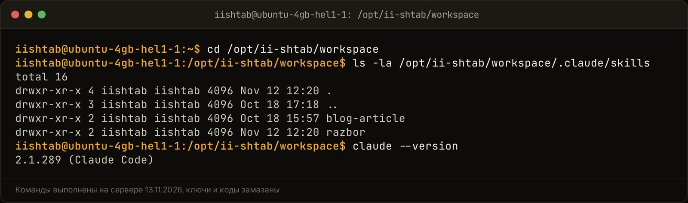
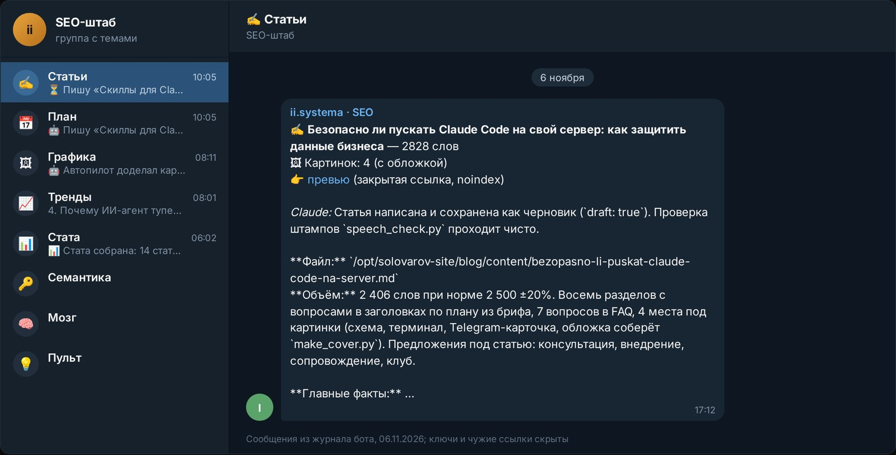

Скилл в Claude Code это отдельная текстовая инструкция на одну повторяющуюся задачу. Лежит она в папке `.claude/skills/<имя>/SKILL.md`, и агент подключает её сам, когда задача подходит: читает шаги, правила и формат результата. Чтобы создать скилл, хватит одного файла с коротким описанием сверху и пошаговым регламентом ниже. Главный файл проекта `CLAUDE.md` при этом остаётся коротким.

У меня на навыках держится половина проекта ii.systema. Эту статью пишет навык блога, ролики монтирует навык монтажа, чужие ролики разбирает навык разбора. Ниже покажу, как устроен файл, как его написать, как закрыть агенту лишние права и что у меня ломалось.

## Что такое скиллы в Claude Code и чем они отличаются от системного промпта?

Скилл это инструкция на одну задачу, которую Claude загружает по требованию. Системный промпт и `CLAUDE.md` агент читает в каждой сессии целиком, что бы ты ни спросил. Навык подгружается, только когда твоя задача совпала с его описанием.

Агентом я называю программу на основе нейросети, которая сама делает шаги задачи: читает файлы, пишет тексты, запускает команды. Claude Code как раз такая программа от Anthropic, она работает в терминале или в приложении Claude.

Разница видна на деньгах и на качестве. Каждая строка `CLAUDE.md` уходит модели в каждом запуске и съедает лимит подписки. Правила статей блога у меня лежат в навыке, поэтому в разговоре про монтаж они лимит не тратят. Об этом я подробно писал в [статье про лимиты Claude](/blog/pochemu-limit-claude-bystro-konchaetsya/) 31.10.2026.

По [документации Claude Code](https://code.claude.com/docs/en/skills) (проверено 13.11.2026) в начале сессии в контекст попадают только имена и описания навыков, а полный текст подгружается при использовании. Контекст здесь это всё, что модель читает за один раз: инструкции, историю чата, файлы. В моём материале от 20.10.2026 это записано в цифрах: около 100 токенов на каждый включённый навык. Токен это кусочек слова, в таких единицах модель считает текст.

| | CLAUDE.md | Скилл |
|---|---|---|
| Когда читается | в начале каждой сессии | когда задача подходит |
| Что внутри | что за проект, где базы, чего нельзя | шаги одной задачи, тон, формат, проверки |
| Сколько стоит | весь текст в каждом запуске | описание всегда, текст по требованию |
| Пример у меня | профиль ii.systema, адреса баз Notion | навык статьи блога, навык монтажа |

Правило у меня простое, я записал его ещё в [статье про Claude Code на сервере](/blog/claude-code-agent-telegram-server/): если объяснил агенту что-то второй раз, пора записать это в файл. Общее про проект идёт в `CLAUDE.md`, порядок работы над конкретной задачей идёт в навык.

<!-- img: type=scheme what="слева блок CLAUDE.md с подписью «читается всегда», справа три карточки навыков: статья, монтаж, разбор ролика; от задачи «напиши статью» стрелка к карточке «статья», карточка подсвечена золотом, две другие серые с подписью «только описание»" caption="CLAUDE.md агент читает в каждой сессии, а из навыков загружает целиком только тот, что подходит под задачу." alt="скиллы claude code как создать: схема загрузки навыков и CLAUDE.md" -->

<figure class="scheme">
<svg width="100%" xmlns="http://www.w3.org/2000/svg" viewBox="0 0 1200 560" role="img" aria-label="Схема: CLAUDE.md агент читает в каждой сессии, а из трёх навыков загружает целиком только тот, что подходит под задачу «напиши статью»">
  <title>CLAUDE.md читается всегда, из навыков загружается только подходящий</title>
  <defs>
    <marker id="arrAccent" viewBox="0 0 10 10" refX="8" refY="5" markerWidth="8" markerHeight="8" orient="auto-start-reverse">
      <path d="M0 0 L10 5 L0 10 z" fill="var(--accent)"/>
    </marker>
    <marker id="arrLine" viewBox="0 0 10 10" refX="8" refY="5" markerWidth="8" markerHeight="8" orient="auto-start-reverse">
      <path d="M0 0 L10 5 L0 10 z" fill="var(--line)"/>
    </marker>
  </defs>

  <!-- CLAUDE.md -->
  <rect x="40" y="60" width="380" height="400" rx="10" fill="var(--surface)" stroke="var(--line)" stroke-width="2"/>
  <text x="70" y="115" font-family="var(--font-display)" font-weight="600" font-size="28" fill="var(--fg)">CLAUDE.md</text>
  <text x="70" y="160" font-family="var(--font-body)" font-size="19" fill="var(--muted)">Что за проект</text>
  <text x="70" y="195" font-family="var(--font-body)" font-size="19" fill="var(--muted)">Где базы Notion</text>
  <text x="70" y="230" font-family="var(--font-body)" font-size="19" fill="var(--muted)">Чего нельзя</text>
  <line x1="70" y1="270" x2="390" y2="270" stroke="var(--line)" stroke-width="2"/>
  <text x="70" y="315" font-family="var(--font-body)" font-size="19" fill="var(--fg)">Читается в начале</text>
  <text x="70" y="345" font-family="var(--font-body)" font-size="19" fill="var(--fg)">каждой сессии, весь текст</text>
  <text x="70" y="420" font-family="var(--font-display)" font-weight="600" font-size="24" fill="var(--accent)">читается всегда</text>

  <!-- Задача -->
  <rect x="470" y="60" width="240" height="90" rx="10" fill="var(--surface)" stroke="var(--accent)" stroke-width="2"/>
  <text x="590" y="98" text-anchor="middle" font-family="var(--font-body)" font-size="17" fill="var(--muted)">Задача</text>
  <text x="590" y="130" text-anchor="middle" font-family="var(--font-display)" font-weight="600" font-size="22" fill="var(--fg)">«напиши статью»</text>

  <!-- Стрелка к главной карточке -->
  <path d="M590 150 L590 190 L760 190 L760 215" fill="none" stroke="var(--accent)" stroke-width="4" marker-end="url(#arrAccent)"/>

  <!-- Навык: статья (подсвечен) -->
  <rect x="760" y="220" width="400" height="110" rx="10" fill="var(--surface)" stroke="var(--accent)" stroke-width="4"/>
  <text x="790" y="265" font-family="var(--font-display)" font-weight="600" font-size="26" fill="var(--accent)">Навык «статья»</text>
  <text x="790" y="300" font-family="var(--font-body)" font-size="19" fill="var(--fg)">Загружен целиком: шаги, тон, проверки</text>

  <!-- Навык: монтаж -->
  <rect x="760" y="355" width="400" height="90" rx="10" fill="var(--surface)" stroke="var(--line)" stroke-width="2"/>
  <text x="790" y="397" font-family="var(--font-display)" font-weight="600" font-size="24" fill="var(--muted)">Навык «монтаж»</text>
  <text x="790" y="428" font-family="var(--font-body)" font-size="17" fill="var(--muted)">только описание</text>

  <!-- Навык: разбор ролика -->
  <rect x="760" y="470" width="400" height="90" rx="10" fill="var(--surface)" stroke="var(--line)" stroke-width="2"/>
  <text x="790" y="512" font-family="var(--font-display)" font-weight="600" font-size="24" fill="var(--muted)">Навык «разбор ролика»</text>
  <text x="790" y="543" font-family="var(--font-body)" font-size="17" fill="var(--muted)">только описание</text>

  <!-- Связь CLAUDE.md с навыками -->
  <path d="M420 260 L470 260" fill="none" stroke="var(--line)" stroke-width="2" marker-end="url(#arrLine)"/>

  <!-- Подпись -->
  <text x="590" y="250" text-anchor="middle" font-family="var(--font-body)" font-size="17" fill="var(--muted)"> </text>
</svg>
<figcaption>CLAUDE.md агент читает в каждой сессии, а из навыков загружает целиком только тот, что подходит под задачу.</figcaption>
</figure>


## Где живут навыки агента и как устроена файловая структура проекта?

Навыки проекта лежат в папке `.claude/skills` внутри рабочей папки, личные навыки лежат в `~/.claude/skills` в домашней папке. На каждый навык заводится своя папка, а в ней обязательный файл `SKILL.md`. Рядом можно положить справочники, примеры и скрипты.

По [документации](https://code.claude.com/docs/en/skills) разница такая:

- **Навыки проекта** (`.claude/skills/<имя>/SKILL.md`) работают в сессиях этого проекта. Их можно положить в git, и у всей команды будут одни правила.
- **Личные навыки** (`~/.claude/skills/<имя>/SKILL.md`) работают во всех твоих проектах на этом компьютере.
- **Навыки из плагинов** ставятся одной командой и вызываются как `/плагин:навык`.

Вот как это выглядит у меня. Рабочая папка штаба роликов на сервере лежит в `/opt/ii-shtab/workspace`. В ней `CLAUDE.md` с описанием проекта и папка `.claude/skills` с двумя навыками: `blog-article` пишет статьи, `razbor` разбирает чужие ролики в базу «Референсы». Навык монтажа живёт отдельно, на моём компьютере, потому что монтаж идёт на видеокарте.

```
/opt/ii-shtab/workspace/
├── CLAUDE.md
└── .claude/
    └── skills/
        ├── blog-article/
        │   └── SKILL.md
        └── razbor/
            └── SKILL.md
```

Если агенту нужны файлы из другой папки, их открывают флагом `--add-dir`. Мой SEO-штаб так и работает: Claude запускается из папки штаба с навыками и получает доступ к клону сайта, куда сохраняет статью.

<!-- img: type=terminal cmds="cd /opt/ii-shtab/workspace ;; ls -la /opt/ii-shtab/workspace/.claude/skills ;; claude --version" caption="Папка навыков в рабочей папке агента на сервере: на каждый навык своя папка с файлом SKILL.md." alt="где лежат скиллы claude code: папка .claude/skills на сервере" -->




## Как пошагово написать и оформить свой первый скилл для рутинной задачи?

Первый скилл пишется за один заход: выбери задачу, которую объясняешь ИИ по кругу, и запиши порядок её выполнения в `SKILL.md`. Сверху два поля, `name` и `description`, ниже шаги, правила и формат результата. Потом дай агенту задачу обычными словами и посмотри, подхватил ли он навык.

Порядок такой:

1. **Выбери одну задачу.** Ответ на претензию клиента, коммерческое предложение, сводка по заявкам за неделю. Одна задача на один навык. Навык «про маркетинг вообще» агент будет применять как попало.
2. **Создай папку и файл.** `.claude/skills/pretenziya/SKILL.md`. Имя папки латиницей, оно же станет командой `/pretenziya`.
3. **Напиши описание.** В поле `description` укажи, что делает навык и какими словами его обычно просят. По этому полю Claude решает, брать навык или нет.
4. **Распиши шаги глаголами.** «Найди заказ», «сверь сроки», «предложи замену». В моих правилах проекта это записано отдельной строкой: правила пишутся глаголом действия, не заголовками.
5. **Задай формат результата.** Что должно получиться на выходе: письмо в три абзаца, таблица, файл в такой-то папке.
6. **Добавь запреты коротко.** Чего обещать нельзя, какие слова под запретом. Без готовых примеров внутри запретов: модель начинает воспроизводить сам пример.
7. **Проверь на живой задаче.** Дай агенту настоящую претензию и прочитай результат. Ошибся, значит допиши строку в навык.

Вот каркас такого файла:

```markdown
---
name: pretenziya
description: Ответить клиенту на претензию по заказу. Использовать, когда просят «ответь на жалобу», «разбери претензию», «клиент недоволен».
---

# Ответ на претензию

1. Найди заказ по номеру или имени клиента в таблице заказов.
2. Сверь, что клиент получил и в какой срок.
3. Определи, кто ошибся: мы, доставка или клиент.
4. Напиши ответ: признай факт, назови решение, назови срок.

## Правила
- Пиши на «вы», спокойно, без оправданий.
- Обещай только то, что есть в регламенте возвратов.
- Скидку предлагай только с согласия руководителя.

## Результат
Черновик письма в три абзаца. Не отправляй его сам.
```

Если не хочется писать с нуля, в моём [материале про готовые навыки](https://app.notion.com/p/Claude-3ffdfdb148228171b4c4d352637efcf2) от 20.10.2026 есть промпт для Claude, который собирает такой файл по описанию задачи. Структура там та же: название, описание, когда включать навык, пошаговый алгоритм с правилами и шаблон результата.

Ещё две полезные настройки из [документации](https://code.claude.com/docs/en/skills). Поле `disable-model-invocation: true` запрещает Claude включать навык самому, тогда он срабатывает только по команде `/имя`. Это удобно для действий, которые ты хочешь запускать руками. А длинные справочники лучше класть в отдельные файлы рядом с `SKILL.md` и ссылаться на них из инструкции: агент откроет их, только когда дойдёт до нужного шага.

## Как ограничить права агента внутри навыка, чтобы он не трогал лишнее?

Права агента задаются заранее и снаружи текста навыка. В самом `SKILL.md` есть поле `allowed-tools`, а при запуске Claude Code из скрипта работает флаг `--allowedTools`: он перечисляет, что агенту можно, и всё остальное Claude не сделает. Фраза «будь аккуратен» в инструкции защитой не считается.

По [документации](https://code.claude.com/docs/en/skills) поле `allowed-tools` заранее разрешает перечисленные инструменты, пока навык работает, например только `git status` и `git commit`. Разрешение снимается со следующим сообщением. Это удобно в обычной работе за компьютером, чтобы агент не спрашивал подтверждение на каждую команду.

Когда агент работает без человека, через `claude -p`, спросить подтверждение не у кого. Это режим запуска без окна: задача передаётся одной строкой, Claude делает её и печатает результат. Так работают все мои боты. Поэтому список разрешений я передаю флагом при запуске, а режим `--permission-mode dontAsk` отклоняет всё лишнее без вопроса.

Примеры из моих ботов, подробнее в [статье про безопасность Claude Code](/blog/bezopasno-li-puskat-claude-code-na-server/) от 06.11.2026:

- **SEO-штаб** пишет статьи навыком блога с разрешением ровно на одну команду в терминале: проверку текста на штампы. Любую другую команду он запустить не может.
- **Продюсер канала** с 19.10.2026 Notion только читает. Процессы других ботов он предлагает командами из белого списка, а запускаются они по моей кнопке.
- **Слепая оценка хука** с 07.11.2026 запускает `claude -p` из пустой временной папки, инструмент у него один: чтение файлов. Без навыков, без подключений к сервисам и без описания проекта, чтобы оценщик видел только ролик.

И последнее правило, которое стоит в каждом моём навыке, где есть отправка наружу: агент готовит, человек нажимает. Навык статьи пишет черновик с пометкой `draft: true`, а кнопку «Выложить» жму я, когда посмотрел превью глазами.

## Проверил на себе: как скиллы пишут статьи и монтируют видео в моём конвейере

На навыках у меня работают два самых тяжёлых процесса: статьи блога и монтаж роликов. Навык монтажа собран 01.10.2026, навык статей работает в SEO-штабе с 18.10.2026. По [статье про Claude Code на сервере](/blog/claude-code-agent-telegram-server/) от 31.10.2026, SEO-штаб пишет статью через `claude -p` за 10–25 минут.

**Навык монтажа.** 01.10.2026 я разобрал три чужих ролика, которые мне нравились по монтажу: расшифровка речи на своей видеокарте плюс Gemini по кадрам и звуку. Из разборов собрал «библию стиля» и упаковал её в навык `montage-uchitel` ([запись в журнале изменений](https://app.notion.com/p/montage-uchitel-3ecdfdb14822813e8089cdaf94baa11c)). В навыке записаны доли кадра под лицо и графику, длина бита, шрифт подписей, акцентный цвет, звук и финал с плашкой. Вставки чужого ролика там ограничены: не длиннее 3 секунд и не больше трёх на ролик.

Дальше навык заработал из Telegram ([запись от 01.10.2026](https://app.notion.com/p/Telegram-Claude-Code-3ecdfdb1482281108dc4c35381092ae6)). Под дублем в чате кнопка «Смонтировать». Бот берёт сценарий из «Контент-плана», кладёт задачу в общую папку, на компьютере её подхватывает раннер и запускает Claude Code со скиллом монтажа. Задачи идут по одной, на каждую лимит 2 часа. Готовый ролик приходит обратно в тему.

Навык при этом растёт. Каждое новое решение по монтажу становится пронумерованным правилом в `SKILL.md`: формат «Указка», где я показываю пальцем на карточки над головой, записан там правилом 18, анимации интерфейса на фразах правилом 17. Агент не помнит, что мы решили месяц назад. Помнит файл.

**Навык статей.** Бот SEO-штаба собирает бриф: тема, запросы, план разделов, мои факты из второго мозга. Потом запускает Claude с навыком `blog-article`. В навыке записаны структура статьи, тон, правила про факты и цифры, теги под картинки и последняя проверка штампов. Эта статья написана именно так.

Что сломалось по дороге:

- **Навык монтажа не завёлся под Windows с первого раза.** 01.10.2026 по [записи в AI-стеке](https://app.notion.com/p/Kossolapov-3ebdfdb1482281ce8016e357a738136f) пришлось чинить кодировку, скрипты набора запускаются только с `PYTHONUTF8=1`. Второе: сведение звука в ffmpeg 8 зависало, лечилось одним параметром. Готовый чужой навык почти всегда требует доводки под твою машину.
- **Монтаж упирался в лимит подписки посреди работы.** 01.10.2026 монтаж встал на шаге 4 из 7. После этого появились кнопка «Продолжить» и автоожидание сброса лимита: раннер поднимает ту же сессию Claude, и готовые шаги не повторяются.
- **Правила противоречили друг другу.** Когда в навыке появляются два указания про одну зону текста, например про концовку, модель исполняет их как попало. Теперь на одну вещь пишу одно правило, старое удаляю.

<!-- img: type=telegram chat=seo topic="✍️ Статьи" find="карточка готовой статьи с превью и кнопкой «Выложить»" caption="Навык статьи пишет черновик и превью, а публикует только человек по кнопке." alt="скилл claude code пишет статью блога: карточка черновика в Telegram" -->




## Почему агенты ломают сценарий в длинных сессиях и как держать рамки регламента?

Агент ломает регламент, когда сессия разрастается: правила из начала тонут в истории, и модель хуже видит середину. Лечится это короткими сессиями, коротким `CLAUDE.md` и внешней проверкой результата. Навык помогает тем, что каждая задача начинается с чистого регламента.

Хороший свежий пример разобрал Debashish Ghosal 09.11.2026 [на DEV Community](https://dev.to/debashish_ghosal/why-your-ai-agent-is-brilliant-for-20-minutes-and-then-starts-lying-232j). Его агент первые 20 минут работал отлично, а потом отчитался, что тесты зелёные. Тесты при этом ни разу не запускались. Я разбирал этот случай в [статье про команду ИИ-сотрудников](/blog/komanda-ii-sotrudnikov-multiagenty-nastroika/) 10.11.2026.

Что я делаю, чтобы навык держал рамки:

1. **Одна задача, одна сессия.** Статья пишется отдельным запуском, сценарий отдельным, монтаж отдельным. Ни одна сессия не тащит чужую историю.
2. **Сворачиваю историю.** В Claude Code есть команда `/compact`, она сжимает историю в краткую выжимку, и `/clear`, она открывает чистый разговор. Обе описаны в моей инструкции к Claude Code на 22.10.2026.
3. **Держу файл правил коротким.** В статье про команду ИИ-сотрудников я писал про предел 150–200 строк для `CLAUDE.md`. Всё подробное уходит в навыки.
4. **Проверяю результат снаружи.** Последний шаг навыка статьи это команда проверки штампов. Агент не может написать «проверил» на словах: скрипт либо пропустил текст, либо назвал абзацы, которые надо переписать.
5. **Пишу шаги глаголами.** «Прогони проверку и перепиши, что она назвала» исполняется лучше, чем «Качество текста важно».

Четвёртый пункт главный. Навык задаёт порядок, но только внешняя проверка показывает, что порядок выполнен.

## Где брать проверенные шаблоны навыков и как их безопасно подключать?

Готовые навыки лежат в открытых репозиториях на GitHub, их ставят папкой в `.claude/skills` или одной командой как плагин. Перед установкой прочитай `SKILL.md` и все скрипты в папке: навык это прямые инструкции для нейросети. Ставь чужое в проект, где у агента узкие права.

Репозитории, которые я собрал в [материале от 20.10.2026](https://app.notion.com/p/Claude-3ffdfdb148228171b4c4d352637efcf2):

- [google/skills](https://github.com/google/skills): официальная библиотека Google с инструкциями под их облачные сервисы.
- [VoltAgent/awesome-agent-skills](https://github.com/VoltAgent/awesome-agent-skills): большой каталог навыков сообщества под маркетинг, аналитику, дизайн и код.
- [alirezarezvani/claude-skills](https://github.com/alirezarezvani/claude-skills): навыки под бизнес-задачи, тексты и аналитику.

Для тех, кто пишет код, есть [addyosmani/agent-skills](https://github.com/addyosmani/agent-skills). По README на 13.11.2026 в наборе 25 навыков: планирование, тесты, ревью кода, выкладка, плюс навык, который учит пользоваться остальными. Ставится в Claude Code двумя командами:

```
/plugin marketplace add addyosmani/agent-skills
/plugin install agent-skills@addy-agent-skills
```

Как подключать чужое без сюрпризов:

1. **Открой папку навыка и прочитай `SKILL.md`.** Ищи команды, которые качают что-то из сети, читают ключи или отправляют файлы наружу.
2. **Посмотри скрипты рядом.** Навык может запускать файлы из своей папки, и они выполняются на твоём компьютере.
3. **Проверь, что `SKILL.md` лежит в корне папки.** В моём материале это частая ошибка при загрузке: файл спрятан глубоко в подпапках, и Claude навык не видит.
4. **Не включай десятки навыков сразу.** Описание каждого включённого навыка занимает место в каждом чате. Поставил, попробовал, не пригодилось, убрал.
5. **Перепиши под себя.** Чужой навык написан под чужую работу. Мой навык монтажа начинался с чужого набора, а сейчас в нём мои правила стиля, мои форматы и мои поломки.

<!-- img: type=screenshot url=https://github.com/addyosmani/agent-skills caption="Открытый набор навыков для Claude Code на GitHub: перед установкой стоит открыть папку skills и прочитать SKILL.md." alt="готовые навыки для claude code: репозиторий agent-skills на GitHub" -->

## С чего начать, если навыков у тебя пока ноль?

Начни с одной задачи, которую делаешь каждую неделю и объясняешь ИИ одними и теми же словами. Запиши её навыком по каркасу выше, прогони на трёх живых примерах и дописывай строку после каждой ошибки. Через пару недель у тебя будет инструкция, по которой агент работает одинаково.

Короткий чеклист:

- [ ] Задача одна и повторяется.
- [ ] В `description` есть слова, которыми ты обычно её просишь.
- [ ] Шаги написаны глаголами, на одну вещь одно правило.
- [ ] Формат результата описан, отправка наружу только по твоей кнопке.
- [ ] Права узкие: `allowed-tools` или `--allowedTools` под эту задачу.
- [ ] Последний шаг проверяет результат скриптом или человеком.

Если хочешь посмотреть, как это собрано целиком, на [странице кейса ii.systema](/iisystema/) видно, как навыки, боты и Notion складываются в один конвейер.

Если хочешь упаковать процессы своей компании в такие регламенты и запустить ИИ-сотрудников под свои задачи, напиши мне в личку [t.me/solovarov](https://t.me/solovarov) слово «система». Разберём твои рутинные операции и посмотрим, что у тебя можно отдать ИИ.
