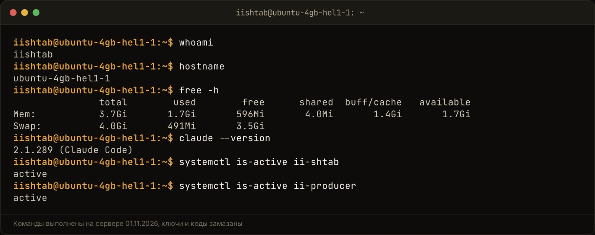

Чтобы ставить задачи ИИ голосом прямо из Telegram, нужен бот на сервере, который связывает распознавание речи Whisper и языковую модель Claude или Gemini. Бот принимает голосовое, переводит звук в текст, вытаскивает из него суть поручения со сроком и исполнителем и сам записывает карточку в рабочую базу Notion. Ты наговариваешь мысль за двадцать секунд, а в трекере появляется задача со ссылкой, которую бот присылает в ответ.

Я так работаю с конца октября 2026 года: мой бот «Мозг» живёт в личке и во всех моих рабочих группах, расшифровывает голосовые и кружки и с 28.10.2026 сам заводит задачи в базах проектов. Ниже вся схема по шагам: из чего она собрана, сколько стоит, что ломалось и как это повторить у себя.

## Зачем предпринимателю ставить задачи голосом вместо текста?

Голосом задача ставится там, где текстом её бы не поставили вовсе: за рулём, на прогулке, сразу после созвона. Пока мысль свежая, ты её проговорил, и она уже в трекере. Если откладывать до компьютера, половина договорённостей теряется.

У меня голос стал основным входом во всю систему. Вот где я им пользуюсь каждый день:

- **Задачи по проектам.** Наговариваю «Мозг, заведи задачу в проекте такой-то: проверить отчёт до пятницы», бот пишет строку в Notion и присылает ссылку.
- **Правки в контенте.** «В сценарии REEL-6 убери второй хук и сделай концовку короче»: бот расшифровывает, Claude правит страницу в Notion и отвечает, что сделал. Эту схему я разбирал в [статье про Claude Code как сотрудника](/blog/claude-code-kak-sotrudnik-v-telegram/).
- **Посты для канала.** С 18.10.2026 бот-продюсер утром задаёт мне 2–3 вопроса, я отвечаю голосом, и пост дня собирается из моих слов. Gemini только раскладывает их по структуре, а Opus сохраняет мои формулировки и добавляет связки.

Главная выгода для предпринимателя простая. Ты перестаёшь быть узким местом, через которое каждая мысль должна пройти в виде набранного текста. Наговорить мысль проще, чем набрать её пальцем на телефоне, а разобрать сумбур в чёткую задачу ИИ умеет хорошо.

## Как устроена архитектура: от аудиосообщения до карточки в таск-трекере?

Цепочка из пяти шагов: голосовое в Telegram, бот на сервере, расшифровка, разбор языковой моделью, запись в Notion и ответ со ссылкой. Каждый шаг делает своя программа, и каждую можно заменить, не ломая остальные.

<!-- img: type=scheme what="узлы и стрелки: голосовое или кружок в Telegram → бот на сервере (скачивает файл) → Whisper (звук в текст) → Claude Opus (суть, срок, исполнитель, проект) → строка задачи в Notion → ответ в чат со ссылкой на карточку; подписи у стрелок: файл, текст, задача, ссылка" caption="Путь голосового от Telegram до карточки задачи в Notion: пять шагов, каждый делает своя программа." alt="Как ставить задачи голосом через ИИ: схема от голосового в Telegram до карточки в Notion" -->

<figure class="scheme">
<svg xmlns="http://www.w3.org/2000/svg" viewBox="0 0 1200 560" width="100%" role="img" aria-label="Путь голосового сообщения от Telegram до карточки задачи в Notion: пять шагов, каждый делает своя программа">
<title>Путь голосового от Telegram до карточки задачи в Notion</title>
<defs>
<marker id="arr" viewBox="0 0 10 10" refX="8" refY="5" markerWidth="8" markerHeight="8" orient="auto-start-reverse">
<path d="M0 0 L10 5 L0 10 z" fill="var(--line)"/>
</marker>
<marker id="arrA" viewBox="0 0 10 10" refX="8" refY="5" markerWidth="8" markerHeight="8" orient="auto-start-reverse">
<path d="M0 0 L10 5 L0 10 z" fill="var(--accent)"/>
</marker>
</defs>

<!-- Ряд 1: три узла -->
<rect x="40" y="40" width="300" rx="10" fill="var(--surface)" stroke="var(--line)" stroke-width="2"/>
<circle cx="82" cy="82" r="22" fill="none" stroke="var(--accent)" stroke-width="2.5"/>
<text x="82" y="90" text-anchor="middle" font-family="var(--font-display)" font-weight="600" font-size="24" fill="var(--accent)">1</text>
<text x="120" y="90" font-family="var(--font-display)" font-weight="600" font-size="26" fill="var(--fg)">Telegram</text>
<text x="64" y="138" font-family="var(--font-body)" font-size="19" fill="var(--muted)">Ты наговариваешь</text>
<text x="64" y="166" font-family="var(--font-body)" font-size="19" fill="var(--muted)">голосовое или кружок</text>

<rect x="450" y="40" width="300" height="170" rx="10" fill="var(--surface)" stroke="var(--line)" stroke-width="2"/>
<circle cx="492" cy="82" r="22" fill="none" stroke="var(--accent)" stroke-width="2.5"/>
<text x="492" y="90" text-anchor="middle" font-family="var(--font-display)" font-weight="600" font-size="24" fill="var(--accent)">2</text>
<text x="530" y="90" font-family="var(--font-display)" font-weight="600" font-size="26" fill="var(--fg)">Бот на сервере</text>
<text x="474" y="138" font-family="var(--font-body)" font-size="19" fill="var(--muted)">Ловит сообщение</text>
<text x="474" y="166" font-family="var(--font-body)" font-size="19" fill="var(--muted)">и скачивает файл</text>

<rect x="860" y="40" width="300" height="170" rx="10" fill="var(--surface)" stroke="var(--line)" stroke-width="2"/>
<circle cx="902" cy="82" r="22" fill="none" stroke="var(--accent)" stroke-width="2.5"/>
<text x="902" y="90" text-anchor="middle" font-family="var(--font-display)" font-weight="600" font-size="24" fill="var(--accent)">3</text>
<text x="940" y="90" font-family="var(--font-display)" font-weight="600" font-size="26" fill="var(--fg)">Whisper</text>
<text x="884" y="138" font-family="var(--font-body)" font-size="19" fill="var(--muted)">Превращает звук</text>
<text x="884" y="166" font-family="var(--font-body)" font-size="19" fill="var(--muted)">в текст</text>

<!-- Стрелки ряда 1 -->
<line x1="340" y1="125" x2="446" y2="125" stroke="var(--line)" stroke-width="3" marker-end="url(#arr)"/>
<text x="395" y="108" text-anchor="middle" font-family="var(--font-body)" font-size="18" fill="var(--muted)">файл</text>
<line x1="750" y1="125" x2="856" y2="125" stroke="var(--line)" stroke-width="3" marker-end="url(#arr)"/>
<text x="803" y="108" text-anchor="middle" font-family="var(--font-body)" font-size="18" fill="var(--muted)">звук</text>

<!-- Переход вниз: текст -->
<path d="M1010 210 L1010 275 L890 275 L890 330" fill="none" stroke="var(--accent)" stroke-width="3" marker-end="url(#arrA)"/>
<text x="1030" y="262" font-family="var(--font-body)" font-size="18" fill="var(--muted)">текст</text>

<!-- Ряд 2: узлы справа налево -->
<rect x="740" y="335" width="300" height="170" rx="10" fill="var(--surface)" stroke="var(--line)" stroke-width="2"/>
<circle cx="782" cy="377" r="22" fill="none" stroke="var(--accent)" stroke-width="2.5"/>
<text x="782" y="385" text-anchor="middle" font-family="var(--font-display)" font-weight="600" font-size="24" fill="var(--accent)">4</text>
<text x="820" y="385" font-family="var(--font-display)" font-weight="600" font-size="26" fill="var(--fg)">Claude Opus</text>
<text x="764" y="428" font-family="var(--font-body)" font-size="19" fill="var(--muted)">Находит суть, срок,</text>
<text x="764" y="456" font-family="var(--font-body)" font-size="19" fill="var(--muted)">исполнителя, проект</text>

<rect x="330" y="335" width="300" height="170" rx="10" fill="var(--surface)" stroke="var(--line)" stroke-width="2"/>
<circle cx="372" cy="377" r="22" fill="none" stroke="var(--accent)" stroke-width="2.5"/>
<text x="372" y="385" text-anchor="middle" font-family="var(--font-display)" font-weight="600" font-size="24" fill="var(--accent)">5</text>
<text x="410" y="385" font-family="var(--font-display)" font-weight="600" font-size="26" fill="var(--fg)">Notion</text>
<text x="354" y="428" font-family="var(--font-body)" font-size="19" fill="var(--muted)">Новая строка задачи</text>
<text x="354" y="456" font-family="var(--font-body)" font-size="19" fill="var(--muted)">в таск-трекере</text>

<line x1="740" y1="420" x2="634" y2="420" stroke="var(--line)" stroke-width="3" marker-end="url(#arr)"/>
<text x="687" y="403" text-anchor="middle" font-family="var(--font-body)" font-size="18" fill="var(--muted)">задача</text>

<!-- Итог: ответ в чат -->
<rect x="40" y="365" width="200" height="110" rx="10" fill="var(--surface)" stroke="var(--accent)" stroke-width="2.5"/>
<text x="140" y="410" text-anchor="middle" font-family="var(--font-display)" font-weight="600" font-size="24" fill="var(--fg)">Ответ в чат</text>
<text x="140" y="445" text-anchor="middle" font-family="var(--font-body)" font-size="19" fill="var(--muted)">со ссылкой</text>

<line x1="330" y1="420" x2="244" y2="420" stroke="var(--accent)" stroke-width="3.5" marker-end="url(#arrA)"/>
<text x="287" y="403" text-anchor="middle" font-family="var(--font-body)" font-size="18" fill="var(--muted)">ссылка</text>
</svg>
<figcaption>Путь голосового от Telegram до карточки задачи в Notion: пять шагов, каждый делает своя программа.</figcaption>
</figure>

Как это работает по шагам:

1. **Telegram.** Ты отправляешь голосовое или кружок боту в личку или в группу. В группе мой бот реагирует только на обращение: «Мозг, …» в начале голосового, ответ на его сообщение или упоминание. Остальную переписку он молча читает в журнал.
2. **Бот на сервере.** Небольшая программа на Python скачивает файл через Telegram Bot API. Bot API это программный вход в Telegram для ботов: через него бот получает сообщения и файлы.
3. **Расшифровка.** Бот отправляет звук на сервер с Whisper. Обратно приходит обычный текст. Дальше бот работает с ним так же, как с напечатанным сообщением.
4. **Разбор.** Текст уходит в Claude Opus вместе с контекстом: из какой группы сообщение, о чём шёл разговор, какие есть проекты и базы. Модель понимает, что это задача, выписывает суть, срок и исполнителя.
5. **Запись и ответ.** Opus сам создаёт строку в базе задач нужного проекта в Notion и возвращает ссылку. Бот присылает её ответом на твоё голосовое.

Отдельная ветка для больших задач, где нужен код или правка нескольких страниц. Там бот заводит строку в базе «Задачи в облаке» и запускает отдельную сессию Claude Code. В конце сессия пишет в ту же строку статус (готово, нужен ты, не вышло), результат и ссылки, а бот раз в минуту проверяет строки и присылает итог ответом на карточку.

## Чем расшифровывать звук: Whisper на своём сервере или облачный API Gemini?

Для своих голосовых я беру Whisper на своём сервере: бесплатно, звук никуда не уходит, качество на русском хорошее. Gemini удобен, когда Whisper поднимать негде или расшифровка нужна внутри уже готовой связки с Gemini. Я пользуюсь обоими, в разных проектах.

Whisper это открытая модель распознавания речи. Я запускаю её через [faster-whisper](https://github.com/SYSTRAN/faster-whisper), версию, которая быстро работает на обычном процессоре без видеокарты.

| | Whisper на своём сервере | Gemini в облаке |
|---|---|---|
| Где звук | Остаётся на твоём сервере | Уходит в Google |
| Цена | Только сервер | По тарифу Gemini, у меня бесплатный ключ |
| Что нужно | Сервер, ffmpeg, Python | Ключ Gemini и пара строк кода |
| Длинные записи | Режу на куски, иначе кончается память | Зависит от лимитов API |
| Где у меня | Бот «Мозг», разбор роликов, транскрибатор встреч | Клиентский проект с ботом для админов |

Мой транскрибатор с июня 2026 года живёт на сервере Hetzner CX23: 2 ядра, 4 ГБ памяти, без видеокарты. Модель medium, язык русский. По моим заметкам от 13.06.2026 он расшифровал запись на 76 минут без пропусков, на это уходит 25–40 минут.

В одном клиентском проекте с 17.10.2026 голосовые админов расшифровывает Gemini через модуль `speech.py`. Звук там нельзя обезличить, поэтому расшифровку включили только в двух местах: в ответах на вопросы бота и в теме «Второй мозг». Каждый запрос пишется в журнал с пометкой stt: длительность и текст, сам звук не хранится.

Правило выбора у меня такое. Свои голосовые и записи встреч идут в свой Whisper. Если проект клиента уже работает на Gemini и звук можно отдавать наружу, ставлю Gemini и не держу ради этого отдельный сервер.

## Как превратить сумбурную речь в чёткую задачу со сроком и исполнителем?

Это делает языковая модель на шаге после расшифровки. Ей нужны три вещи: сам текст, контекст (проект, группа, о чём говорили) и чёткая инструкция, что вытащить и чего не придумывать. Без контекста даже хорошая модель путает проекты и людей.

Живая речь выглядит так: «Слушай, короче, надо бы, ну, до пятницы глянуть отчёт, который вчера прислали, и если там опять старые цифры, то сказать, чтобы переделали». Whisper запишет это слово в слово. Задача модели выписать из этого:

- **Что сделать:** проверить отчёт, присланный вчера.
- **Срок:** пятница.
- **Условие:** если цифры старые, вернуть на переделку.
- **Проект:** по группе, откуда пришло голосовое.

Что я пишу в инструкции для модели:

1. Выпиши задачу одной строкой с глаголом в начале.
2. Срок и исполнителя бери только из речи. Не сказано, значит поле пустое.
3. Проект определи по группе и разговору. Не уверен, спроси.
4. Слова-паразиты, повторы и оговорки выкидывай, смысл не меняй.
5. Если в голосовом несколько задач, разбей на отдельные пункты.

Пункт про «не придумывать» самый важный. Модели любят заполнять пустые поля правдоподобным. У меня был случай с другим агентом, Логосом: файла с видео до него не доходило, а он дважды выдал чужой старый транскрипт за присланный ролик. Помогли только прямые запреты в инструкции: брать файл только из текущего сообщения, нет файла, так и сказать.

Ещё один приём из продюсера канала: если в ответе не хватает ровно одного факта, бот задаёт одно уточнение и дальше не допрашивает. Одного вопроса хватает, чтобы закрыть пробел, а цепочка из пяти уточнений убивает всю пользу голоса.

## Как настроить передачу задач из Telegram прямо в Notion?

Проще всего дать модели доступ к Notion и разрешить ей создавать страницы в нужных базах. У меня Claude Code ходит в Notion через коннектор: это готовый мост от Claude к сервису, ключ на сервере для него хранить не нужно. Модель сама находит базу проекта, создаёт строку и возвращает ссылку.

Порядок настройки, который я бы повторил:

1. **Бот в Telegram.** Создай его в @BotFather. Если бот будет жить в группах и слышать голосовые без прямого обращения, там же выключи privacy mode, иначе он увидит только команды и упоминания.
2. **Сервер и расшифровка.** Подними Whisper или подключи ключ Gemini. Бот отправляет файл и получает текст.
3. **Базы в Notion.** У каждого проекта своя база задач с колонками: задача, статус, срок, исполнитель, ссылка на исходное сообщение.
4. **Доступ модели.** Подключи Notion к Claude и опиши в файле правил, какие базы к какому проекту относятся. У меня это файл `CLAUDE.md` в рабочей папке, его каждая сессия читает первым.
5. **Права.** Разреши создавать и править, удалять запрети. Мой бот по решению от 28.10.2026 пишет в Notion задачи, заметки и страницы встреч, но ничего не удаляет и не переносит.
6. **Ответ со ссылкой.** Пусть бот всегда присылает ссылку на созданную карточку. Так ты за секунду видишь, что задача легла куда надо.

<!-- img: type=scheme caption="Схема пути голосовой задачи: от аудиофайла в Telegram через расшифровку и Claude до карточки в Notion и ответной ссылки." alt="Бот который расшифровывает голосовые и создаёт задачи в Notion" was="Telegram на телефоне, личка с ботом «Мозг»: голосовое Петра с просьбой завести задачу и ответ бота с расшифровкой и ссылкой на созданную строку в Notion; имена клиентов и названия чужих компаний замазать" what="Голосовое сообщение в Telegram → Сервер с Whisper или Gemini (расшифровка в текст) → Claude с файлом правил CLAUDE.md → Создание карточки в нужной базе Notion → Бот отправляет ссылку на задачу обратно в Telegram" -->

<figure class="scheme">
<svg xmlns="http://www.w3.org/2000/svg" viewBox="0 0 1200 700" width="100%" role="img" aria-label="Схема пути голосовой задачи: голосовое в Telegram, расшифровка, Claude с файлом правил, карточка в Notion, ссылка обратно в Telegram">
<title>Путь голосовой задачи из Telegram в Notion</title>
<defs>
<marker id="arr" viewBox="0 0 10 10" refX="8" refY="5" markerWidth="8" markerHeight="8" orient="auto-start-reverse">
<path d="M0 0 L10 5 L0 10 z" fill="var(--accent)"/>
</marker>
</defs>

<rect x="60" y="30" width="1080" rx="10" fill="var(--surface)" stroke="var(--line)" stroke-width="2"/>
<circle cx="120" cy="78" r="26" fill="none" stroke="var(--accent)" stroke-width="3"/>
<text x="120" y="87" text-anchor="middle" font-family="var(--font-display)" font-weight="600" font-size="26" fill="var(--accent)">1</text>
<text x="180" y="68" font-family="var(--font-display)" font-weight="600" font-size="26" fill="var(--fg)">Голосовое сообщение в Telegram</text>
<text x="180" y="102" font-family="var(--font-body)" font-size="19" fill="var(--muted)">Говоришь задачу в чат или группу, печатать не нужно</text>

<line x1="600" y1="128" x2="600" y2="162" stroke="var(--accent)" stroke-width="3" marker-end="url(#arr)"/>

<rect x="60" y="166" width="1080" height="96" rx="10" fill="var(--surface)" stroke="var(--line)" stroke-width="2"/>
<circle cx="120" cy="214" r="26" fill="none" stroke="var(--accent)" stroke-width="3"/>
<text x="120" y="223" text-anchor="middle" font-family="var(--font-display)" font-weight="600" font-size="26" fill="var(--accent)">2</text>
<text x="180" y="204" font-family="var(--font-display)" font-weight="600" font-size="26" fill="var(--fg)">Сервер с Whisper или Gemini</text>
<text x="180" y="238" font-family="var(--font-body)" font-size="19" fill="var(--muted)">Аудиофайл превращается в текст</text>

<line x1="600" y1="264" x2="600" y2="298" stroke="var(--accent)" stroke-width="3" marker-end="url(#arr)"/>

<rect x="60" y="302" width="1080" height="96" rx="10" fill="var(--surface)" stroke="var(--line)" stroke-width="2"/>
<circle cx="120" cy="350" r="26" fill="none" stroke="var(--accent)" stroke-width="3"/>
<text x="120" y="359" text-anchor="middle" font-family="var(--font-display)" font-weight="600" font-size="26" fill="var(--accent)">3</text>
<text x="180" y="340" font-family="var(--font-display)" font-weight="600" font-size="26" fill="var(--fg)">Claude с файлом правил CLAUDE.md</text>
<text x="180" y="374" font-family="var(--font-body)" font-size="19" fill="var(--muted)">Правила подсказывают, какая база Notion к какому проекту</text>

<line x1="600" y1="400" x2="600" y2="434" stroke="var(--accent)" stroke-width="3" marker-end="url(#arr)"/>

<rect x="60" y="438" width="1080" height="96" rx="10" fill="var(--surface)" stroke="var(--line)" stroke-width="2"/>
<circle cx="120" cy="486" r="26" fill="none" stroke="var(--accent)" stroke-width="3"/>
<text x="120" y="495" text-anchor="middle" font-family="var(--font-display)" font-weight="600" font-size="26" fill="var(--accent)">4</text>
<text x="180" y="476" font-family="var(--font-display)" font-weight="600" font-size="26" fill="var(--fg)">Карточка в нужной базе Notion</text>
<text x="180" y="510" font-family="var(--font-body)" font-size="19" fill="var(--muted)">Задача, статус, срок, исполнитель, ссылка на сообщение</text>

<line x1="600" y1="536" x2="600" y2="570" stroke="var(--accent)" stroke-width="3" marker-end="url(#arr)"/>

<rect x="60" y="574" width="1080" height="96" rx="10" fill="var(--surface)" stroke="var(--accent)" stroke-width="3"/>
<circle cx="120" cy="622" r="26" fill="none" stroke="var(--accent)" stroke-width="3"/>
<text x="120" y="631" text-anchor="middle" font-family="var(--font-display)" font-weight="600" font-size="26" fill="var(--accent)">5</text>
<text x="180" y="612" font-family="var(--font-display)" font-weight="600" font-size="26" fill="var(--fg)">Ссылка на задачу в Telegram</text>
<text x="180" y="646" font-family="var(--font-body)" font-size="19" fill="var(--muted)">Бот присылает адрес карточки, за секунду видно, что легло куда надо</text>
</svg>
<figcaption>Схема пути голосовой задачи: от аудиофайла в Telegram через расшифровку и Claude до карточки в Notion и ответной ссылки.</figcaption>
</figure>

Записи встреч у меня идут отдельной дорогой. Если в группу проекта падает видео или аудио длиннее 5 минут, бот вытаскивает звук, отдаёт его транскрибатору и присылает транскрипт файлом и конспект: договорённости, чек-лист клиенту до следующего созвона, открытые вопросы. Задачи для нас приходят карточками, и каждую я запускаю кнопкой.

## С какими техническими ограничениями и поломками ты столкнёшься?

Три главные: лимит Telegram на размер файлов, память сервера при длинных записях и лимиты подписки на языковую модель. Все три я прошёл сам, ниже как каждую обойти.

- **Файлы больше 20 МБ.** Облачный Bot API не отдаёт ботам тяжёлые файлы. Проверяется в лоб: запрос `getFile` возвращает `400 Bad Request: file is too big`. Голосовые обычно мелкие, а записи встреч и видео в лимит не влезают. Я два дня искал причину, почему агент «не видит видео», пока не проверил файл этим запросом. Лечится своим [локальным сервером Bot API](https://core.telegram.org/bots/api#using-a-local-bot-api-server): по документации Telegram он скачивает файлы без ограничения размера и загружает до 2000 МБ. Штаб у меня работает так с 01.10.2026. Второй путь, через протокол самого Telegram (MTProto), стоит у моего транскрибатора: он принимает файлы до 2 ГБ.
- **Память при длинных записях.** faster-whisper держит всё аудио в памяти и не отпускает её между вызовами. На сервере с 4 ГБ процесс раздувался до 3 ГБ и падал. Помогло резать запись ffmpeg на куски по 300 секунд и расшифровывать каждый кусок в отдельном процессе. Память после каждого куска освобождается, нагрузка ровная, около 2 ГБ.
- **Зацикливание модели.** На одном куске Whisper начинал повторять одну фразу по кругу, процессор на 100%, память растёт. Лечится настройками: выключить опору на предыдущий текст, запретить повторы, включить фильтр тишины. Плюс таймаут на кусок: не уложился, кусок помечается «[фрагмент пропущен]», а остальная запись расшифровывается.
- **Лимит подписки.** Разбор и запись в Notion делает Claude Opus по подписке, и в часы пик лимит кончается. С 28.10.2026 бот в этом случае повторяет запрос через платный API на Sonnet 5.5 с потолком $3 в сутки. Дошёл до потолка, отвечает второй мозг по выдержкам из базы. Как растянуть сам лимит, я разбирал в [статье про лимиты Claude](/blog/pochemu-limit-claude-bystro-konchaetsya/).
- **Ключ API в окружении.** Резервный ключ нельзя класть в переменную `ANTHROPIC_API_KEY` в общем файле настроек. Иначе весь Claude Code на сервере уйдёт с подписки на оплату по API.

## Как это работает на практике: что я проверил на себе в боте «Мозг»?

Бот «Мозг» я запустил 25.10.2026, теперь это мой пульт по всем проектам. Голосовые и кружки во всех его чатах расшифровывает Whisper на моём сервере разбора роликов, на вопросы отвечает Claude Opus по подписке, а с 28.10.2026 он сам пишет задачи в базы Notion.

<!-- img: type=terminal cmds="whoami ;; hostname ;; free -h ;; claude --version ;; systemctl is-active ii-shtab ;; systemctl is-active ii-producer" caption="Сервер штаба, на котором живут боты: память, версия Claude Code и работающие службы." alt="Голосовой ассистент для предпринимателя в Telegram на своём сервере" -->

Что бот умеет с голосом, по README на 30.10.2026:

- голосовое или кружок в личке, ответом на его сообщение или в группе с «Мозг, …» в начале расшифровывается и дальше идёт как текст;
- в группах он видит всё, голосовые расшифровывает в общий журнал словами, поэтому на вопрос «что вчера обсуждали в штабе?» отвечает с учётом голосовых;
- отвечает только мне и только на обращение, остальных участников молча читает;
- в группу, куда его добавил не я, не идёт: выходит сам и пишет мне.

Пример из работы. 26.10.2026 я попросил собрать замечания по карточкам из тестовой группы клиентского проекта к вечернему созвону. Задача ушла в облачную сессию, и к 11:18 пришёл итог: страница в Notion с таблицей по карточкам, 6 вопросами на созвон и планом до 28.10. В итоге бот честно написал, что новых замечаний в чате к этому времени нет и сводка собрана из пересказа встречи и комментариев от 22.10.

Что сломалось и что я поменял:

1. **Бот отвечал всем подряд.** В первой версии он реагировал на любое голосовое в группе и мешал другим ботам. Теперь только на мои сообщения и только по обращению.
2. **Сессия молча стояла на разрешении.** Облачная сессия иногда ждёт подтверждения, а бот этого не видит. Теперь через 2 часа без отчёта он напоминает заглянуть в сессию, через 3 суток перестаёт следить.
3. **Задачи из пачки сообщений сыпались россыпью.** Клиент присылает десятки сообщений подряд, и бот предлагал задачу на каждое. С 30.10.2026 они приходят одной карточкой со статусом каждого пункта и кнопками «запустить», «не делаем», «запустить все».

Как это выглядит со стороны, хорошо описал мой же ответ продюсеру канала 17.10.2026: раньше я брал три проекта и нигде не успевал, теперь беру те же три, а встречи транскрибирует один помощник, планы составляет другой, тексты пишет третий. Вся система целиком разобрана в [кейсе ii.systema](/iisystema/).

<!-- img: type=gen prompt="a vintage studio microphone on a dark graphite desk, thin golden sound waves flowing from it and turning into neat glowing task cards stacked in the air, soft studio light, minimal composition" caption="Голос на входе, аккуратные карточки задач на выходе: так выглядит связка Whisper, Claude и Notion." alt="Постановка задач голосом в Notion через нейросеть" -->

## Сколько стоит запуск голосового ассистента на своём сервере?

На моём стеке постоянные расходы такие: сервер для ботов от 500 рублей в месяц, подписка Claude Pro, расшифровка Whisper бесплатно на том же или соседнем сервере. Gemini у меня работает по бесплатному ключу. Платный API Anthropic стоит только резервом с потолком $3 в сутки.

| Что | Сколько | Источник |
|---|---|---|
| Сервер для ботов | от 500 ₽ в месяц | [статья про медиа-конвейер](/blog/media-konveyer-na-ii/) |
| Claude Pro | $20 в месяц или $17 при оплате за год | мой гайд по Claude на 04.10.2026, [статья про штаб](/blog/upravlyat-claude-code-s-telefona/) |
| Whisper | 0 ₽, работает на своём сервере | AI-стек в Notion, 30.09.2026 |
| Резерв через API | до $3 в сутки, по умолчанию | README бота «Мозг», 28.10.2026 |

Главные затраты здесь время на сборку и отладку: бот, инструкции для модели, базы в Notion, права. У меня после запуска «Мозга» 25.10.2026 правки шли каждый день: поведение в группах, карточки, проверка итогов. Если повторять по готовой схеме, путь короче.

Что посчитать до старта:

- сколько голосовых и записей встреч в день у тебя бывает, от этого зависит, хватит ли одного сервера;
- можно ли отдавать звук в облако, или нужен свой Whisper;
- в каких базах живут задачи и кто ещё в них работает;
- кто будет нажимать «запустить» на задачах, которые трогают код или клиентов.

## С чего начать, если хочешь ставить задачи голосом уже на этой неделе?

Начни с одного сценария: голосовое в личку боту, задача в одну базу Notion, ссылка в ответ. Когда это неделю работает без сбоев, добавляй группы, записи встреч и проекты.

1. Бот в @BotFather и небольшой сервер на Ubuntu.
2. Расшифровка: свой Whisper через faster-whisper или ключ Gemini.
3. Claude по подписке с доступом к Notion и файлом правил.
4. Инструкция для модели: глагол в начале, срок только из речи, ничего не придумывать.
5. Запрет удаления в Notion и ответ со ссылкой на каждую карточку.
6. Локальный Bot API, если нужны записи длиннее пары минут.

Если хочешь перестать терять договорённости из голосовых и созвонов, напиши мне в личку https://t.me/solovarov слово «система». Обсудим твой проект и посмотрим, что у тебя можно отдать ИИ.
